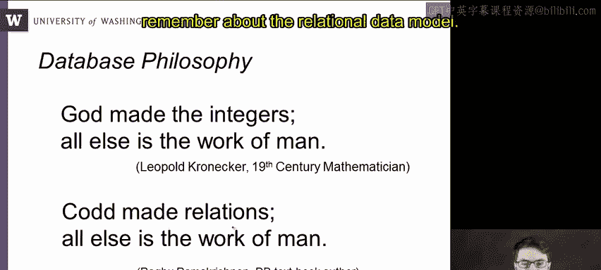

# 大规模数据科学（大数据操作，第1课／共3课） - P26：关系型数据库的动机 🗄️

在本节课中，我们将探讨关系型数据库的核心动机与基本概念。我们将了解它为何被发明，其核心设计思想是什么，以及它如何通过一种统一的模型来组织数据。

---

## 关系型数据库的核心理念

上一节我们讨论了层次型和网状数据库。本节中，我们来看看关系型数据库的设计哲学。

关系型数据库管理系统被发明出来，是为了让你能够以多种方式使用同一组数据。这包括在数据库构建之初、以及最初编写应用程序时未曾预见到的方式。

**需要强调的是，这才是关系型数据库的关键思想**，并非SQL语言，也并非你可能会联想到的某些具体实现细节。它的核心在于：**以某种方式组织数据，以支持未预见的数据访问方法和查询方式，并使应用程序免受数据组织方式变更的影响。**

---

## 什么是关系型数据库？

那么，什么是关系型数据库呢？在最简单的层面上，**一切皆是关系（Relation）**，这与表（Table）是同义词。所有数据都组织成行和列。

以下是一个需要明确的重要细节：
*   表中的每一行都拥有完全相同的列，即列的数量相同。
*   同时，每一列的数据类型也必须一致。如果某一列在某一行是整数类型，那么在所有行中，该列都必须是整数类型。

---

## 关系模型的含义

这种“一切皆是表”的模型带来一个重要的结果：**你不再拥有指针**，即不再有物理地址。你拥有的只有表。

因此，不同数据项之间的关系是隐式的。让我们切换到“课程与学生”这个领域来举例说明。

假设我们有两个表：
1.  **`学生`** 表：包含学生记录。
2.  **`选课`** 表：记录哪个学生（通过ID）选了哪门课程（通过课程ID）。

在关系模型中，`选课`表和`学生`表之间没有物理指针。它们之间唯一的联系是：**两个表中某一列具有相同的值**（例如，学生ID）。

**直观上，这听起来可能对性能非常不利**。例如，如果我想查找与某门特定课程相关的所有学生姓名，在找到课程记录后，我需要在`选课`表中查找所有匹配该课程ID的行，然后再去`学生`表中查找对应的学生姓名，而不是像层次型数据库那样直接导航过去。

但是，这种设计具有对称性。如果我想反方向查询——查找某个学生选修的所有课程，我可以使用完全相同的机制：先在`学生`表找到该学生ID，然后在`选课`表中查找所有匹配该学生ID的行。虽然可能需要付出查询的代价，但**两个方向的查询机制是相同的**。

此外，**所有数据只存储一次**。这与层次型数据库在大多数情况下能达到的效果一致，但网状数据库则无法保证这一点。我们不会让数据的多个副本四处散落。

---

## 设计哲学总结

用一句俏皮话来总结其哲学：正如19世纪的名言“上帝创造了整数，其余都是人类的杰作”，在数据库领域，**“科德创造了关系，其余都是我们的杰作”**。这里指的是埃德加·科德（Edgar Codd），他撰写了第一篇关系型数据库论文，并因其工作获得了图灵奖（计算机科学领域的诺贝尔奖）。

所以，关于关系数据模型，要记住的第一件事就是：**一切皆是表（关系）**。

---

本节课中，我们一起学习了关系型数据库的起源和基本设计思想。我们了解到，其核心动机是支持灵活、未预见的查询方式，并通过“一切皆是表”的模型，使用共享列值来隐式地建立数据间的关系，从而实现了数据的独立性和一致性。