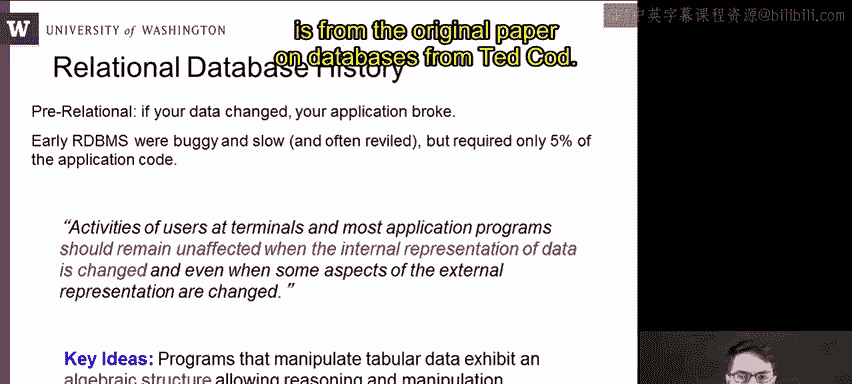
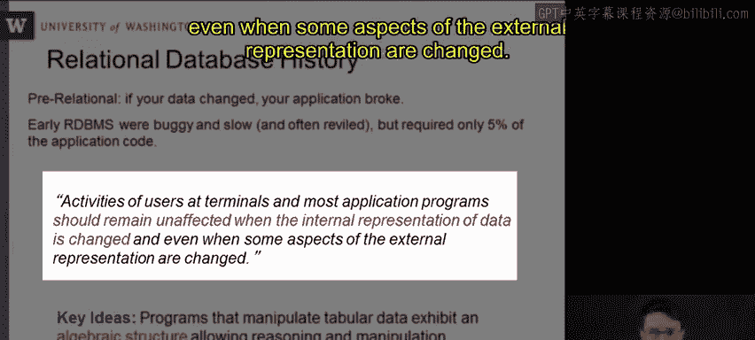
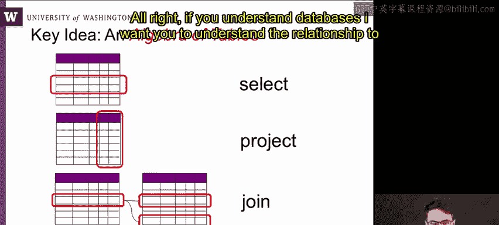

# 课程名称：大规模数据科学（大数据操作，第1课／共3课） - P27：关系型数据库的关键思想 🗄️

## 概述
在本节课中，我们将学习关系型数据库的核心思想。我们将探讨其历史背景、关键设计原则，以及支撑其强大功能的代数结构。理解这些概念对于掌握现代数据管理至关重要。

---

## 关系型数据库的历史背景与核心动机

上一节我们介绍了早期数据模型的局限性。在关系型数据库出现之前，如果数据的结构发生显著变化，例如在层次模型中更改父子关系，或在网络或面向文件的模型中做任何调整，应用程序通常需要重写才能适应这些变化。

早期关系型数据库正是为了解决这个问题而诞生的。尽管它们最初可能存在缺陷且速度较慢，但它们只需要编写之前约5%的代码量。这是一个巨大的进步。

以下引文来自Ted Codd关于数据库的原始论文，它延续了上一节中Kurt Monash引文的观点，强调了关系型数据库的核心动机：

> 当数据的内部表示发生变化时，甚至当外部表示的某些方面发生变化时，终端用户的活动和大多数应用程序应保持不受影响。

我想强调这一点，因为**数据独立性**是关系型数据库的关键思想，而不是SQL或特定实现的其他功能。这个核心思想在原始论文的摘要中就已明确提出。

我如此强调这个观点，是因为这个思想在今天和当时一样重要。

---

## 关键思想一：物理数据独立性

接下来，我们来看看与关系型数据库相关的其他关键思想，无论它们是否出现在原始论文中。

一个关键思想是：操作表格数据的程序展现出一种代数结构。我们可以利用这种结构来推理和操作逻辑模型，而无需考虑任何物理数据表示。

这意味着，如果你从表格的角度思考，并考虑表格支持的操作，你就可以理解程序的含义，甚至知道如何优化它，而无需关心数据在磁盘上的实际组织方式。这是极其强大的。

这里的核心思想同样是**物理数据独立性**。我们将在下一节讨论逻辑数据独立性的含义。

你编写的用于操作数据的程序不再需要直接操作文件和追踪指针。相反，你可以通过高级语言（如SQL，但重点不在于必须是SQL）来访问数据。关键在于，你操作的是称为“表”的逻辑结构。

请记住术语“物理数据独立性”，并理解它意味着：你编写的操作数据的程序比没有这种关系模型时更加健壮。

---

## 关键思想二：关系代数

另一个关键思想是我提到的**关系代数**。我们稍后会详细讨论这些具体的操作符。

从高层次看，对表的一个操作是**选择**出满足某些条件的行。另一个操作是**投影**，即忽略你不感兴趣的列。对于两个表，还有一个操作是**连接**：对于第一个表中的每条记录，在另一个表中找到对应的记录。

以下是核心操作：
*   **选择 (Select/σ)**：根据条件筛选行。
    *   `σ_{condition}(Table)`
*   **投影 (Project/π)**：选择特定的列。
    *   `π_{column1, column2, ...}(Table)`
*   **连接 (Join/⋈)**：基于关联条件合并两个表。
    *   `Table1 ⋈_{Table1.key = Table2.key} Table2`

此外，你还可以定义其他操作，如**聚合**，以及源自集合论的各种集合操作，如**并集 (Union)**、**差集 (Difference)** 和**笛卡尔积 (Cross Product)** 等。

如果你用这些操作来表达你的查询，其含义会非常清晰。从软件工程的角度看，这允许数据库设计者专注于高效地实现这些操作。

如果是在教室里，我通常会问两个问题：有多少人听说过关系代数？又有多少人使用过数据库？通常，使用过数据库的人数非常多，而听说过关系代数的人数则相对较少。

我希望通过本课程能改变这一状况，将两者等同起来。如果你理解数据库，我希望你也能理解关系代数，反之亦然。

---

## 总结
本节课中，我们一起学习了关系型数据库的核心思想。我们回顾了其解决数据依赖问题的历史动机，深入探讨了**数据独立性**（尤其是物理数据独立性）这一根本原则，并介绍了支撑关系数据库查询的**关系代数**（包括选择、投影、连接等基本操作）。理解这些基础概念是掌握后续更复杂数据操作技术的关键。