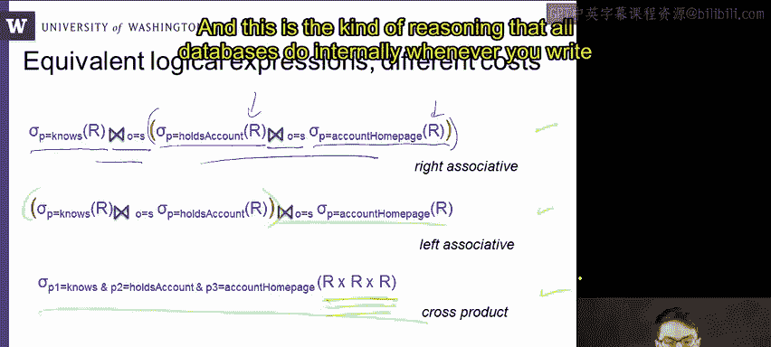

# 大规模数据科学（大数据操作，第1课／共3课） - P28：代数优化概述 🧮


在本节课中，我们将要学习代数优化的基本概念。这是一种数据库系统用于高效处理查询的核心技术，其思想与我们中学代数课上学到的简化表达式原理相通。

---

## 概述

代数优化是数据库查询处理中的一项关键技术。它通过应用一系列代数规则来重写和简化查询表达式，从而找到执行成本最低的查询计划。其核心思想与我们简化数学表达式（如 `(z*2 + z*3 + 0) / 1`）的过程类似：通过消除冗余操作（如加0、除以1）和应用分配律等规则，将复杂表达式转化为更高效的形式。

上一节我们介绍了查询处理的基本流程，本节中我们来看看数据库系统如何利用代数规则来优化查询执行。

## 代数优化的核心思想

想象一个数学表达式：`(z*2 + z*3 + 0) / 1`。当 `z = 4` 时，最直接的求值方法是按顺序计算：
1.  `4 * 2 = 8`
2.  `4 * 3 = 12`
3.  `8 + 12 = 20`
4.  `20 + 0 = 20`
5.  `20 / 1 = 20`

这需要5次操作。然而，我们可以运用代数知识进行简化：
*   **消除恒等操作**：加0和除以1不影响结果，可以忽略。表达式简化为 `z*2 + z*3`。
*   **应用分配律**：`z*2 + z*3 = z*(2+3)`。
*   **计算常数**：`2+3 = 5`。最终表达式简化为 `z*5`。

现在只需一次乘法即可得到结果 `20`。这种**符号推理**过程就是代数优化的精髓：在计算前，先利用规则对表达式本身进行变换。

对于计算机处理整数，这种符号推理的成本可能高于直接计算。但当操作对象是TB级别的数据表时，操作的顺序和数量将极大影响性能。执行不必要的连接（Join）或选择（Select）操作可能导致系统无法承受的开销。因此，代数优化对于大数据处理**至关重要**。

## 关系代数与查询优化

所有关系型数据库在处理SQL查询时，都会进行这种代数优化。过程如下：
1.  将SQL查询翻译成关系代数表达式（包含选择 `σ`、投影 `π`、连接 `⋈` 等操作）。
2.  应用一系列代数重写规则（类似于分配律、结合律）对表达式进行变换。
3.  从多个**等价**的表达式中，估算每个的执行成本，并选择成本最低的一个作为最终执行计划。

以下是关系代数表达式及其不同执行顺序的例子：

考虑一个涉及对同一关系 `R` 进行多次选择和连接的查询。其代数表达式可能如下：
```
( σ_a(R) ⋈ σ_b(R) ) ⋈ σ_c(R)
```
这表示先执行第一个连接，再与第三个结果连接。

另一种等价但执行顺序不同的计划是：
```
σ_a(R) ⋈ ( σ_b(R) ⋈ σ_c(R) )
```
这表示先执行后两个连接，再与第一个结果连接。

甚至存在一种理论上等价但效率极低的计划（例如先计算所有表的笛卡尔积），数据库优化器会识别并避免选择此类计划。

数据库优化器的任务就是评估这些不同但等价的执行计划，并选择预计成本最低的一个。

## 代数的封闭性

“代数”一词在此并非比喻，它严格遵循数学中代数的定义，核心特性是**封闭性**。这意味着：
*   每个作用于关系（表）的操作，其结果仍然是一个关系（表）。
*   因此，操作可以无限组合串联，始终得到关系。

这类似于整数上的运算：两个整数相加或相乘，结果仍是整数（尽管除法可能产生实数，这引入了多类代数，但封闭性的思想是相通的）。这种封闭性保证了我们在优化时，始终在同一个系统（关系集合）内进行变换。

## 代数优化的价值与挑战

代数优化是关系数据库查询处理的“魔法”，它之所以有效，是因为关系模型为数据操作提供了**形式化**的数学定义。优化器可以基于这些明确的语义进行推理和变换。

然而，当我们放松这种形式化模型，允许在数据上执行任意代码（例如在MapReduce等框架中编写自定义处理逻辑）时，系统就失去了自动进行代数优化的能力。优化工作的负担完全转移到了程序员身上，他们必须手动设计出高效的算法，这无疑增加了复杂性和出错的风险。

---

## 总结

本节课中我们一起学习了代数优化的核心概念。我们了解到：
1.  代数优化通过重写查询表达式来减少不必要的计算，特别适用于大数据场景。
2.  其原理类似于简化数学表达式，运用了消除恒等操作、分配律等规则。
3.  关系数据库将SQL查询转换为关系代数表达式，并通过**基于成本的优化**从多个等价计划中选取最优解。
4.  关系代数的**封闭性**是这一系列操作能够成立的基础。
5.  形式化模型是自动优化的前提，而在更灵活的编程范式中（如MapReduce），优化责任则由系统转移给了程序员。




理解代数优化有助于我们认识到数据库高性能查询背后的机制，以及在设计大规模数据处理管道时需要考虑的效率因素。