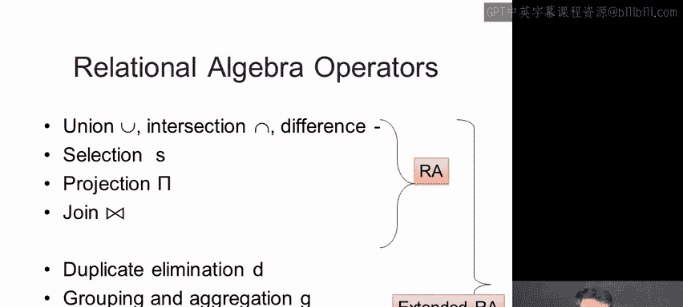

# 大规模数据科学（大数据操作，第1课／共3课） - P29：关系代数概述 📚

在本节课中，我们将要学习关系代数的核心概念。关系代数是理解数据库操作，特别是数据清洗、重构和操作的基础。它提供了一种独立于物理数据存储细节的方式来思考和描述数据操作任务。

上一节我们介绍了关系数据库的历史及其解决物理数据独立性的初衷。本节中，我们来看看实现这一目标的关键“秘方”——关系代数。

## 关系代数运算符概览 🧮

关系代数包含一系列用于操作表格（关系）的运算符。以下是其主要组成部分：

*   **集合运算**：这些是传统集合论运算（如并集、交集、差集）在关系（表）上的扩展。
*   **核心三大运算符**：这是关系代数的基石，包括：
    *   **选择 (Selection)**
    *   **投影 (Projection)**
    *   **连接 (Join)**
*   **扩展关系代数运算符**：这些运算符处理关系中的重复元组或引入排序等概念，使其更贴近实际应用（如SQL）的需求。主要包括：
    *   消除重复的运算符
    *   分组操作
    *   排序操作

需要理解的是，纯粹基于集合论的关系代数模型不包含顺序概念。而扩展关系代数为了实用性（例如，在SQL中排序结果）引入了这些操作。从理论证明的角度看，纯粹的关系代数更易于处理，但两者在实际应用中的区别并不特别重要。

**核心要点**：当提到“关系代数”时，你首先应该想到的是**集合运算**加上**选择、投影和连接**这三大核心操作。

## 总结 📝

本节课中我们一起学习了关系代数的基本框架。我们了解到，关系代数通过提供一套形式化的表格操作符，使得我们能够独立于底层物理存储细节来思考和描述数据操作。其核心在于集合运算以及选择、投影和连接这三大操作。理解这些概念是掌握后续数据操作技术，包括SQL语言的基础。