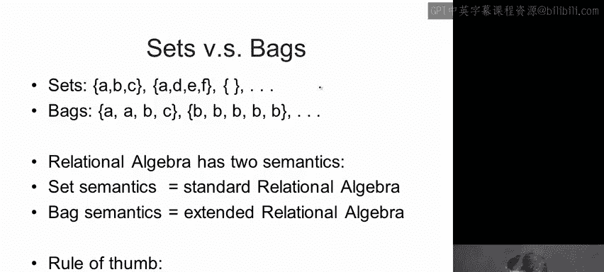
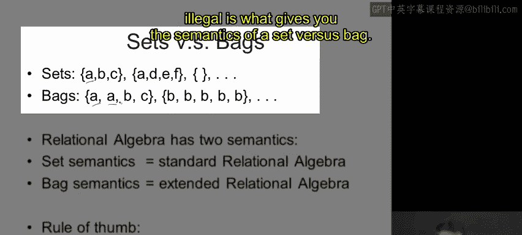
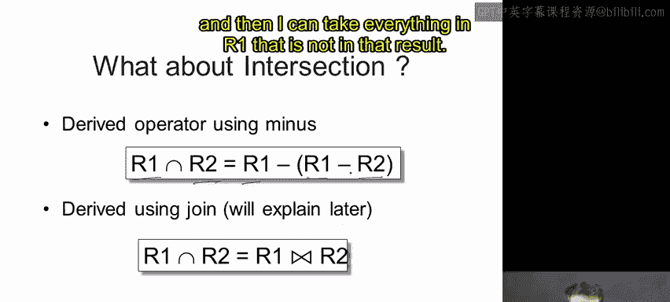
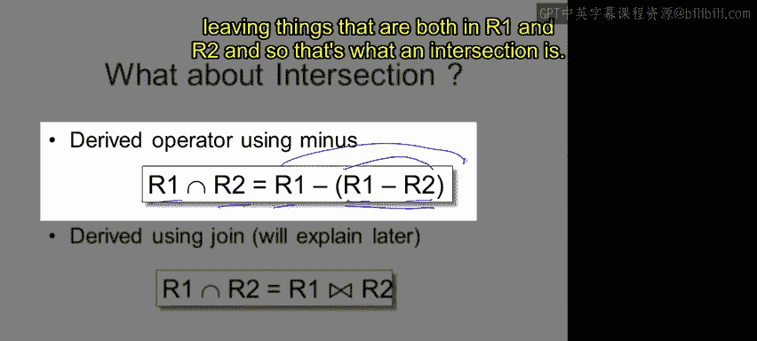
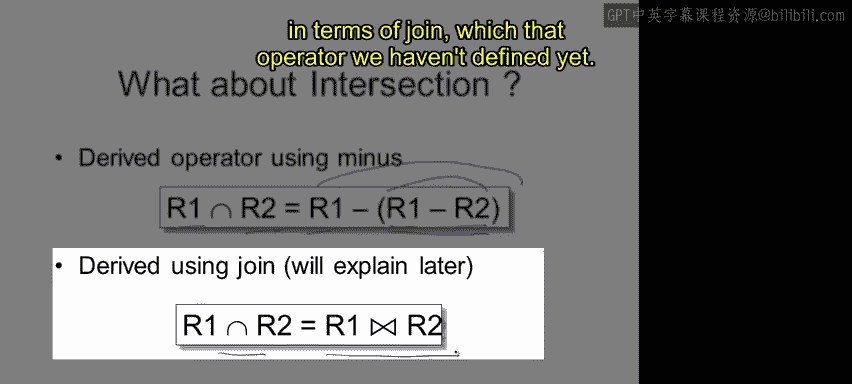
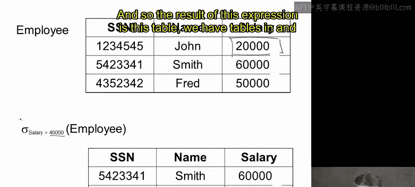
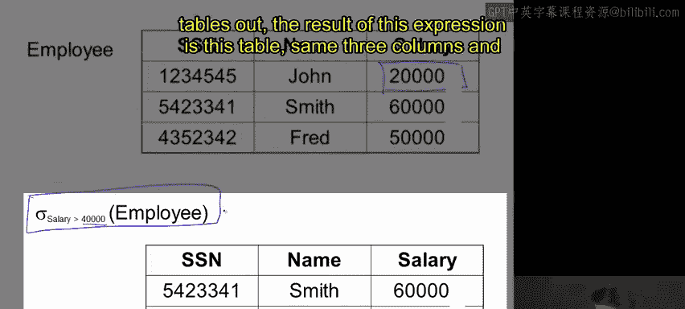

# 大规模数据科学（第1课） - P30：关系代数运算符：并集、差集、选择 🧮

在本节课中，我们将要学习关系代数中的三个基础运算符：并集、差集和选择。理解这些运算符是掌握数据操作和查询构建的关键。我们会从集合与包的概念差异开始，然后逐一探讨每个运算符的定义、语义及其在SQL中的表达方式。

---

## 集合与包的概念 🔄

上一节我们介绍了关系代数的基本概念，本节中我们来看看一个重要的底层区别：集合与包。

集合是一个**不包含重复元素**的对象集合。包则是一个**允许包含重复元素**的对象集合。

例如，在集合 `{a, b, c}` 中，元素 `a` 不会重复出现。而在包中，`{a, a, b, c}` 是合法的，元素 `a` 可以出现多次。

这种合法性差异定义了集合语义与包语义。关系代数可以基于这两种语义来定义。扩展关系代数的概念源于需要处理包以及其他操作（如排序）的需求。

一个实用的经验法则是：在学术论文中，除非明确说明，否则通常**默认采用集合语义**。而在实际的商业数据库实现中，则通常**默认采用包语义**。理解这一区别在实践中非常重要。

---

## 并集运算符 ∪

在理解了集合与包的区别后，我们来看看第一个运算符：并集。

并集运算符将两个关系合并。在关系代数中，关系被视为元组的集合，因此并集的定义是标准的集合合并。

在关系代数符号中，并集写作： **R ∪ S**

在SQL中，对应的关键字是 `UNION`。此时集合与包语义的区别就显现出来了：
*   标准的 `UNION` 会**消除重复元组**，遵循集合语义。
*   如果想保留所有重复项（包语义），则需要使用 `UNION ALL`。

以下是具体示例：

假设有两个关系 R1 和 R2。
*   R1 包含元组：(A1, B1), (A2, B1)
*   R2 包含元组：(A1, B1), (A3, B4)

那么：
*   `R1 UNION R2` 的结果是三个元组：`(A1, B1), (A2, B1), (A3, B4)`。重复的 `(A1, B1)` 只出现一次。
*   `R1 UNION ALL R2` 的结果是四个元组：`(A1, B1), (A2, B1), (A1, B1), (A3, B4)`。所有元组都被保留。

---

## 差集运算符 −

接下来，我们探讨差集运算符。

差集运算符找出存在于第一个关系但不存在于第二个关系中的所有元组。其定义同样源于集合论。

在关系代数符号中，差集写作： **R − S**

在SQL中，对应的关键字是 `EXCEPT`（在某些数据库中也用 `MINUS`）。

继续使用上面的例子：
*   `R1 − R2` 的结果是：`(A2, B1)`。
*   因为 `(A1, B1)` 也出现在 R2 中，所以被移除。
*   `(A3, B4)` 不在 R1 中，因此从一开始就不在考虑范围内。差集的目标是获取所有在 R1 中但不在 R2 中的元组。

---

## 交集运算符 ∩ 及其表达方式

现在，我们来看看交集运算符。虽然交集也是一个基本的集合操作，但在关系代数中，它并非必须作为原始运算符存在，因为它可以通过其他运算符表达。

交集运算符找出同时存在于两个关系中的元组。符号为： **R ∩ S**

交集可以通过差集来重新表达：
**R ∩ S = R − (R − S)**

这个表达式的逻辑是：
1.  `(R − S)` 得到所有**只在 R 中**的元组。
2.  `R − (R − S)` 从 R 中移除所有“只在 R 中”的元组，剩下的就是**既在 R 中又在 S 中**的元组，即交集。

我们稍后也会看到，交集同样可以通过连接运算符来表达。

---

## 选择运算符 σ

最后，我们来学习最常用的运算符之一：选择。

选择运算符用于筛选出满足特定条件的元组。它不会改变关系的结构（列），只会减少行数。

在关系代数符号中，选择写作： **σ_c(R)**
其中 **c** 代表选择条件。

在SQL中，这直接对应 `WHERE` 子句。

选择条件 **c** 可以是一个布尔表达式，以下是其组成部分：

*   **基本比较**：可以使用等于(`=`)、大于(`>`)、小于(`<`)、大于等于(`>=`)、小于等于(`<=`)等操作符。
    *   示例：`salary > 40000`
*   **复杂布尔表达式**：条件可以是任意复杂的布尔表达式，使用 `AND`、`OR`、`NOT` 进行连接。
    *   示例：`salary > 40000 AND name = ‘Smith’`
*   **任意函数**：条件甚至可以是一个返回布尔值的用户自定义函数，这提供了极大的灵活性。

让我们看一个具体例子。假设有一个“员工”表，包含姓名、部门和薪水。

对“员工”表执行选择操作 **σ_(salary>40000)(Employee)**，将过滤掉薪水小于等于40000的元组（例如员工“John”），结果表只包含薪水高于40000的员工记录。输入一个表，输出也是一个具有相同列的表，只是行数减少了。

---

## 总结 📝

本节课中我们一起学习了关系代数的三个核心运算符：
1.  **并集**：合并两个关系，需注意`UNION`（去重）与`UNION ALL`（保留所有）在集合与包语义下的区别。
2.  **差集**：找出属于第一个关系但不属于第二个关系的所有元组。
3.  **选择**：根据指定条件过滤关系中的元组，是进行数据筛选的基础操作。

我们还了解到，**交集**可以通过差集运算推导得出。理解这些运算符的集合论基础及其在SQL中的实现，是构建复杂查询和进行高效数据操作的基石。