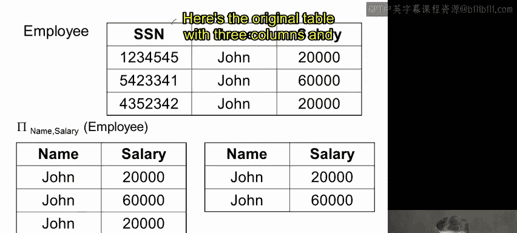
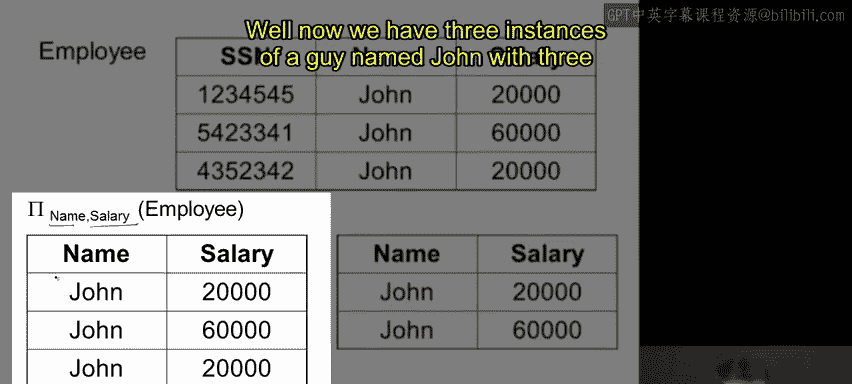
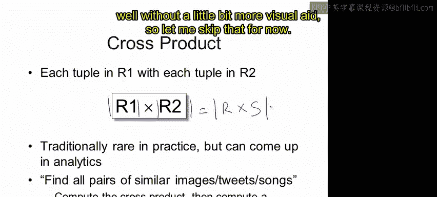

# 大规模数据科学（大数据操作，第1课／共3课）📊：关系代数运算符：投影与笛卡尔积


在本节课中，我们将学习关系代数中的两个核心运算符：**投影**与**笛卡尔积**。我们将探讨它们的基本概念、在不同语义下的行为差异，以及它们在现代数据科学应用中的实际意义。

---

## 投影运算符 📤

投影运算符用于从关系（表）中**消除列**。这是一个需要特别注意**集合语义**与**包语义**差异的运算符。

在集合语义下，投影不仅会移除所有未明确列出的列，还会自动移除结果中可能出现的所有重复元组。而在包语义下，重复的元组会被保留。这种差异直接影响了数据库查询的效率和结果。

以下是投影运算符的一个示例：假设我们只想从员工表中获取“姓名”和“薪资”两列。

```sql
-- 投影操作示例：选择姓名和薪资列
π_{姓名, 薪资}(员工表)
```



原始员工表可能包含三列：SSN（社会保险号）、姓名和薪资。




应用投影后，我们移除了SSN列。结果中可能出现多个同名但薪资不同的元组（例如，三个名为John的员工有不同的薪资）。


*   **包语义**会接受并保留这三个重复的“John”元组。
*   **集合语义**则会自动移除重复项，只保留一个“John”元组（通常保留第一个，但集合本身无序）。

那么，哪种方式更高效？移除重复项是一个昂贵的操作。因此，直接保留重复项（包语义）通常效率更高。事实上，这正是商业数据库系统默认采用包语义的关键动机之一。在许多实际应用中，用户可能不关心重复数据，或者根据领域知识知道剩余列的组合本身是唯一的，因此可以容忍重复。为了形式化理论的纯粹性而强制去重，并非总是必要。

---

上一节我们介绍了用于筛选列的投影运算符，本节中我们来看看一个能组合两个表的运算符。

## 笛卡尔积运算符 ✖️

笛卡尔积是一个在传统关系数据库应用中不常被提及，但值得了解的运算符。原因有二：第一，它是思考表操作时一个有用的推理工具；第二，它在分析和数据科学应用中正变得越来越常见。

笛卡尔积的定义是：对于关系R1中的**每一个**元组，与关系R2中的**每一个**元组进行组合，生成输出中的一个新元组。

其输出结果的大小是：
**|R1| × |R2|**

为了让你理解它为何越来越常用，这里有一个例子：你经常需要找到所有满足某种相似性条件的对象对。虽然针对特定问题可能有更高效的技巧，但在实践中，**生成所有可能的配对，然后应用某个函数来判断它们的相似性**，这种“暴力”方法经常被使用。

例如，如果你想比较两张图像的相似性（比如判断两张人脸是否属于同一个人），并且你有一段代码可以完成这个比较，同时你拥有两个包含大量图像的表或集合。那么，生成所有可能的图像对并应用比较函数，始终是一种可行的实现方式。因此，这类笛卡尔积操作正日益频繁地出现。



---

## 总结 📝

本节课中我们一起学习了关系代数中的两个重要运算符：
1.  **投影**：用于选择表中的特定列，需注意其在集合语义（自动去重）和包语义（保留重复）下的不同行为，后者因效率更高而广泛应用于商业数据库。
2.  **笛卡尔积**：用于生成两个表中所有元组的组合对，其结果规模是两表大小的乘积。尽管在传统事务处理中不常用，但在需要成对比较或组合的数据科学和 analytics 任务中正变得越来越重要。


理解这两个运算符是掌握更复杂数据操作和查询的基础。