# 大规模数据科学（大数据操作，第1课／共3课） - P32：关系代数运算符：笛卡尔积（续）、连接 🧮

在本节课中，我们将继续学习关系代数中的核心运算符。上一节我们介绍了笛卡尔积的基本概念，本节中我们将深入探讨笛卡尔积的具体示例，并重点介绍一个极其重要且常用的运算符——连接（Join）。我们将通过简单的例子和清晰的解释，帮助你理解这些操作是如何工作的。

---

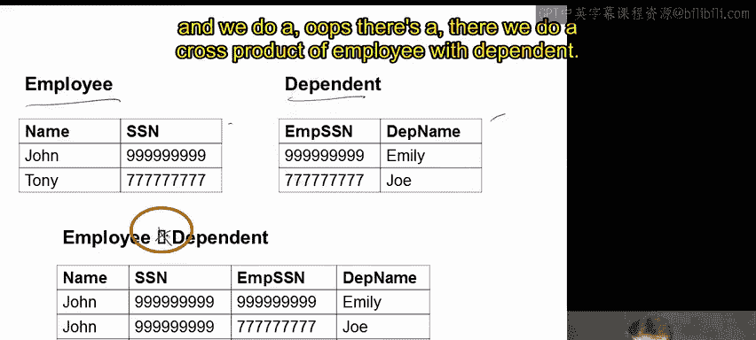

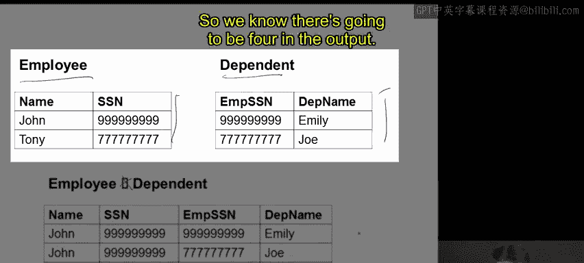

## 笛卡尔积示例

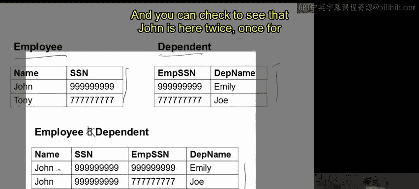

上一节我们介绍了笛卡尔积，本节中我们来看看一个具体的例子。

想象你有一个名为 `employee` 的表，它包含以下两列。同时，还有一个名为 `dependent` 的表，也包含两列。

如果我们对 `employee` 表和 `dependent` 表执行笛卡尔积操作，结果将是所有员工记录与所有家属记录的所有可能组合。

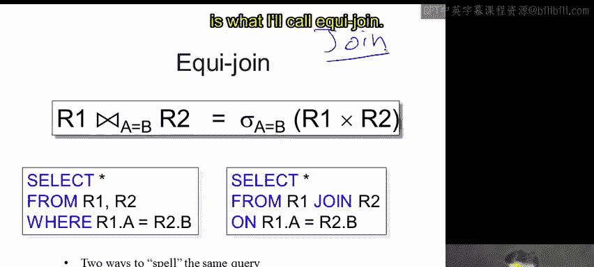

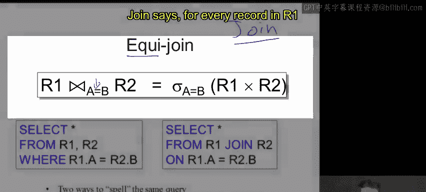

因此，我们可以预知输出结果中将包含四条记录。

以下是 `employee` 表和 `dependent` 表进行笛卡尔积运算后的结果。你可以检查发现，John 出现了两次，对应 `dependent` 表中的每一个实例，其他记录同理。

---

## 连接运算符介绍

现在，让我们来讨论连接（Join）操作。或许我应该先放一张专门介绍连接操作的幻灯片。

实际上，我们讨论的连接，是你最常遇到的那种连接类型。事实上，如果我们不加限定地提到“连接”，通常指的就是等值连接（Equijoin）。

等值连接是一种在特定相等条件下进行的连接操作。

那么，连接操作具体做什么呢？连接操作是说：对于关系 R1 中的每一条记录，在关系 R2 中寻找满足某个条件的对应记录。

通常，特别是对于熟悉数据库的同学来说，你会从等值连接的角度来思考。例如，对于每门课程，找出选修了该课程的学生ID。因此，基于主键和外键的连接（如果你不介意这些术语）就是等值连接的实例。

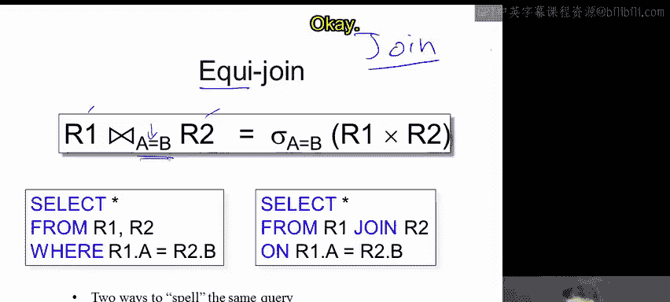

它们不一定是等值连接，但我想强调一点：在本课程中，我们不会过多讨论数据库模式设计。我更感兴趣的是教授关系代数及其应用，而不是从一开始就教你如何设计数据库。原因在于，正如我之前提到的，你通常没有精心设计的模式可用。你没有时间去构建一个，或者一开始就没有现成的模式给你。甚至可能因为只需要回答几个问题就转向其他任务，而没有太大必要去设计一个完整的模式。因此，没有机会去分摊开发模式的初始成本。

如果你使用过数据库，你所做的大多数连接操作都是沿着这些被称为外键的预定义关系进行的。但即使没有这些预定义关系，你仍然可以应用连接操作。

---

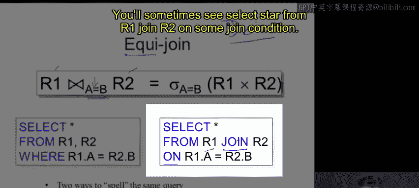

## 连接在SQL中的两种写法

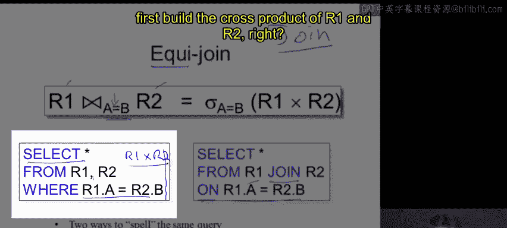

这里我想指出一个语法上的注意事项。在SQL中，你可以用两种不同的方式编写连接查询。

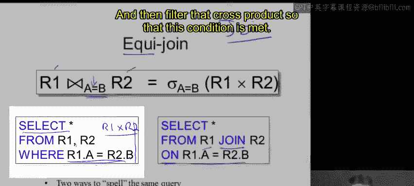

有时你会看到这样的写法：`SELECT * FROM R1 JOIN R2 ON <连接条件>`。

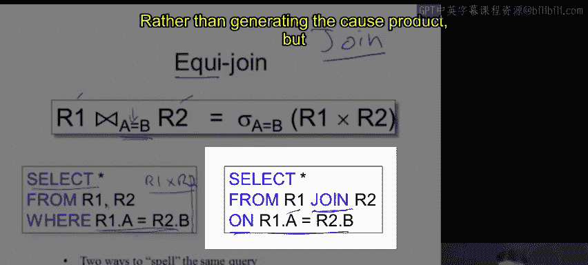

而其他时候，你可能会看到：`SELECT * FROM R1, R2 WHERE <条件>`。

如果我机械地将后一种写法翻译成关系代数执行计划（我们稍后会讨论如何更机械地做到这一点），它实际上是在说：首先构建 R1 和 R2 的笛卡尔积，然后过滤这个笛卡尔积，使其满足指定的条件。

而前一种写法则是说：不，不要那样做，实际上应该使用连接运算符，而不是先生成笛卡尔积。

但是，数据库的查询优化器并没有那么笨。它们足够聪明，能够识别出即使在后一种写法中，正确的执行方式也是表达为一个连接操作。因此，在实践中，这两种编写同一查询的不同方式没有区别。

事实上，粗略地讲，这是两个语法不同但语义相同的SQL查询。优化器并不关心你如何编写SQL，它都会对查询进行优化。它会将查询转换为关系代数执行计划，并操作该计划以找到评估该查询的最佳方式。

我说“粗略地讲”，是因为存在查询提示（query hints）等方法，你可以用来告诉优化器你希望如何评估查询。我们不会讨论这些，因为它们很少重要。另外，虽然存在优化器无法识别为等价的、功能相同的不同查询，从而导致不同执行计划的情况，但这并不常见。在我们这个例子中，这完全无关紧要。

关于使用 `JOIN` 关键字与在 `WHERE` 子句中指定条件，如果它们出现，我倾向于使用前一种方式编写查询。

---

## 连接操作的本质

以上就是连接运算符最常见和最简单的实例。事实上，我觉得我在这里用左右结构举例可能有点不妥。这实际上是一个很好的例子：这种写法是SQL中等价于使用 `JOIN` 关键字的写法。

而这种写法，在关系代数中，等价于先进行笛卡尔积再进行选择操作的SQL写法。实际上，它们是相同的。

在代数中，代数作为一种形式体系，只要你能表达出操作，是否推导出新运算符并不那么重要。然而，由于存在大量优秀的工作和算法专门用于高效实现连接操作，因此它理应作为一个特定的运算符存在。当我们讨论高效的连接算法时，我们并不希望写成“先笛卡尔积再选择”的形式。

---

## 总结

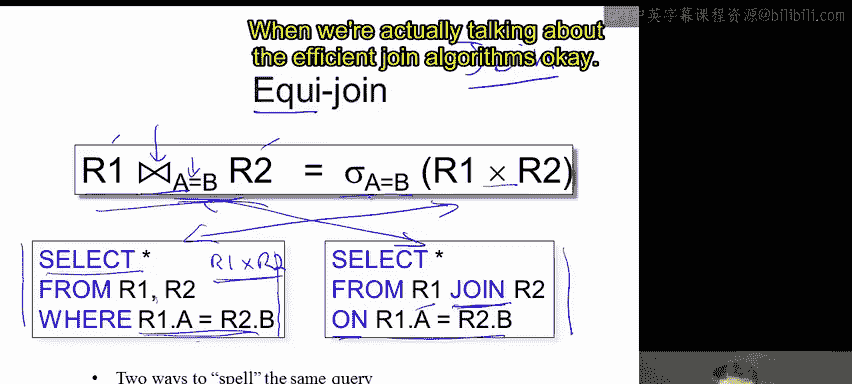

本节课中我们一起学习了关系代数中两个重要的运算符。我们首先通过一个具体例子回顾了笛卡尔积的操作和结果。然后，我们重点介绍了连接运算符，特别是最常见的等值连接，解释了它的基本逻辑和实际应用场景。我们还探讨了在SQL中编写连接查询的两种等效语法，并理解了数据库优化器会如何处理它们。最后，我们明确了连接操作在关系代数中的核心地位，它不仅仅是笛卡尔积加选择的组合，而是拥有独立高效实现算法的关键操作。理解这些基础运算符是掌握大规模数据操作的重要一步。