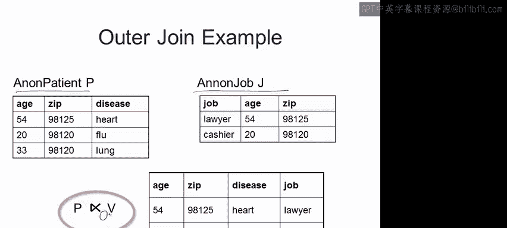
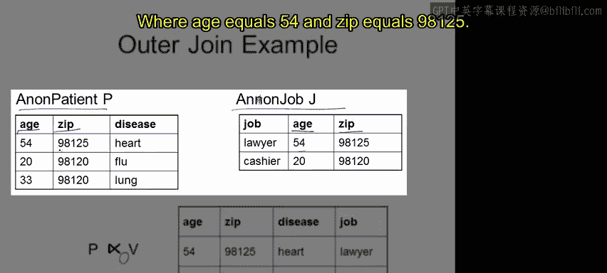
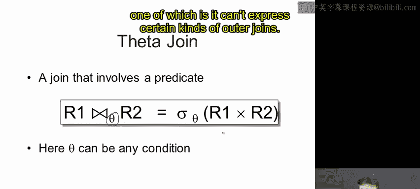
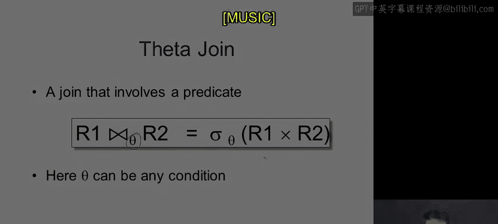

# 课程名称：大规模数据科学（大数据操作，第1课／共3课） - 第33节：关系代数运算符：外连接 🧩

## 概述
在本节课中，我们将要学习关系代数中的一个重要运算符——外连接。我们将了解外连接的基本概念、它与普通连接的区别，以及它在实际应用中的用途。

---

## 外连接的概念
上一节我们介绍了连接操作，本节中我们来看看外连接。外连接是一种特殊的连接操作，它确保结果中包含指定一侧（或两侧）表中的所有元组，即使在另一侧没有匹配的元组。

外连接的核心思想是：**保留所有来自左侧（或右侧，或两侧）的元组**。如果另一侧存在匹配的元组，则像普通连接一样输出；如果不存在匹配，则用 `NULL` 值填充缺失的列。

外连接有三种主要变体：
*   **左外连接**：保留左侧表的所有元组。
*   **右外连接**：保留右侧表的所有元组。
*   **全外连接**：保留两侧表的所有元组。

在SQL中，左外连接和右外连接较为常用。全外连接在形式上较难表达，因为它看起来像笛卡尔积。右外连接在实践中很少需要，因为通常可以通过调整操作顺序来实现相同效果。

---

## 外连接的示例
为了理解外连接如何工作，我们来看一个具体的例子。假设我们有两个表：`匿名病人` 表和 `匿名工作` 表。

以下是这两个表的示例数据：

如果我们在这两个表之间执行外连接操作，需要明确连接的条件。虽然图中没有明确写出连接条件，但我们可以推断出来。

推断连接条件的方法是查看两个表共有的列。`匿名病人` 表有 `年龄` 和 `邮编` 列，`匿名工作` 表也有 `年龄` 和 `邮编` 列。因此，连接条件很可能是基于这两列进行匹配。

连接条件可以描述为：对于 `匿名病人` 表中的每一个元组，在 `匿名工作` 表中寻找一个对应的元组，使得两者的 `年龄` 和 `邮编` 值都相等。

---

## 外连接与内连接的区别
如果我们只进行普通的（内）连接，那么结果中只会包含在两个表中都能找到匹配的元组。

然而，当我们使用外连接时，情况就不同了。例如，在 `匿名病人` 表中有一个元组（年龄=33，邮编=98120），在 `匿名工作` 表中没有与之匹配的元组（没有年龄33且邮编98120的记录）。

如果执行内连接，这个不匹配的元组将从输出结果中消失。但如果执行的是外连接（例如左外连接），这个来自左侧表的元组仍然会被包含在结果中。对于右侧表没有匹配的列，系统会用 `NULL` 值进行填充。

---

## SQL中的外连接
在SQL语言中，我们可以明确地写出外连接。就像可以写 `JOIN` 来表示连接一样，也可以写 `LEFT OUTER JOIN` 来表示左外连接，以匹配我们上面的例子。

需要指出的是，本课程作业中使用的数据库是 **SQLite**。SQLite 作为一个单用户数据库，具有将整个数据库存储为单个文件等优点，非常适合学习和完成作业。但它也有一些限制，其中之一就是**无法表达某些类型的外连接**，特别是**全外连接**。

---

## 外连接的实用性
外连接在形式上可能不那么优雅，但在实践中经常出现。对于用户（尤其是新手）手动编写查询时，外连接尤其有用。

许多时候，用户会发现当他们将一个表与另一个表连接时，自己表中的一些记录“消失”了，这常常令人感到意外。这是因为内连接只输出满足匹配条件的元组对，没有匹配的元组就不会出现在结果中。

外连接提供了一种方式，可以更符合SQL程序员（特别是初学者）的预期，确保重要的数据不会因为缺少匹配而被过滤掉。

---

## 总结
本节课中我们一起学习了关系代数中的外连接运算符。我们了解了外连接的核心是保留一侧或两侧的所有元组，并用 `NULL` 填充缺失值。我们通过示例比较了外连接与内连接的区别，并认识到外连接在保留所有相关数据、避免记录意外“消失”方面的实用价值。最后，我们还提到了在SQL（特别是SQLite）中实现外连接的语法和限制。