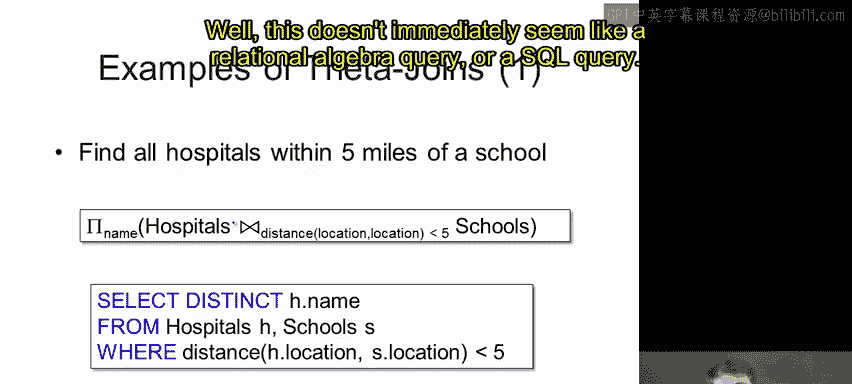
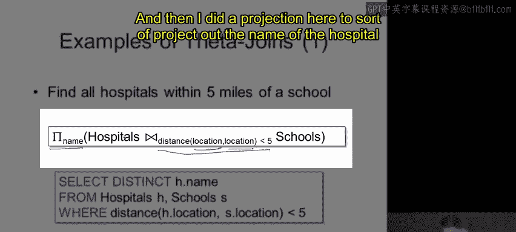
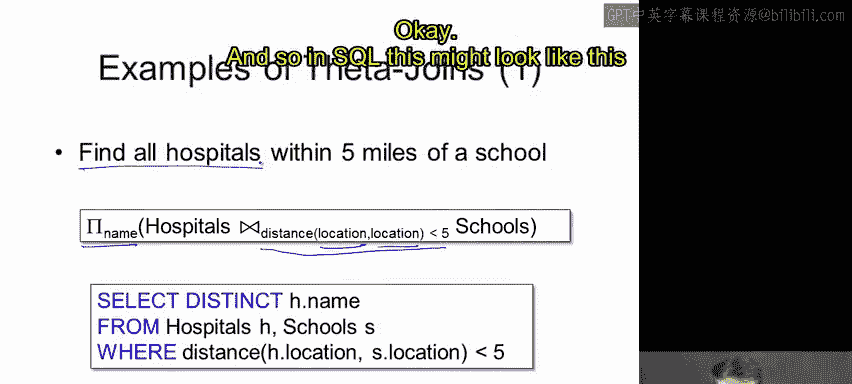
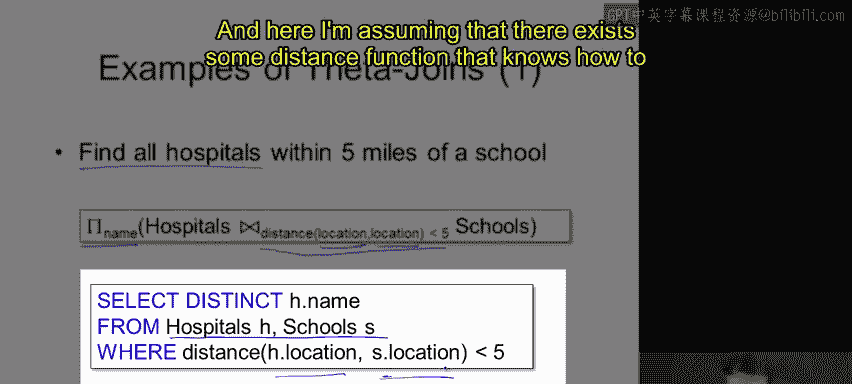
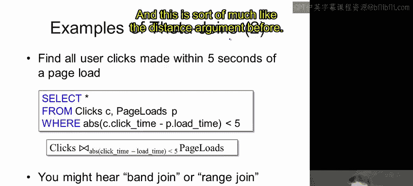
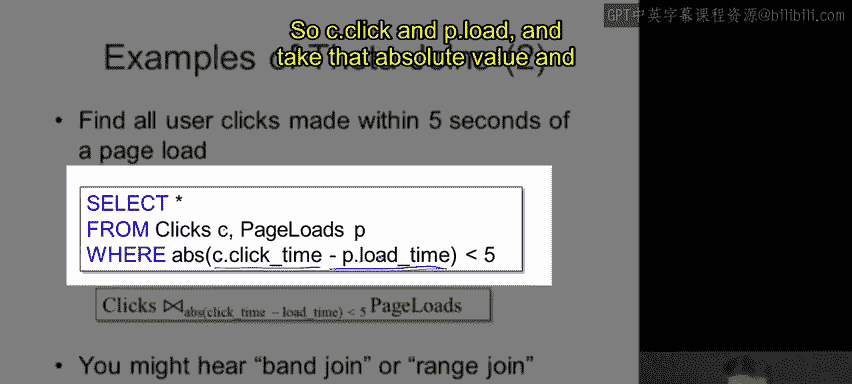
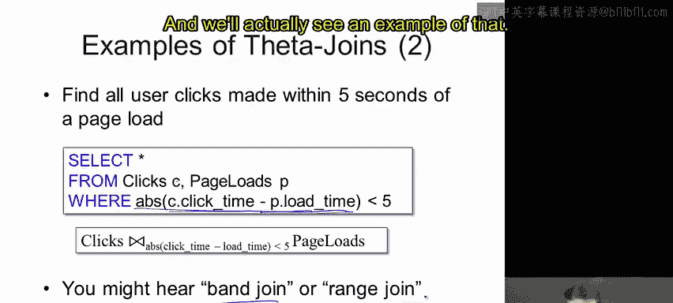

# 大规模数据科学（大数据操作，第1课／共3课） - P34：关系代数运算符：θ连接 🧩


在本节课中，我们将要学习关系代数中的一个重要运算符——θ连接。我们将了解它的定义、它与等值连接的区别，并通过几个实际例子来理解其应用场景。

上一节我们介绍了等值连接，本节中我们来看看更通用的连接形式——θ连接。

## θ连接的定义

更一般地，我们可以拥有一种称为θ连接的操作，这本质上仍然是一种连接，但其连接条件可以是任何你想要的谓词。它不限于等值条件，可以是大于、小于或任意函数等。

我之前提到的“邻近度测试”就是θ连接的一个例子，稍后我们将看到一个更详细的示例。



需要指出的是，等值连接本身是θ连接的一个特例，其中θ条件就是等值条件。



## θ连接的应用示例



以下是一些θ连接的例子，用以说明它们在实践中出现的频率可能比你熟悉的要高。特别是对于有数据库经验的人来说，这些连接条件并不总是基于主键-外键关系。

**示例一：查找学校五英里内的所有医院**



这看起来不像是典型的关系代数或SQL查询，但它确实是。它就是一个连接，其连接条件是基于医院位置和学校位置的距离函数。

以下是该查询的SQL表示，它选取所有医院和学校的组合，然后筛选出医院位置与学校位置距离小于5英里的记录。这里假设存在一个能计算距离的函数。

```sql
SELECT H.name
FROM Hospitals H, Schools S
WHERE distance(H.location, S.location) < 5
```

这里的要点是，即使你没有看到等值条件，这仍然是一个连接操作。另一个要点是了解“θ连接”这个术语，它通常指代任意条件、更通用的连接情况。

**示例二：查找页面加载后五秒内的所有用户点击**

这个例子类似于之前的距离参数，但现在我们考虑的是时间维度，这是一个一维的、更容易定义的度量。



其逻辑是：计算点击时间与页面加载时间的绝对差值，并检查该差值是否小于5秒。这可能是网络分析人员常用的一个指标，用于快速找到用户所需内容。



```sql
SELECT ...
FROM Clicks C, PageLoads P
WHERE ABS(C.click_time - P.load_time) < 5
```

**示例三：区间连接或范围连接**

你可能会听到“区间连接”或“范围连接”，这类似于在一个表中有一个时间区间（开始时间和结束时间），并试图从另一个表中找到落在这个区间内的元组。我们稍后会看到一个这样的例子。

## 总结




本节课中我们一起学习了θ连接。我们了解到θ连接是连接操作的通用形式，其连接条件（θ）可以是任何谓词，而等值连接只是它的一个特例。我们通过查找附近医院、分析用户点击行为等实际例子，看到了θ连接在非等值条件（如距离、时间差、区间包含）下的应用。理解θ连接有助于我们认识到，许多复杂的数据关联问题都可以通过灵活的连接条件来解决。