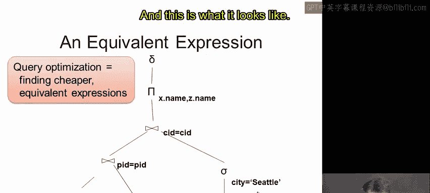

# 课程名称：大规模数据科学（大数据操作，第1课／共3课） - P35：从SQL到关系代数 🧮


## 概述
在本节课中，我们将学习如何将SQL查询语句转换为关系代数表达式。我们将通过一个具体的例子，理解SQL查询的各个部分如何对应到关系代数的运算符，并探讨如何通过优化关系代数表达式来提高查询效率。

---

## 关系代数运算符回顾
上一节我们介绍了关系代数的基本运算符。本节中，我们来看看如何将这些运算符应用到实际的SQL查询转换中。

## 从SQL到关系代数的转换
我们通过一个具体的例子来学习转换过程。假设存在以下三个表的结构：

*   **product** 表：主键为 `PID`。
*   **purchase** 表：主键为 `PID` 和 `CID` 的组合。
*   **customer** 表：主键为 `CID`。

以下是需要转换的SQL查询语句：
```sql
SELECT DISTINCT P.name, Z.cname
FROM product X, purchase Y, customer Z
WHERE X.pid = Y.pid
  AND Y.cid = Z.cid
  AND Y.price > 100
  AND Z.city = ‘Seattle’;
```

### 分析SQL查询结构
首先，我们分析SQL查询的构成。以下是关键步骤：

1.  **识别涉及的表**：`FROM` 子句中包含了 `product`、`purchase` 和 `customer` 三个表。多表查询通常意味着需要进行连接操作。
2.  **识别连接条件**：`WHERE` 子句中的 `X.pid = Y.pid` 和 `Y.cid = Z.cid` 是连接条件，它们将三个表关联起来。
3.  **识别过滤条件**：`WHERE` 子句中的 `Y.price > 100` 和 `Z.city = ‘Seattle’` 是过滤条件，它们只涉及单个表的列，用于筛选数据。
4.  **理解查询语义**：这个查询的目的是找出在**西雅图**的顾客购买的、价格**超过100**的产品的**唯一**产品名和顾客名对。

### 构建关系代数表达式
基于以上分析，我们可以构建出对应的关系代数表达式。其逻辑顺序如下：

1.  首先，使用**连接**运算符将 `product` 表和 `purchase` 表在 `PID` 相等的条件下连接起来。
2.  接着，将上一步的结果与 `customer` 表在 `CID` 相等的条件下进行第二次连接。
3.  然后，使用**选择**运算符应用过滤条件：`price > 100` 且 `city = ‘Seattle’`。
4.  之后，使用**投影**运算符只保留我们需要的列：`P.name` 和 `Z.cname`。
5.  最后，使用**去重**运算符（对应SQL中的 `DISTINCT` 关键字）消除结果中的重复元组。

这个表达式可以用一个树形结构来表示，清晰地展示了数据流的处理过程。

## 关系代数表达式的优化
我们之前讨论过代数优化。思考一下，上面构建的查询计划是最快的吗？查询成本通常取决于中间结果的大小，我们希望流经计划的元组尽可能少。

**选择**运算符能过滤数据，减少元组数量。一个基本的优化原则是：**尽可能早地应用选择操作**。

在上面的计划中，过滤条件 `price > 100` 和 `city = ‘Seattle’` 是在所有连接完成之后才应用的。我们可以通过“**选择下推**”这一最常见的代数变换来优化它：

*   将 `price > 100` 这个条件直接下推到 `purchase` 表连接之前。
*   将 `city = ‘Seattle’` 这个条件直接下推到 `customer` 表连接之前。

这样，在连接操作发生前，每个表的数据量就已经被大幅减少了，从而降低了整个查询的成本。

理解这种优化非常重要。虽然在数据库实践中，查询优化器会自动完成这类工作，但当我们脱离数据库的舒适区（例如，在处理大规模数据或使用其他计算框架时），就需要手动考虑这些优化。关系代数为我们提供了一种形式和语言，来推理这类问题。

---



## 总结
本节课中，我们一起学习了如何将SQL查询转换为关系代数表达式。我们通过一个例子，逐步分析了SQL的 `FROM`、`WHERE`、`SELECT DISTINCT` 子句如何对应到关系代数的连接、选择、投影和去重运算符。此外，我们还探讨了通过“选择下推”来优化关系代数表达式的基本原理，这有助于我们理解查询执行的内部机制，并为后续处理更复杂的数据操作场景打下基础。