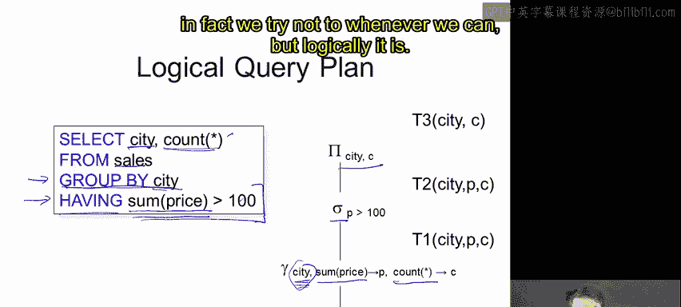

# 大规模数据科学（大数据操作，第1课／共3课） - P36：关系代数思维：逻辑查询计划 🧠


在本节课中，我们将学习如何将SQL查询语句（特别是包含`GROUP BY`和`HAVING`子句的查询）转换为关系代数中的逻辑查询计划。我们将理解每个SQL子句如何对应一个或多个关系代数操作符，并体会关系代数的“闭包”特性带来的优势。

---

上一节我们讨论了去重操作，它对应SQL中的`DISTINCT`关键字。本节中我们来看看分组和筛选操作。

我们之前没有深入讨论分组操作，稍后会看到一个例子。我现在不打算详细讲解关系代数的分组操作符，它会在后续讨论这些操作的实现时再次出现。分组操作对应SQL语句中的`GROUP BY`子句。我们也提到了排序，它对应`ORDER BY`子句。基本上，需要注意这些子句并理解它们意味着需要执行额外的操作。

以下是一个包含`GROUP BY`的例子，并且引入了另一个叫做`HAVING`的子句。

```sql
SELECT City, COUNT(*)
FROM Sales
GROUP BY City
HAVING SUM(Price) > 100;
```

这条语句的含义是：对于每一个唯一的城市，统计发生在那里的所有销售交易记录。这里我们只有一张表，所以没有连接操作。`GROUP BY City`明确指示按城市分组。

关于SQL有一点需要注意：即使没有明确写出`GROUP BY`，有时从上下文也能推断出分组意图。例如，`COUNT(*)`是一个聚合函数，而`City`列没有应用任何聚合函数，因此它必须是被分组的列。实际上，如果尝试不写`GROUP BY`子句，通常会得到一个错误，尽管从逻辑上系统可以推断出来。

对于每个唯一的城市，计算记录数量。这里还有一个额外的`HAVING`子句。它表示：我只想返回那些该城市总销售额大于100的记录。

现在，让我们从关系代数的角度来思考这个过程。

首先，我们从销售表（Sales table）开始。然后应用分组操作。分组操作有两类参数：分组列的集合（这里只有“City”一列）以及一个或多个聚合表达式。这里实际上有两个聚合表达式：一个是`COUNT(*)`，出现在`SELECT`子句；另一个是`SUM(Price)`，出现在`HAVING`子句中。但它们是在同一次分组操作中计算的。

需要认识到的是，在实际实现分组操作时，有机会在一次操作中计算尽可能多的聚合表达式，因为多次扫描数据是低效的。

那么，如何应用`HAVING`子句的筛选呢？这需要一个新的操作符吗？并不需要，因为它本质上就是一个选择（Selection）操作。总价（`SUM(Price)`）现在就像一个普通的属性，我们可以像对底层表中的列一样，对它应用选择操作符。

这正体现了几个段落前讨论过的关系代数“闭包”特性的另一个优势：我们知道每个操作都返回表，因此我们可以对任何表应用相同的操作符集合。例如，我们不需要一个叫做“分组选择”的特殊选择操作符。我们稍后会在某些语言中看到这种模型被破坏的情况。

最后，我们投影出我们不需要的所有列，只保留城市和计数（`COUNT(*)`）。

这里的要点是，你可以将**每一个操作符的结果**都视为一张临时表。虽然在物理上我们尽量避免，但在逻辑上，它就是一张表。

---




本节课中我们一起学习了如何将包含`GROUP BY`和`HAVING`的SQL查询分解为关系代数的逻辑操作序列。我们看到了分组操作如何同时计算多个聚合表达式，以及`HAVING`子句如何被简化为对分组后临时表的标准选择操作。这充分展示了关系代数作为查询处理基础模型的简洁性和一致性。