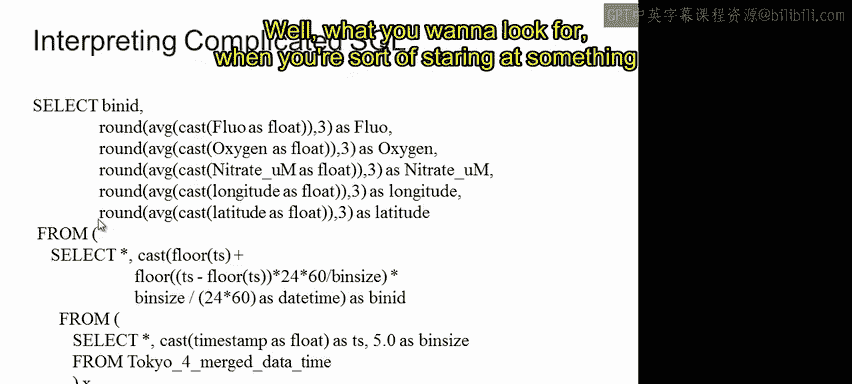
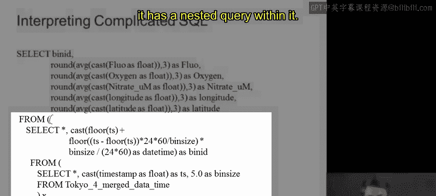
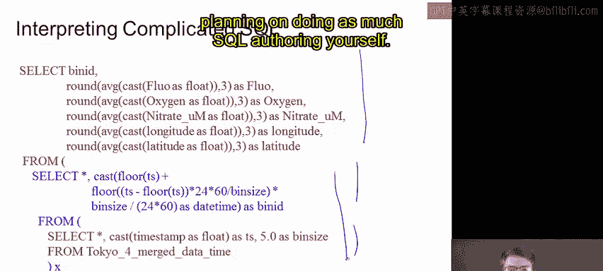

# 杜克大学《大规模数据科学》第1课 - P37：实用SQL：时间序列分箱 📊


在本节课中，我们将学习如何解读一个看似复杂的SQL查询语句。我们将通过一个具体的例子，理解如何将时间序列数据按固定时间窗口（例如5分钟）进行聚合（分箱），并分析查询中多层嵌套的逻辑结构。

上一节我们介绍了关系代数和SQL的基础，本节中我们来看看如何实际分析一个多层嵌套的SQL查询。



---



## 分析复杂SQL语句的方法

当面对一个可能看起来复杂的SQL语句时，关键在于寻找`FROM`子句。在本例中，`FROM`子句并未直接指定表名，而是包含了一个嵌套查询。这完全可行，因为关系代数具有**闭包性**：任何关系代数表达式（以及SQL语句）都操作于表并返回一个表。因此，我们可以像查询基表一样查询派生结果。

在这个例子中，我们查询的就是一个派生结果。

以下是理解嵌套查询的步骤：

1.  **定位数据源**：我们继续向下查看`FROM`子句，会发现又有一层嵌套查询。再深入一层，最终找到了基表 `tblESV`。
2.  **理解数据**：这些数据来自安装在海洋研究船底部的传感器，记录了多种变量（如荧光度、氧气、硝酸盐浓度）以及采集时刻的经纬度和时间戳。
3.  **查询目的**：这个操作的核心是将测量数据聚合到**5分钟的时间窗口**中。

---

## 查询逻辑分解

现在，我们来逐层剖析这个查询是如何实现时间分箱的。

### 1. 最内层查询（红色部分）

这一层的主要任务是为每条记录添加一个常量列，作为分箱的宽度。
```sql
SELECT *, 5 AS binWidth FROM tblESV
```
代码中的 `5 AS binWidth` 为结果集中的每一行都添加了一个值为5的新列 `binWidth`。这为后续计算时间窗口提供了参数。

### 2. 中间层查询（蓝色部分）

这一层执行核心的分箱计算，即根据时间戳将每条记录归入对应的5分钟窗口。
```sql
SELECT
    *,
    FLOOR(EXTRACT(epoch FROM timestamp) / (binWidth * 60)) * (binWidth * 60) AS binId
FROM (...内层查询...)
```
这里使用了公式 **`binId = FLOOR(时间戳 / 窗口秒数) * 窗口秒数`** 来将时间戳向下取整到最近的5分钟边界。例如，6分32秒会被归入5分钟开始的窗口，11分29秒归入10分钟开始的窗口。`*` 确保了所有其他列（包括测量值和经纬度）都被传递到这一层。

### 3. 最外层查询（绿色部分）

这一层进行最终的聚合计算，并整理输出结果。
```sql
SELECT
    binId,
    AVG(lat) AS lat,
    AVG(lon) AS lon,
    AVG(fluorescence) AS fluorescence,
    AVG(oxygen) AS oxygen,
    AVG(nitrate) AS nitrate
FROM (...中层查询...)
GROUP BY binId
ORDER BY binId
```
我们使用 `AS` 重命名操作符为复杂的 `binId` 表达式赋予了一个简洁的名称。然后，查询通过 `GROUP BY binId` 对每个5分钟窗口内的所有记录进行分组，并计算经纬度及各测量变量的平均值(`AVG`)。最后，`ORDER BY binId` 确保结果按时间顺序输出，这可能符合某些应用的需求。

---

## 为何采用多层嵌套结构？

你可能会问，为什么不将所有逻辑合并成一个表达式？这类似于在命令式编程中进行抽象或重构，是软件工程思想的体现。这样做有两点好处：

1.  **逻辑分离**：将不同的逻辑块（定义参数、计算分箱、执行聚合）分离，使查询结构更清晰，易于理解和维护。本例中通过颜色区分了这三个逻辑块。
2.  **提高可重用性**：复杂的表达式（如计算`binId`的公式）可以被封装和复用。更进一步，我们可以将中间结果保存为**视图（VIEW）**，然后像查询普通表一样在外部查询中引用它，这能极大地简化最终查询语句的复杂度。

---



本节课中我们一起学习了如何解读一个利用多层嵌套查询实现时间序列分箱的复杂SQL语句。关键要点包括：利用关系代数的闭包性理解嵌套查询、通过分解逻辑块来分析查询步骤、以及了解使用嵌套或视图来组织复杂查询的软件工程实践。掌握这些方法将有助于你理解和编写更高效、清晰的数据分析SQL代码。