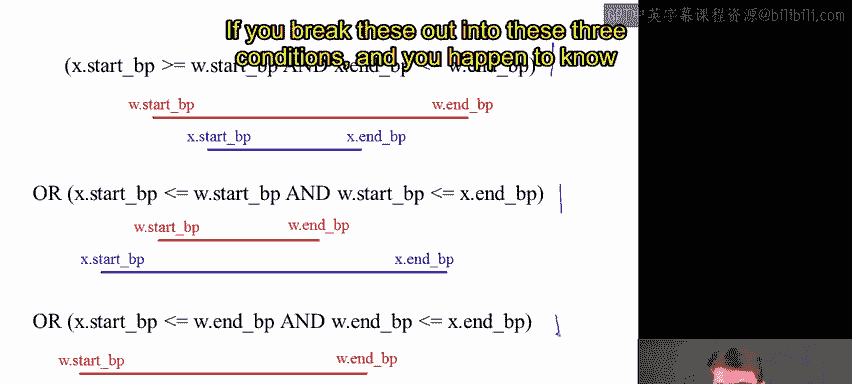
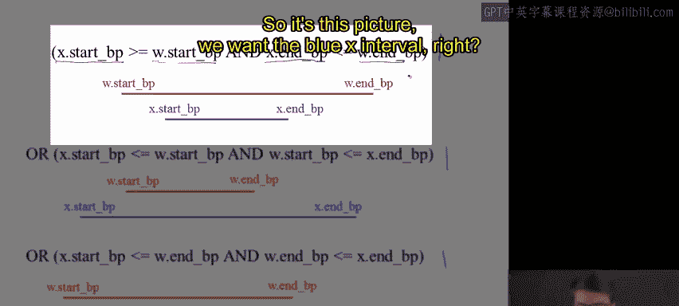
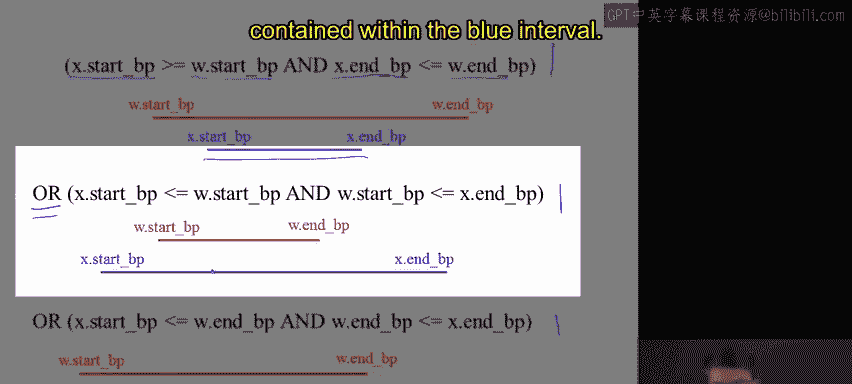
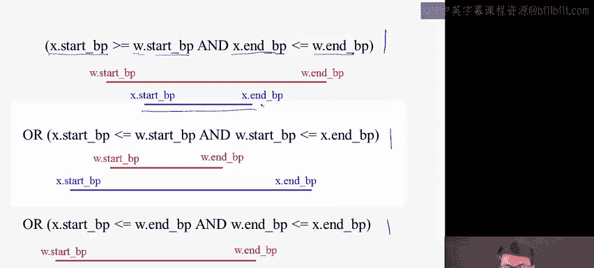
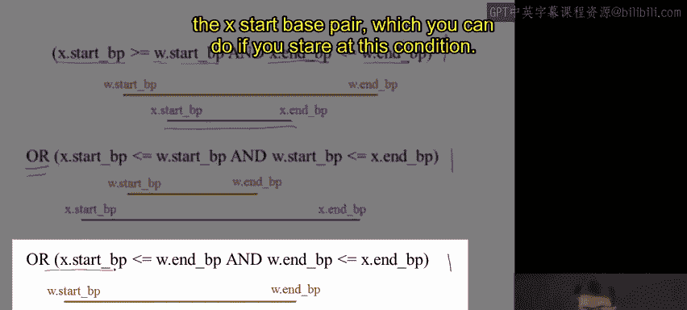
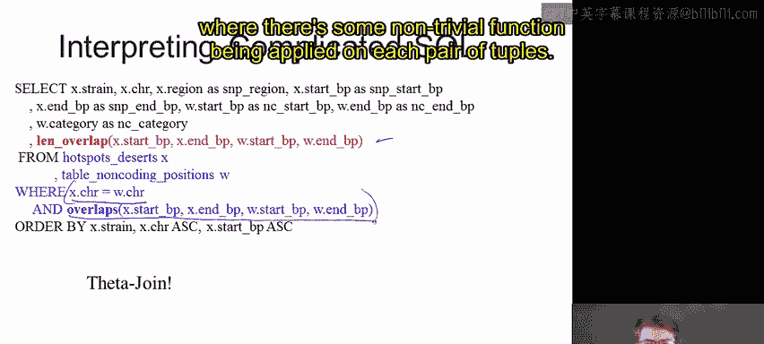

# 大规模数据科学（大数据操作，第1课／共3课） - P38：实用SQL：基因组区间分析 🧬

在本节课中，我们将学习如何分析一个复杂的SQL查询，即使你对其背后的数据领域（例如生物信息学）并不熟悉。我们将通过解构一个涉及基因组区间重叠分析的查询示例，来掌握分析复杂SQL语句结构的通用技能。

## 概述与查询结构

首先，我们来看一个SQL查询示例。分析任何SQL语句的第一步，通常是查看`FROM`子句，以了解涉及了哪些表。

以下是查询中我们看到的结构：涉及两个表，并使用`INNER JOIN`关键字进行显式连接。连接条件是某个ID字段与另一个ID字段的匹配。

上一节我们介绍了查询的基本结构，本节中我们来看看如何深入分析其逻辑。

即使你完全不了解数据的背景，通过分析SQL语句的结构来理解其意图也是一种有用的技能。在数据科学工作中，你可能会遇到这种情况：有人需要你预测下个月的平均销售额，但只告诉你“数据在某个数据库里”。这时，你可能需要自己分析数据库中的模式和现有查询。

因此，掌握分析复杂查询的技巧非常重要。

## 识别连接条件

表面上看，`ON`子句定义了连接条件。但如果我们查看`WHERE`子句，会发现一个要点。

被别名为`X`的表（hotspot_deserts）和被别名为`W`的表，在`WHERE`子句中还参与了额外的条件判断。

这些实际上也是连接条件。尽管`INNER JOIN ... ON`明确列出了部分条件，但任何涉及两个表属性的条件，本质上都是连接条件。

因此，整个`ON`和`WHERE`中的相关部分共同构成了一个复杂的连接条件。

## 理解CASE语句与函数抽象

现在，让我们回到查询顶部，这里有一段复杂的逻辑。

SQL中提供了一种称为`CASE`的语句，其作用与其他编程语言中的`case`语句类似，这并不难理解。具体来说，即使你忽略所有内部逻辑，也可以将这一整段`CASE`语句“折叠”起来，视作一个名为`length_of_overlap`的函数。

这个名称是查询作者为这个复杂表达式结果所起的别名。通过上下文线索（如`SNP_region`代表单核苷酸多态性，`strain`，`BP`代表碱基对，`noncoding_regions`），我们可以推断这个查询可能用于分析基因序列。即使你没有生物信息学背景也没关系，关键在于我们可以将`length_of_overlap`看作一个接收某些属性并返回结果的黑盒函数。这有助于我们看清查询底层的简洁性。

## 解析区间逻辑

接下来，让我们深入看看`WHERE`子句中那个复杂表达式具体在做什么。这是一个有趣的例子。

如果你将这些条件拆分成三部分，并且对数据来源有所了解，就能明白它的含义：

以下是三个区间包含关系的条件，用于判断两个基因组区间（范围）如何重叠：

1.  **条件A**：`X.start_bp > W.start_bp AND X.end_bp < W.end_bp`
    *   这意味着蓝色区间（X表）完全位于红色区间（W表）之内。
    *   

2.  **条件B**：`X.start_bp < W.start_bp AND X.end_bp > W.end_bp`
    *   这意味着红色区间（W表）完全位于蓝色区间（X表）之内。
    *   

3.  **条件C**：`X.start_bp BETWEEN W.start_bp AND W.end_bp`
    *   这意味着红色区间（W表）“跨越”了蓝色区间（X表）的起始点。
    *   

因此，他们直接在SQL中实现了区间逻辑。详细分析这个例子有几点启示：一是关于连接条件的观点，即使不明白具体逻辑，也能从结构上看出它只是一个连接条件；二是你实际上可以直接在SQL中执行某些类型的分析。

## 在数据库中进行分析的意义

这是一个相当不简单的操作。许多人，尤其是那些对数据库没有好感或听朋友说数据库不好用的人，可能会认为这在数据库中是不可能或不应该做的。

但事实并非如此。在数据库内进行分析不仅可能，而且通常是一个很自然的想法。将数据分析作为你的技能包的一部分是应该的。第一步不应该是“让我们把所有数据从数据库里拉出来，然后用命令式代码开始处理”。

仅凭这个例子，可能不足以说服你“把数据留在数据库里处理是个好主意”这个观点。在整个课程中，我可能会陆续提出一系列论据来支持这一点。同时，我需要说明，我并非将数据库鼓吹为数据科学的终极解决方案，但它确实扮演着重要的角色。

## 查询的简化视图

现在，我们可以将这个查询抽象化：
*   我们将`CASE`语句折叠为函数 `length_of_overlap(...)`。
*   我们将连接条件归结为两点：
    1.  必须在`CHR`字段上匹配。
    2.  必须满足我们在上一张幻灯片中看到的那种区间重叠条件。

因此，这只是一个**θ-连接**的例子，其中对每一对元组应用了一个非平凡的函数 `f(x, w)` 作为连接条件。

## 总结

本节课中我们一起学习了如何解构和分析一个复杂的SQL查询。我们通过一个基因组区间分析的实例，掌握了几个关键技能：从`FROM`子句入手理解结构，识别显式和隐式的连接条件，将复杂的`CASE`逻辑抽象为函数以简化视图，以及解读其中具体的区间重叠逻辑。最重要的是，我们认识到直接在数据库中使用SQL进行此类非平凡的分析是可行且自然的，这应该是数据科学家工具箱中的一项重要技能。