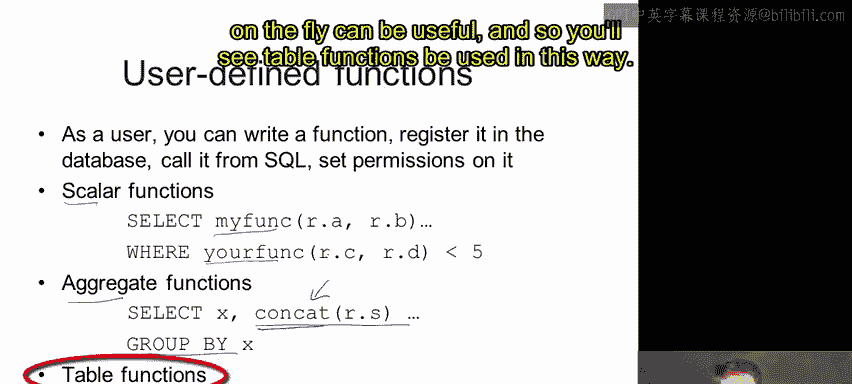

# 大规模数据科学（大数据操作，第1课／共3课） - P39：用户自定义函数 (UDFs) 🧩


在本节课中，我们将要学习用户自定义函数（UDFs）。UDFs 允许你根据特定应用需求，在数据库中创建并注册自己的函数，从而扩展 SQL 的功能。我们将了解 UDFs 的三种主要类型及其使用场景。

我们已经在前面的例子中接触过用户自定义函数。例如，我们曾假设存在一个名为 `overlaps` 的函数和一个名为 `length_of_overlap` 的函数。这些函数并非数据库内置，而是为了满足特定应用逻辑而创建的。

实际上，作为用户，你可以编写这类函数，将其注册到数据库中，然后就可以在 SQL 语句中调用它们。你还可以为其他用户授予使用这些函数的权限。这样一来，数据库就成为了一个可被各处调用的用户自定义函数库。

UDFs 主要分为三种类型：标量函数、聚合函数和表函数。你可以通过它们在 SQL 语句中的使用方式来区分它们。

## 1. 标量函数 (Scalar Functions) 🔢

标量函数可以出现在任何允许表达式出现的地方。例如，在 `SELECT` 子句、`WHERE` 子句的条件比较中，甚至在连接条件里，只要属性可以出现的地方，标量函数就能出现。

它的行为类似于对单行数据进行操作并返回单个值的函数。

**示例公式/代码表示：**
```sql
-- 假设有一个标量函数 calculate_discount(price, rate)
SELECT product_name, calculate_discount(price, 0.1) AS discounted_price
FROM products;
```

## 2. 聚合函数 (Aggregate Functions) 📊

聚合函数只出现在 `SELECT` 子句中，并且总是与 `GROUP BY` 子句相关联。一个常见的、数据库可能未内置但用户常需要定义的聚合函数是字符串连接（concatenate）。

想象一下，你有一个包含标识符和单词的表，你想将所有相关的单词连接成一个长字符串。虽然许多编程语言可以轻松实现字符串连接，但 SQL 中可能没有内置此功能的聚合函数。

以下是其工作方式的抽象描述：你通过某个分组属性定义一组相关的字符串，然后使用自定义的聚合函数将它们全部连接起来。如果你有一个能连接两个字符串的基础函数，你就可以构建一个能连接多个字符串的用户自定义聚合函数。

**示例公式/代码表示：**
```sql
-- 假设有一个自定义聚合函数 string_agg_concat(words)
SELECT group_id, string_agg_concat(word) AS combined_text
FROM word_table
GROUP BY group_id;
```

## 3. 表函数 (Table Functions) 📑

表函数出现在 `FROM` 子句中，可以说是最复杂的一种。最常见的例子是用于生成整数序列的函数。

例如，如果你想将 5 到 10 的所有整数表示为一个表，一种方法是物理地在磁盘上创建表并插入这些整数。但这可能有些浪费资源，因为我们知道这个序列应该是什么，并不需要真正存储它。当序列范围很大时（例如从 1 到 100 万），物理存储的缺点会更明显。

因此，一个能够动态生成这些值的函数会非常有用。表函数就用于此类场景。

**示例公式/代码表示：**
```sql
-- 假设有一个表函数 generate_series(start, end)
SELECT * FROM generate_series(5, 10);
-- 这将返回一个包含 5, 6, 7, 8, 9, 10 的单列表
```



本节课中我们一起学习了用户自定义函数（UDFs）的三种类型：标量函数、聚合函数和表函数。它们极大地增强了 SQL 的表达能力，允许你将复杂的应用逻辑封装成可重用的数据库函数，从而简化查询并提高效率。理解并善用 UDFs 是进行高效、灵活大数据操作的重要技能。