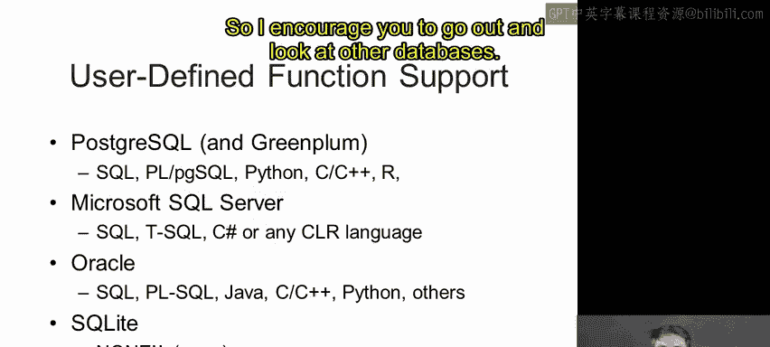
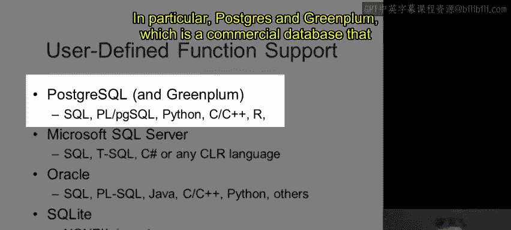
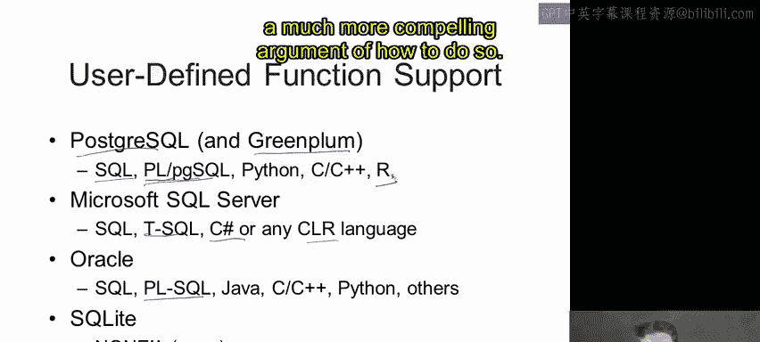

# 大规模数据科学（大数据操作，第1课／共3课） - P40：用户自定义函数支持 📚

在本节课中，我们将探讨数据库中对用户自定义函数的支持情况。我们将了解哪些数据库提供了良好的支持，以及如何在不同环境中定义和使用这些函数。

---

## 概述

用户自定义函数允许开发者在数据库系统中扩展其功能。大多数主流数据库都提供了对此功能的支持，尽管存在一些例外。

## 用户自定义函数的广泛支持

几乎所有数据库都提供了对用户自定义函数的全面支持。然而，一个显著的例外是 SQLite，它恰好是本课程作业中使用的数据库。因此，我鼓励大家去探索其他数据库在这方面的实现。

以下是支持用户自定义函数的主要数据库：

*   **PostgreSQL** 和 **Greenplum**：Greenplum 是一个基于 PostgreSQL 代码库的商业并行数据库，它们对用户自定义函数提供了非常出色的支持。
*   **SQL Server**、**Oracle** 和 **IBM DB2**：这些数据库同样提供了强大的支持。
*   **PostgreSQL 的独特优势**：PostgreSQL 的接口特别清晰，其设计之初就将可扩展性作为核心理念。它最初是一个研究项目，主要目标就是证明可扩展数据库是一个好主意，允许用户添加自己的函数、类型和各种功能。例如，它对处理时间戳数据提供了很好的支持。

## 如何定义用户自定义函数

用户自定义函数可以用多种语言定义，包括纯 SQL。你可能会疑惑为什么用 SQL 定义函数是个好主意。简单来说，原因与在任何编程语言中定义函数的好处相同：**抽象**和**复用**。

此外，还有 SQL 的命令式语言扩展：
*   Microsoft 的 **T-SQL**
*   Oracle 的 **PL/SQL**
*   PostgreSQL 的 **PL/pgSQL**

这些扩展增加了类似命令式编程的特性，例如：运行查询并将结果保存到变量中供后续使用，定义整数等基本类型的变量，以及通常还包括循环结构和条件判断等你在命令式语言中可能见到的所有功能。

这些扩展确实有用，如果你是数据库管理员或认识相关朋友，他们会非常熟悉这些语言。但我个人并不特别推崇使用它们，并非认为它们不好，而是觉得它们有时被过度使用了。有些任务其实不需要降级到编写命令式程序也能完成，这一点并不总是被认识到。

另一个我不喜欢使用它们的原因并非根本性的，只是因为用这些语言编写代码的体验有些痛苦。它们难以调试，因为运行时出错时缺乏良好的调试器支持，很难弄清楚发生了什么。

虽然当我看到 SQL 逻辑被推到应用层时我会抱怨很多，但如果替代方案是使用这些 SQL 的命令式扩展，我的抱怨会少一些。所以，不要把你的连接操作放在应用程序中，但你可以处理循环逻辑，这没问题。

## 扩展语言支持

在 Microsoft SQL Server 中，任何来自 .NET 的 CLR 语言都可以使用，通常需要用 C# 等语言编写。

对于 Python，PostgreSQL 有一个 R 语言扩展，我还没有太多机会尝试，但这很令人兴奋，因为它为那些希望将数据库与统计例程结合使用的人提供了一个更具吸引力的实现方式。

## 总结

本节课我们一起学习了用户自定义函数在数据库中的支持情况。我们了解到大多数主流数据库都支持此功能，并探讨了使用纯 SQL 或命令式扩展语言（如 T-SQL、PL/SQL）来定义函数的方法。关键在于理解用户自定义函数的核心价值在于**代码抽象**和**逻辑复用**。虽然命令式扩展功能强大，但也需权衡其复杂性和调试难度。最后，我们看到了像 .NET CLR 和 PostgreSQL 的 R 扩展等更广泛的编程语言集成可能性。