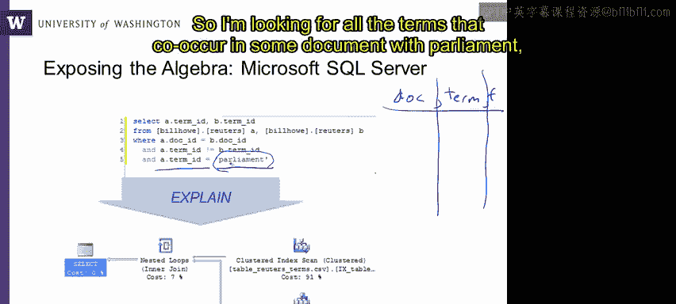
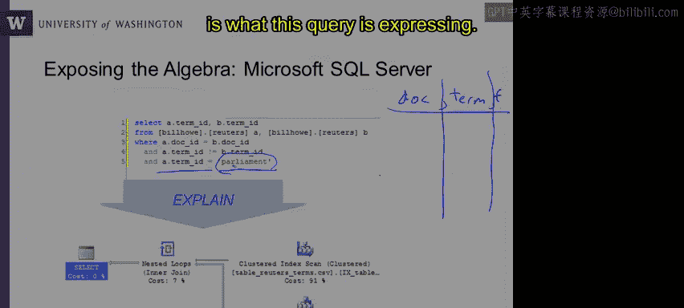

# 大规模数据科学（大数据操作，第1课／共3课） - P41：物理查询计划优化 🚀


在本节课中，我们将要学习数据库查询处理的最后一个关键环节：物理查询计划优化。我们将探讨在确定了逻辑操作顺序（即代数优化）之后，如何选择具体的执行算法来高效地实现这些操作。

上一节我们介绍了代数优化和声明式查询语言，它们让数据库系统能够自主决定如何执行查询。本节中，我们来看看如何将逻辑计划转化为可实际执行的物理计划。

## 逻辑计划与物理计划的区别

即使我们已经指定了操作的顺序（例如，先选择再连接），我们仍未指定实际评估查询所需的每一个细节。让我用一个例子来说明这一点。

这是一个我们上节课看过的查询的简化版本：对于每一个订单（Order），我们想找到所有属于该订单的对应商品（Item）。这直接翻译成的代数计划非常简单，就是两个表的连接（Join）。

你可能会认为工作已经完成了。然而，我们还需要指定**如何**执行这个连接操作。

## 连接操作的物理实现选项

以下是实现连接操作的两种主要物理算法。

**选项一：嵌套循环连接**
这种方法在高级伪代码中如下所示：
```python
for each record I in Item:
    for each record O in Order:
        if I.order_id == O.order_id:
            output (I, O)
```
这个算法检查`Item`表中的每一条记录与`Order`表中的每一条记录，如果它们在订单属性上匹配，则输出结果。其时间复杂度大致是O(n²)。

**选项二：哈希连接**
另一种方法如下：
```python
# 构建阶段
hash_table = {}
for each record I in Item:
    hash_table[I.order_id].append(I)

# 探测阶段
for each record O in Order:
    for each I in hash_table.get(O.order_id, []):
        output (I, O)
```
这种方法首先将`Item`表的所有记录插入一个哈希表（按连接键`order_id`）。然后，扫描`Order`表，并在哈希表中快速查找匹配的记录。如果哈希表查找是（平摊）常数时间，那么这个算法的时间复杂度接近O(n)。

## 算法选择：哪个更快？

我暗示了选项二（哈希连接）可能更快，但在实践中，情况可能并非总是如此。请思考一下，为什么在某些情况下，看似低效的嵌套循环连接反而可能更快？

答案与数据大小和内存有关。如果`Item`表非常小（可以完全放入内存），而`Order`表非常大，嵌套循环扫描小表对于大表的每一条记录可能开销不大。然而，如果`Item`表很大，构建哈希表可能消耗大量内存，甚至需要溢出到磁盘，这会显著降低哈希连接的速度。因此，查询优化器必须根据数据统计信息（如表的大小）来做出明智的选择。

## 实际数据库中的物理计划

你可以在实际数据库系统中访问和查看这些物理计划。例如，在Microsoft SQL Server（以及其他主流数据库）中，你可以使用`EXPLAIN`命令。

以下是一个针对Reuters数据集的查询示例（该数据集包含文档ID、词条和频率三列）：
```sql
EXPLAIN
SELECT a.term, b.term
FROM Reuters a, Reuters b
WHERE a.doc = b.doc
  AND a.term = ‘Parliament‘;
```
执行解释命令后，数据库会返回一个物理操作树。你可能会看到类似“Hash Match Inner Join”的操作，这正对应了我们之前讨论的哈希连接算法。

这个查询的目的是：找出所有与“Parliament”这个词出现在同一文档中的其他词条。

## 物理优化的重要性

物理查询计划优化是数据库性能的关键。它负责将高级的逻辑操作（如连接、选择）转化为具体的、考虑数据分布和系统资源（如内存）的低级算法步骤。优化器的目标是在众多可行的物理计划中，选择一个预估执行成本最低的计划。





本节课中我们一起学习了物理查询计划优化的核心概念。我们理解了逻辑计划与物理计划的区别，探讨了连接操作的两种基本物理实现算法（嵌套循环连接和哈希连接），并认识到查询优化器需要根据实际数据情况选择最合适的算法。最后，我们看到了如何在真实数据库中使用`EXPLAIN`命令来查看系统生成的物理执行计划。