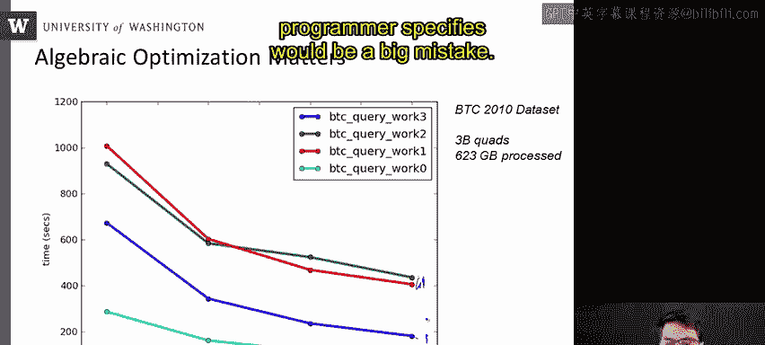
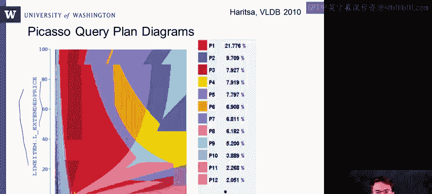

# 大规模数据科学（大数据操作，第1课／共3课） - P42：优化：选择物理计划 🧠

在本节课中，我们将要学习数据库查询优化中的一个核心环节：物理计划的选择。我们将看到，对于同一个逻辑查询，数据库系统可能会根据数据的具体情况选择不同的物理执行算法，而程序员无需关心这些底层细节。

---

上一节我们介绍了逻辑查询计划，本节中我们来看看数据库系统如何将逻辑计划转化为具体的物理执行计划。

现在，请注意，当我解释这个查询时，我得到了一个不同的物理计划。逻辑计划看起来相同，它仍然包含扫描、扫描和连接操作，但计算连接所用的算法已经改变，现在它使用了一种叫做“嵌套循环”的方法。

这种嵌套循环算法完全对应了这里的伪代码。这就是它被称为嵌套循环的原因：一个外循环和一个内循环。两者完全一致。

因此，系统选择了这个嵌套循环计划。尽管我们曾论证这是一种O(n²)复杂度的算法，通常不会被频繁选择。那么，为什么在这个案例中它被选用了呢？

如果你仔细思考，这次连接操作的一侧只涉及那些包含“parliament”一词的文档记录。这是一个非常小的关系表。由于关系表非常小，这种嵌套循环算法可能非常高效，甚至比构建哈希表或其他数据结构的开销还要快。

这里的主要收获（与具体细节相对）是：不同的物理算法在不同情况下是合适的。得益于声明式语言和代数优化，程序员无需担心任何这些细节，也无需做出选择。

这是一个非常强大的理念。你只需表达查询意图，数据库会完成其余工作。

需要指出的是，这不仅限于SQL Server。在Postgres中，你也可以通过使用`EXPLAIN`命令生成这类代数计划。实际上，它们看起来更清晰。这里再次出现了哈希连接，它实际上向你展示了构建哈希表作为第一步，然后用第二步进行探测的过程。这里还有另一个我们未讨论的运算符，例如当你需要对某个分组的所有成员进行计数时。这里的哈希是基于分组ID的，你可以对其余部分应用聚合函数。不过，在未深入讨论的情况下，我不应给出如此高层次的概述，所以让我们先跳过这部分。

总之，代数计划确实存在。你可以直接通过使用关键字`EXPLAIN`来查看它。如果你使用数据库，我建议你经常这样做，以尝试理解正在发生的事情。

我想指出的另一点是，这很重要。下面的例子并非直接来自SQL，事实上也非来自商业数据库，而是来自我们研究小组的一些工作。但要点是相同的。

这些是针对完全相同的查询的不同物理计划。事实上，这里我正在进行并行处理，所以这里应用了多个处理器。当你从4个处理器增加到16个处理器时，执行时间有所下降，但下降幅度不如我们预期的那样大。实际上，它应该下降得相当多。

但关键是，这些计划中的每一个所花费的时间都非常不同。好吧，其中两个计划的时间差不多，但差异是相当重要的。因此，忽略这些优化机会，只坚持程序员指定的计划，将是一个巨大的错误。

以下是另一个说明，虽然有点难以直观理解，但让我尝试解释一下这里发生了什么。这是Hea等人在VLDB 2010会议上的一项非常出色的工作，围绕这项工作有一系列论文。他们试图可视化可能的查询计划空间。

这里的两个坐标轴都是针对同一个查询的，但查询的参数在变化。实际上，这涉及供应商账户余额和某种扩展价格参数。他们改变了查询中这些参数的值。想象一下，语法相同，都是`SELECT * FROM something WHERE some condition = extended price AND some other condition = account balance`，仅仅通过调整这两个“旋钮”，你就得到了由优化器选择的不同计划的丰富图谱。

在这个空间中，每种颜色代表一个不同的查询计划，即由优化器选择的一个不同的代数查询计划。我认为这里的要点是，数据库做出的决策非常复杂，而且必须如此。实际上，这些不同的计划确实很重要。虽然这里没有展示，但你可以证明计划的选择确实重要。数据库在寻找正确计划方面往往做得相当好。

我在上一张幻灯片中论证过，这实际上很重要，执行时间的差异可能相当显著。

将这种复杂性留给程序员处理，可能是一个巨大的效率损失来源。隐藏这种复杂性是一个巨大的、巨大的胜利。

---

本节课中，我们一起学习了数据库查询优化中物理计划选择的重要性。我们了解到：
1.  同一个逻辑查询可以对应多个物理执行计划。
2.  数据库优化器会根据数据特征（如数据量大小）自动选择高效的物理算法（例如，对小表使用**嵌套循环**，对大表使用**哈希连接**）。
3.  程序员使用声明式语言（如SQL）时，无需关心底层执行细节，只需关注“要什么”，而不是“怎么做”。
4.  我们可以使用`EXPLAIN`等工具查看数据库生成的物理计划。
5.  优化器的选择对查询性能有重大影响，将算法选择的复杂性从程序员身上抽象掉是数据库系统的一个核心优势。