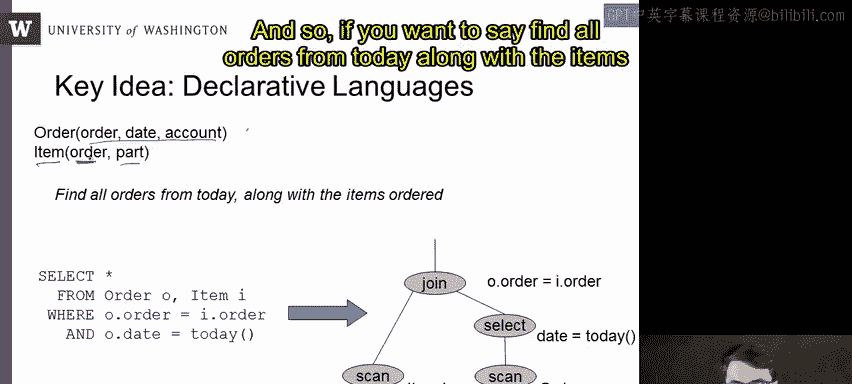
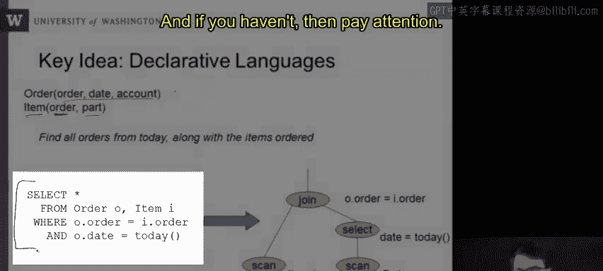
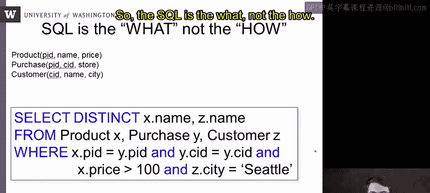
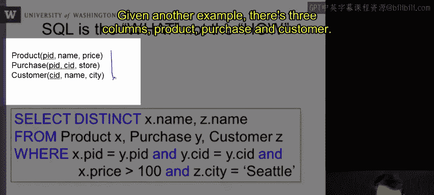
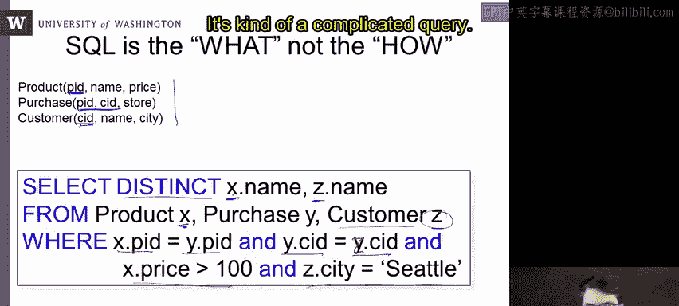

# 大规模数据科学（大数据操作，第1课／共3课） - P43：声明式语言 🗣️


## 概述

在本节课中，我们将要学习关系型数据库中的一个核心概念：**声明式语言**。我们将了解它与之前讨论的代数优化的关系，并通过SQL查询示例来理解其“描述结果是什么，而非如何获取”的本质。

---

上一节我们介绍了**代数优化**，讨论了多个关系代数表达式在逻辑上等价，但执行顺序不同。数据库系统能够自动选择最优的执行顺序。

本节中，我们来看看**声明式语言**。声明式语言的核心思想是：你只需指定你想要的结果所满足的条件，而无需指定获取该结果的具体步骤或顺序。

## 什么是声明式语言？

声明式语言意味着你**指定想要的答案**，但**不指定任何关于如何获取它的信息**。

一个关系代数表达式实际上指定了操作顺序。正如上一张幻灯片所示，三个不同的表达式明确指示了每个操作的执行顺序。这意味着，如果你编写这样的表达式，你就是在指示计算机：“按照这个特定顺序执行”。

而声明式语言则说：“我们只描述结果必须满足的属性，然后让数据库自行找出执行这些操作的正确顺序。”

## SQL查询示例一

以下是一个快速示例。假设你有两个表：
*   `Order` 表，包含三列：`order`、`date`、`account`。
*   `Item` 表，包含两列：`order`、`part`。其中 `order` 列表示该物品应关联到哪个订单。

如果你想查询“找出今天的所有订单及其订购的物品”，你可能会编写如下查询：



```sql
SELECT *
FROM Order, Item
WHERE Order.order = Item.order
  AND Order.date = today;
```



这个查询从 `Order` 表和 `Item` 表中选择所有列，但只保留满足以下条件的记录：
1.  `Order` 表中的 `order` 列与 `Item` 表中的 `order` 列匹配。
2.  `Order` 表中的 `date` 列等于今天。

这只是对结果的条件表达，没有任何关于如何实际获取此答案的具体思路。自动发生的情况是，该查询被转换为类似于我们已经见过的关系代数表达式。你可以将其理解为：扫描 `Item` 表，扫描 `Order` 表，选择 `date` 等于今天的记录，然后执行连接操作，为 `Order` 中的每条记录找到 `Item` 中在 `order` 列上匹配的记录。

每次运行查询时都会发生这种情况。因此，SQL 描述的是 **“做什么”**，而不是 **“如何做”**。

## SQL查询示例二

以下是另一个例子。我们有三个表：
*   `Product(PID, name, price)`
*   `Purchase(PID, CID)`
*   `Customer(CID, name, city)`

下划线表示构成表记录唯一性的列（主键）。这里，`PID` 使产品记录唯一，`CID` 使客户记录唯一，`PID` 和 `CID` 的组合使购买记录唯一。





以下是一个SQL查询：

```sql
SELECT DISTINCT P.name AS product_name, Z.name AS customer_name
FROM Product P, Purchase, Customer Z
WHERE P.PID = Purchase.PID
  AND Purchase.CID = Z.CID
  AND P.price > 100
  AND Z.city = 'Seattle';
```

这个查询的意思是：
*   从这三个表中选择数据。
*   条件是：`Product` 表中的 `PID` 与 `Purchase` 表中的 `PID` 匹配，并且 `Purchase` 表中的 `CID` 与 `Customer` 表中的 `CID` 匹配。
*   同时，只选择价格大于100的产品，以及城市为西雅图的客户。
*   最后，返回唯一的（`DISTINCT`）产品名称和客户名称组合。

用自然语言描述就是：找出所有**唯一的**产品和客户组合，其中客户位于西雅图，并且他们购买了价格超过100的产品。

我们很清楚我们想要什么，但如何获取它并不明确。这是一个相当复杂的查询，但SQL语句只声明了结果需要满足的条件。

---

## 总结



本节课中我们一起学习了**声明式语言**。我们了解到，在关系型数据库中，像SQL这样的声明式语言允许用户只描述查询结果的逻辑条件，而将具体的执行计划（包括操作顺序和优化）交给数据库管理系统自动处理。这是关系数据库的一个关键特性，它极大地简化了数据查询的复杂性，并使得系统能够通过代数优化等技术来提升查询效率。