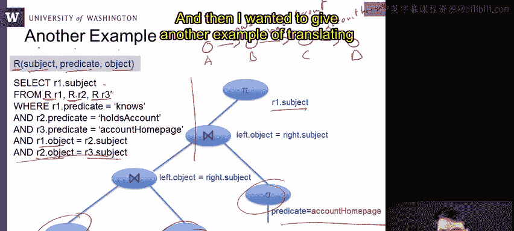

# 大规模数据科学（大数据操作，第1课／共3课） - P44：声明式语言更多示例 📚

在本节课中，我们将通过更多示例深入探讨声明式查询语言，特别是如何将复杂的查询转换为关系代数表达式。我们将学习如何清晰地指定操作顺序，同时理解其中仍保留的物理实现细节。

---

## 关系代数转换示例

上一节我们介绍了声明式语言的基本概念，本节中我们来看看如何将具体的SQL查询转换为关系代数表达式。

我们有一个涉及产品、购买和客户三个表的查询。在关系代数中，这个查询被转换为以下操作序列。

首先，在底部我们有产品表和购买表。我们执行一个连接操作：对于产品表中的每一条记录，在购买表中找到对应的记录。接着，对上一步连接的结果，我们再执行一次连接操作：对于结果中的每一条记录，在客户表中找到对应的记录。

然后，我们进行过滤操作：筛选掉所有价格不大于100的记录，只保留价格大于100的记录；同时，只保留城市等于“西雅图”的记录。

接下来，我们进行投影操作。投影意味着只保留我们感兴趣的两列，舍弃所有其他列。

最后，我们得到最终答案。

这里有两个关键点：第一，操作的执行顺序现在被明确指定了；第二，许多物理层面的细节仍然是开放的。这是一个非常高层次的指示，只明确了操作顺序，但并未规定具体的实现方式。例如，我们不知道将如何具体执行连接操作，实际上存在多种方法。虽然我们指出“对于产品表中的每条记录，在购买表中查找对应记录”，但并未精确定义其含义。

---

## RDF数据与复杂查询示例

现在，我们来看另一个涉及不同数据模型的例子。

这里我们只有一个名为R的关系（表），它包含三列：主语、谓语和宾语。当你处理RDF数据时，会看到这种模式。RDF是资源描述框架，是一种用于管理“关联数据”的语言、形式体系和软件栈。

在RDF中，一切都被编码为一组事实。例如，你可以编码一个事实：“本课程的讲师是Bill Howe”。其中，主语是“本课程”，谓语是“有讲师”，宾语是“Bill Howe”。人们使用这种形式体系作为一种非常通用的方式来编码来自任何来源的任何信息，我们可能在课程后期再次提及。

以下是一个稍复杂的查询示例。该查询使用了同一个关系的三个实例，并将它们全部连接起来。

查询的目标是寻找一个特定的模式序列：找到一个认识某人的人，而这个人持有一家公司的账户，并且该账户的主页是一个特定值。换句话说，我们寻找满足“认识 -> 持有账户 -> 账户主页”这个边序列的所有可能组合。

在关系代数中，这个查询被转换为以下形式：
1.  首先进行选择操作，分别找出谓语等于“认识”、“持有账户”和“账户主页”的记录。
2.  然后，通过一系列连接操作将这些结果组合起来，连接的条件是：第一个关系的宾语必须等于第二个关系的主语，第二个关系的宾语必须等于第三个关系的主语。
3.  最后，通过投影操作提取出我们感兴趣的最终答案列。

这个例子可能有些复杂，但我想强调几个要点：第一，你可能会再次遇到RDF；第二，它演示了在单个查询中可以多次访问同一个关系；第三，它展示了即使复杂的查询也能被转换为关系代数表达式。

---

## 总结

本节课中，我们一起学习了声明式查询语言的更多转换示例。我们看到了如何将涉及多表连接和过滤的SQL查询，清晰地映射为关系代数中的操作序列（连接、选择、投影）。我们也接触了RDF数据模型，并通过一个复杂查询示例，了解到关系代数能够表达基于图模式的查找。关键在于，关系代数明确了操作的逻辑顺序，但将具体的物理实现细节留给了数据库系统。