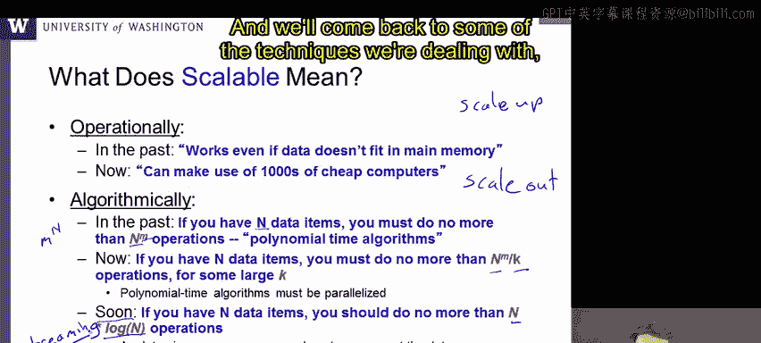

# 大规模数据科学（第1课）📊：可扩展性的含义

在本节课中，我们将探讨数据科学中的一个核心概念——“可扩展性”。我们将了解其不同层面的含义，从单机处理到分布式计算，并简要介绍算法复杂度如何影响可扩展性。

---

## 可扩展性的操作定义

上一节我们提到了处理大规模数据的重要性。本节中，我们来看看“可扩展性”在操作层面上的具体含义。

过去，一种常见的理解是：算法必须能够处理无法完全装入单台机器主内存的数据。这意味着，即使只有一台机器，算法也需要能够分块从磁盘读取数据、进行处理，并可能分块写回磁盘。

以下是这种处理方式的关键点：
*   **内存占用小**：在任何时刻，算法在内存中只保留一小部分数据。
*   **数据库的角色**：数据库系统擅长这种“核外处理”，确保查询只要磁盘上有数据就能完成。
*   **核外处理**：`out of core processing` 指利用磁盘进行操作，而 `in core` 则指所有操作都在内存中完成。

---

## 从纵向扩展到横向扩展

然而，随着互联网应用在21世纪初的兴起，仅靠单台机器的核外处理变得不够。无论服务器多么强大，其磁盘I/O速度也难以满足海量并发请求。

因此，可扩展性的含义演变为：能够利用成千上万台廉价计算机共同解决同一个问题。这被称为 **横向扩展**。相比之下，为单台机器增加更大的内存和更多核心则被称为 **纵向扩展**。

---

## 算法复杂度的视角

从更精确的算法复杂度角度来看，可扩展性也有其定义。

传统上，如果一个算法处理 **n** 个数据项所需的操作数不超过 **n^m**（m是一个常数），则该算法被认为是“可扩展的”或“易处理的”。例如：
*   当 m=1 时，是 **线性时间复杂度** 算法。
*   当 m=2 时，是 **二次时间复杂度** 算法。

而非多项式时间算法（例如指数时间算法 **k^n**）则被认为是不可扩展的。但在实践中，即使是二次复杂度算法，对于超大数据集也可能变得不可行。

在现代分布式计算中，可扩展性要求算法复杂度能除以一个很大的常数 **K**（即 **n^m / K**），这里的 **K** 代表可以用于解决问题的计算机数量。算法必须能有效利用这些并行资源。

---

## 流式数据的挑战

最后，我们简要提及一个更极端的场景：流式数据处理。在某些情况下，即使是 **n^m / K** 的复杂度也可能不够。

对于以流形式高速涌入的数据（例如大型巡天望远镜每晚产生30TB数据），系统通常只能对每个数据项进行一次处理。因此，理想的算法复杂度应为 **O(n log n)**。

这里的 **log n** 因子通常意味着可以使用树形数据结构对处理过的数据进行索引。流式数据处理是一个重要的前沿领域，我们将在课程后续部分探讨相关技术。

---

## 总结

本节课我们一起学习了“可扩展性”的多层含义：
1.  **操作层面**：从处理超出单机内存的数据开始。
2.  **架构层面**：从单机纵向扩展转向多机横向扩展。
3.  **算法层面**：从多项式时间复杂度，到需利用多机并行降低复杂度，再到流式处理中近乎线性的复杂度要求。

理解这些不同层面的可扩展性，是设计和实施大规模数据科学项目的基础。