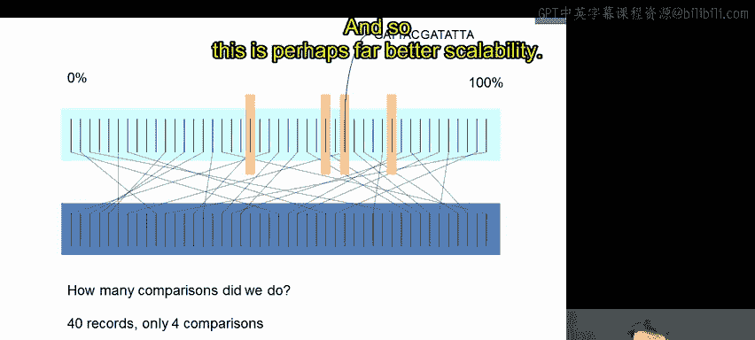

# 大规模数据科学（大数据操作，第1课／共3课） - P48：算法复杂度概述 🧠

在本节课中，我们将学习算法复杂度的基本概念，并通过一个具体的例子来理解不同算法在处理数据时的效率差异。我们将探讨线性搜索和二分搜索两种方法，并分析它们的时间复杂度。

---

## 两种可扩展性的视角

“可扩展性”可能有两种不同的含义。在本节中，我们将通过一些例子和直观解释来探讨这个问题：我们能否利用多台计算机？是否存在“杀鸡用牛刀”的情况？

## 一个简单的示例问题

以下是一个经过简化的示例问题：我们想要找出所有匹配的DNA序列。一个DNA序列是由字母G、A、T和C组成的短字符串。给定一个目标短序列，我们需要找出所有与之完全相同的序列。

换句话说，就是找出所有与给定序列完全相等的序列。

## 如何解决这个问题？

想象一下，下图中的每一条黑线代表一个DNA序列。这条黑线对应一个序列，那条黑线对应另一个序列，其余黑线则代表其他序列。

请花一分钟思考一下，设计一个算法来找出匹配目标序列的序列。

## 方法一：线性搜索

在不对数据做任何假设的情况下，数据只是以列表形式提供。我们可以做的一件事是进行线性搜索。

我们将检查第一项，并将其与目标序列进行比较。如果相等，很好，我们找到了一个匹配项。如果不相等，我们则继续检查下一项。这一切都发生在时间 `t=0`。

然后我们移动到下一个序列。在时间 `t=1`，我们检查另一个序列并进行相等性比较。如果不匹配，我们继续移动。以此类推，直到时间 `t=17`，我们找到了一个匹配项。在这里，我用了“包含”而不是“相等”，可能改变了原意。但无论如何，我们找到了一个匹配项并将其输出。

那么，这需要多长时间？我们进行了多少次操作？在这个图示中，我们处理了40条记录，进行了40次比较。

因此，对于 `n` 条记录和 `n` 次比较，我们说算法复杂度是 **O(n)**。所以，对于这个简单的搜索和检索任务，这是一个线性时间算法。

## 能否做得更好？

问题是，我们能否做得更好？如果你有一些数据结构方面的经验或上过相关课程，你应该会想：是的，我们可以。

## 方法二：排序与二分搜索

一种更好的方法是先对序列进行排序。这有什么帮助呢？当然，我们仍然可以进行线性时间算法，逐一检查这些序列。但我们也可以做一些更聪明的事情：从中间开始搜索。

从中间开始，将我们的目标序列与在此处找到的序列进行比较。它们不相等，但我们可以看到找到的这个序列小于我们的目标序列。因此，我们知道目标序列在右侧，它一定在这个方向上的某个位置。

这样，我们就无需检查一半的数据（20条记录）。然后，跳转到剩余部分的中间再次比较。现在我们发现，我们“跳过”了——这个序列大于目标序列。同样，我们再次排除了一半的数据。

在第一步中，我们排除了一半数据；在这里，我们又排除了剩余部分的一半。现在我们知道目标序列在这个范围内。再次对半分割并比较，发现它小于目标序列，所以我们大致在目标附近来回调整。

让我试着画得更好一些，划掉那些部分，再划掉这些部分。现在我们知道它在某一侧。在下一步中，我们找到了一个匹配项。如果有多个相同的项，我们知道它们会相邻出现，因此如果需要，我们可以遍历记录，收集所有匹配项。

那么，这花了多长时间？这里我们仍然有40条记录，但我们只进行了4次比较。因此，对于 `n` 条记录，我们进行了 `log n` 次比较。我们遍历了这个隐含的二叉树，对排序后的数据进行了二分搜索。

所以，这个查找操作的时间复杂度是 **O(log n)**。当然，我们必须提前对数据进行排序。如果算上排序，那是一个 `O(n log n)` 的操作，我们这里不一定会讨论。但一旦你有了排序好的数据，查找就只需要 `log n` 次操作，这可能是更好的可扩展性。

---

## 总结

在本节课中，我们一起学习了算法复杂度的基本概念。我们通过一个查找匹配DNA序列的例子，对比了线性搜索（**O(n)**）和基于排序的二分搜索（**O(log n)**）两种方法。我们了解到，通过合理组织数据（如排序），可以显著提高算法效率，这对于处理大规模数据至关重要。理解算法复杂度是设计和选择高效、可扩展解决方案的基础。