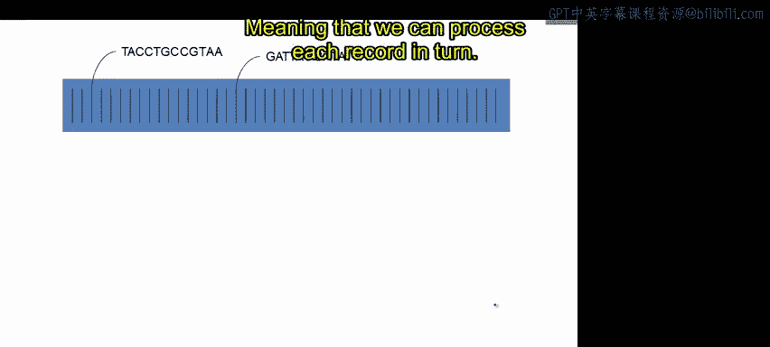
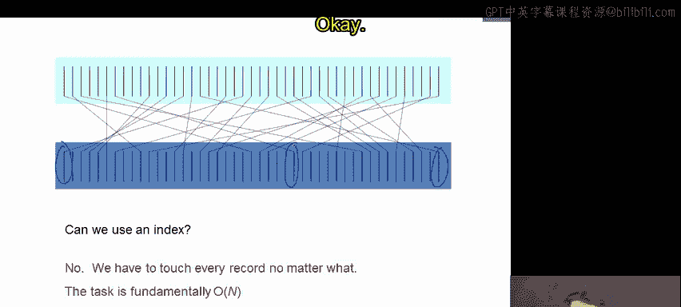
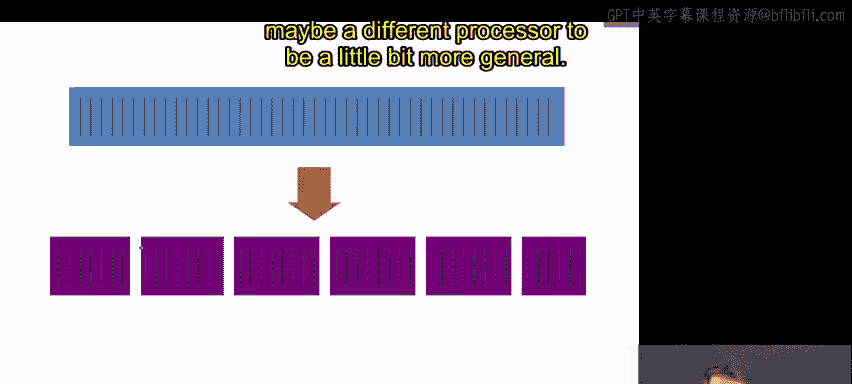
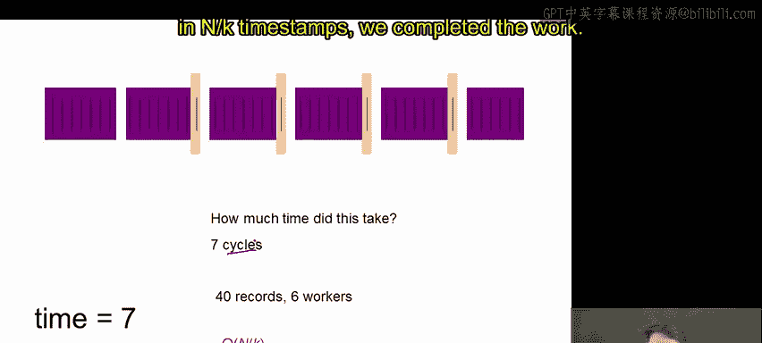

# 大规模数据科学（大数据操作，第1课／共3课） - P49：数据并行算法概述 📊


在本节课中，我们将要学习数据并行算法的基本概念。我们将探讨如何通过并行处理来加速那些需要处理数据集中每个记录的任务，并与之前讨论的“大海捞针”式搜索任务进行对比。

## 关系数据库的优势 🗄️

上一节我们介绍了针对“大海捞针”式搜索任务的优化技巧。这个技巧非常有效，以至于已经被内置于许多系统中，尤其是关系数据库。

关系数据库擅长处理这类从大数据集中追踪小结果的问题。它们能够透明地提供一种旧式的可扩展性。这里所说的“旧式可扩展性”是指数据能装入主内存。正如我们多次提到的，无论主内存大小如何，你的查询总能完成。

此外，数据库是构建、使用和复用索引的绝佳平台。因此，关系数据库在“核外算法”和寻找对数时间算法这两种旧式可扩展性方面都表现出色。

索引可以轻松构建，并在适当时自动使用。在关系数据库中，你可以写一条简单的语句：

```sql
CREATE INDEX index_name ON table_name (column_name);
```

这条语句会根据指定列对记录进行排序。磁盘上的实际数据是否物理排序，取决于你所使用的具体系统。通常，这条语句不会移动物理记录，而是会构建一个辅助索引。无论如何，你都能利用这种对数时间的访问模式。

只需这一行代码，你就能创建索引并利用它。之后，任何需要且能受益于该索引的查询，优化器都会自动选择使用它（如果合适的话）。这比你手动重写代码以实现核外处理或利用索引要容易得多。

因此，当你将关系数据库与R或Python脚本进行比较时，仅仅通过将问题转化为SQL语句，你就免费获得了大量已经完成的算法工作。这不仅仅是SQL与表达能力更强的代码语言之间的对比，实际上你从中获得了巨大的好处。

## 引入新任务：序列修剪 ✂️

现在，让我们来看另一个任务，称为“序列修剪”。

我们被给予同一组DNA序列，但这次不是搜索一个特定的序列，而是要从每个序列中修剪掉最后几个碱基对。也就是说，我们将去掉一个后缀，并返回一个数据集，其中每个读取序列现在只是原读取序列的前缀。

在实践中，确实需要进行这种修剪。原因是测序仪的准确度在读取长度超过一定值后会急剧下降。因此，从每个读取序列中修剪掉最后几个碱基对是一种标准的预处理操作。

我们该如何完成这个任务呢？我们可以尝试使用与第一次搜索任务相同的技巧，即依次处理每个记录。



在时间0，我们可以修剪此后缀，只返回“TCCT”。在时间1，我们修剪这个后缀，依此类推。在时间17，我们会遇到以“GATTA”开头的老朋友。

然而，与搜索任务不同，这里没有索引能真正帮助我们。我们必须接触并操作每一个记录，从中提取前缀并移除后缀。因此，这个操作本质上是**O(n)** 复杂度的。不可能有低于O(n)的算法，你至少需要接触每一个记录。

## 并行处理的威力 ⚡

但是，我们能否做得更好呢？答案是肯定的。

处理第一个任务与处理最后一个任务完全独立，也与处理这个任务（实际上是指处理记录）完全独立。因此，虽然没有索引可用，但我们可以将数据集分解成多个部分，并独立处理每个部分。



想象一下，我们获取单个数据集，将其分解成这些数据块，并将每个数据块分配给不同的机器，或者更广义地说，分配给不同的处理器。



现在，在时间0，我们可以同时处理每个数据块中的一个序列。在时间1，我们同时处理每个数据块中的第二个序列，依此类推。

我们做了多少工作呢？我们仍然处理了全部40个记录，工作量相同。但花了多少时间呢？只花了7个时间单位（这里用“周期”表示，但更通用地说，因为我们有6个工作单元）。这里的复杂度是 **O(n/k)**。平均而言，对于n个项目，我们可以在n/k个时间步内完成工作。

## 总结 📝



本节课中我们一起学习了数据并行算法的核心思想。我们回顾了关系数据库通过索引和优化器，为“大海捞针”式搜索提供的强大且自动化的旧式可扩展性。接着，我们探讨了“序列修剪”这种需要处理每个记录的任务，并认识到虽然其复杂度下限为O(n)，但通过将数据分块并分配给多个工作单元并行处理，我们可以将实际执行时间显著减少到O(n/k)，其中k是并行度。这体现了数据并行在处理“全扫描”型任务时的巨大价值。