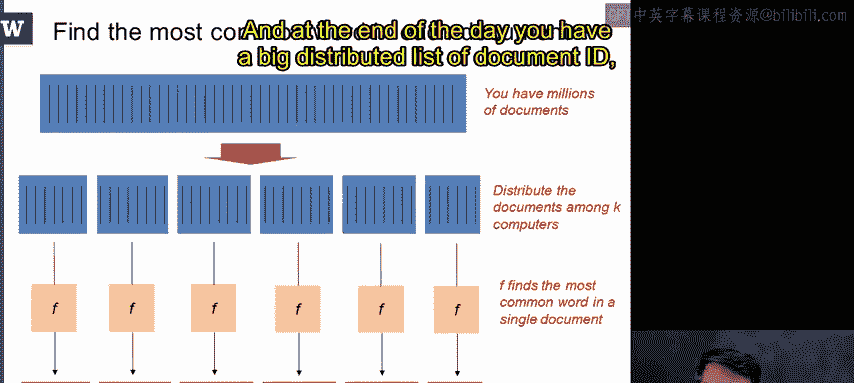
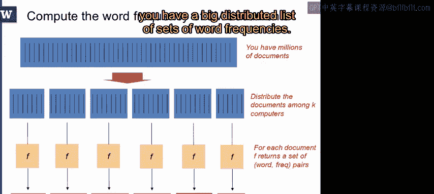
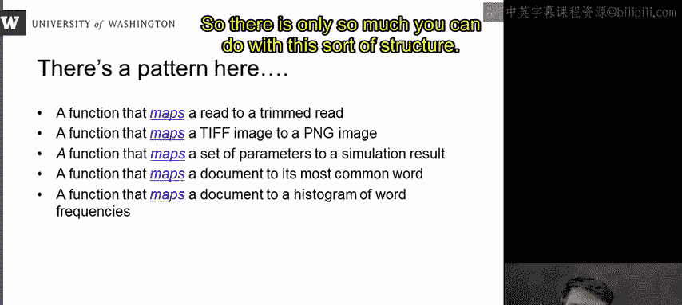

# 大规模数据科学（第1课） - 🧩 令人愉悦的并行算法

在本节课中，我们将要学习一种在大规模数据处理中反复出现的核心模式——令人愉悦的并行算法。我们将探讨其基本概念、典型应用场景，并理解其优势与局限性。

---

我们之前从算法复杂度的角度讨论了可扩展性，也从数据并行处理的角度讨论了可扩展性。数据并行处理是指将大型数据集分割成多个数据块，并在每个数据块上执行独立的计算。在我们观察的每一个任务中，都出现了同一种模式。

以下是几个典型的应用场景：

**1. 基因序列修剪任务**
我们被给予大量短读序列，需要修剪掉每个读序列的低质量后缀。这是因为测序仪在处理长读序列时表现不佳，序列越长，质量越差。这是基因组处理中的常见任务。我们将读序列分布在K台计算机上，然后对每个数据块完全独立地应用修剪函数。最终，我们得到了一个大型的、分布式的已修剪读序列集合。

**2. 文件格式转换任务**
例如，将TIF格式图像转换为PNG格式。在2008年，《纽约时报》需要回溯处理其整个印刷档案，就进行了此类处理。他们利用亚马逊网络服务在短时间内（例如一个周末）并行完成了这项工作。具体过程是：给定大量TIF图像，将图像分布在K台计算机上，应用将TIF转换为PNG的函数。该函数应用于每一项，且完全独立，计算机之间无需通信。最终，你得到一个大型的、分布式的已转换图像集合。

**3. 大规模模拟任务**
如果你需要运行数千次模拟，你可能会划分一个参数空间。对于输入条件在很大范围内的每一个不同值，你都想运行模拟以观察结果。这就是蒙特卡洛模拟的做法。将参数空间划分给K台计算机，针对这些参数运行模拟。同样，这些模拟完全并行且独立。最终，你得到一个大型的、分布式的模拟结果集合。

**4. 查找文档中最常见单词**
如果你想在一个包含数百万文档的大型集合中，为每个文档查找最常见的单词。你可以将文档分布在K台计算机上，提供一个函数来查找单个文档中最常见的单词。这些计算机并行且独立地计算。最终，你得到一个大型的、分布式的“文档ID - 单词”对列表。

这种结构一次又一次地反复出现。

---

上一节我们介绍了几个独立的并行计算任务。本节中我们来看看一个稍微更通用的程序。

例如，你不仅想找出最常见的单词，还想找出所有单词的频率。因此，输出不再只是一个单词及其频率，而是一组单词，每个单词都带有其频率。

对于一个单文档，函数是这样的：接收一个文本块，统计每个单词的出现次数，并输出整个词频集合。那么，如果你有数百万个文档，这个过程会是什么样呢？

将文档分布在K台计算机上，就像之前做的那样。现在的函数略有不同，它返回一组“单词-频率”对。最终，你得到一个大型的、分布式的词频集合列表。

---

这里存在一个相当简单的模式。程序员提供一个函数，该函数将：
*   一个读序列映射为一个已修剪的读序列。
*   一个TIF图像映射为一个PNG图像。
*   一组参数映射为一个模拟结果。
*   一个文档映射为其最常见的单词。
*   一个文档映射为一个词频直方图，等等。

因此，任何时候当你谈论跨大型数据集的独立分布式计算时，你都会遇到这种模式。所以，将这种模式抽象出来，让程序员更容易使用是合理的。他们只需要提供特定于应用程序的函数，而无需担心实际跨多台机器分配计算任务的机制。

然而，这些是令人愉悦的并行计算或易并行计算，它们之间实际上没有任何通信。因此，这种结构能做的事情是有限的。

---

为了说明这一点，想象一下，如果你想计算所有文档中的单词频率。这里的目标不再是某个特定文档中某个单词的出现频率，而是想找出该单词在整个语料库的所有文档中有多常见。

现在，我们想要做的仍然是提供“单词-计数”对。例如，单词“people”在所有三个文档中出现了78次，单词“government”出现了123次，依此类推。我需要聚合来自每个独立文档的所有信息，并且仍然希望以并行方式完成这个任务。

---

**总结**
本节课中我们一起学习了“令人愉悦的并行算法”的核心模式。我们了解到，这种模式适用于数据块间完全独立、无需通信的计算任务，例如数据清洗、格式转换、参数扫描和简单的文档分析。程序员只需定义应用于单个数据元素的函数，系统即可自动将其并行化处理。然而，这种模式的局限性在于它无法直接处理需要跨数据块聚合信息的任务，这引出了对更复杂并行模型的需求。