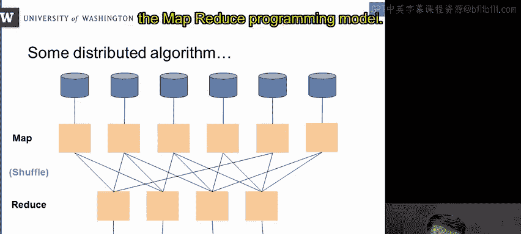

# 大规模数据科学（第1课）📊：更一般的分布式算法


在本节课中，我们将学习一种通用的分布式算法模式，用于处理海量文档并生成统一的词频统计结果。我们将从具体问题出发，逐步理解如何将计算任务分解、分发并最终汇总。

---

## 问题回顾与目标设定

上一节我们讨论了如何将数百万份文档分发到多台计算机上进行初步处理。本节中，我们来看看如何将分散在各处的中间结果汇总成一个全局的、统一的词频直方图。

你拥有数百万份文档，并将它们分发到了 K 台计算机上。你提供了一个函数，能将每份文档映射成一组（单词， 频率）对。但现在你面临一个新问题：你得到了一个分布在集群中许多计算机上的巨大数据集，你需要将所有信息整理合并，以得到最终所需的那个词频直方图。

你不想要一堆小直方图，你想要一个完整的大直方图。为了生成这个大直方图，你需要确保：对于任何一个单词（例如“Parliament”），它的所有出现记录都集中在**同一台**计算机上。这样，该计算机就拥有足够的“管辖权”来独立完成计数，无需再与其他计算机通信。

## 核心挑战：数据重分布

我们已将文档分发到 K 台计算机，并应用了映射函数，得到了一个分布式的单词频率列表。现在，假设我们有4台计算机来负责最终的计数汇总。

以下是实现数据重分布的关键步骤：

我们需要一个函数，能够将特定单词的所有出现记录发送到同一台指定的计算机。例如：
*   将所有红色单词（代表“Parliament”）的出现记录发送到计算机A。
*   将所有绿色单词（代表“government”）的出现记录发送到计算机B。
*   将所有蓝色单词（代表“people”）的出现记录发送到计算机C。

这个函数就是**哈希函数**。它根据单词本身的值，计算出一个目标计算机的ID（例如0, 1, 2, 3）。程序员通常无需自己编写这个哈希函数，因为它足够通用，可以被内置到系统中。

## 通信与最终计算

在映射阶段产出数据的每台计算机，可能需要将数据发送给所有参与最终汇总步骤的计算机。这就形成了一个大规模的、多对多的分布式通信步骤，数据像喷雾一样被分发到负责最终计算的计算机上。

此时，负责汇总的计算机便拥有了完整的“管辖权”。例如，负责“government”的计算机可以确信自己拥有该单词的所有出现记录，因此可以独立地完成计数并输出最终结果。

于是，我们得到了分布式的最终直方图。所有计算都是并行进行的，因此我们可以通过增加大量计算机来扩展系统。

## 通用模式：Map与Reduce

这里的核心在于，这种“对分布式数据应用函数 -> 使用哈希函数在网络中分发数据 -> 合并相同值”的模式频繁出现，以至于将其抽象到系统底层非常有用。这可以将程序员的任务简化为只编写两个简单的函数：

1.  **Map函数**：处理单个数据项。在我们的例子中，它将文档映射为（单词， 频率）对。
    ```python
    # 伪代码示例
    def map_function(document):
        word_counts = {}
        for word in document.split():
            word_counts[word] = word_counts.get(word, 0) + 1
        for word, count in word_counts.items():
            emit(word, count)  # 输出键值对
    ```

2.  **Reduce函数**：对与特定**键**相关联的一组值进行聚合、组合或归约操作。在我们的例子中，它负责累加某个单词的所有计数。
    ```python
    # 伪代码示例
    def reduce_function(word, list_of_counts):
        total_count = sum(list_of_counts)
        emit(word, total_count)  # 输出最终结果
    ```

而中间那个**Shuffle**步骤（即基于哈希的数据重分发）是通用的，由系统自动提供。你无需考虑它，只需设计好你的Map和Reduce函数，让它们协同工作以产生你想要的结果。

**公式表示核心思想：**
`最终结果 = Reduce( Shuffle( Map( 原始数据 ) ) )`

这就是**MapReduce系统**和**MapReduce编程模型**的本质。我们将在接下来的课程中更详细地讨论它。

---

## 总结



本节课中，我们一起学习了如何从具体的词频统计问题，抽象出通用的MapReduce分布式算法模式。我们理解了通过Map函数进行本地处理，通过Shuffle阶段（基于哈希）将相同键的数据汇集，再通过Reduce函数进行全局聚合的核心流程。这种模式将复杂的分布式通信细节隐藏于系统底层，让程序员能够专注于业务逻辑（Map和Reduce函数）的编写，从而高效地处理大规模数据集。