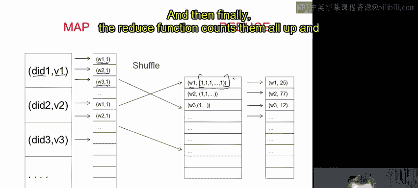

# 大规模数据科学（大数据操作，第1课/共3课） - P52：MapReduce抽象 🧩

在本节课中，我们将深入探讨MapReduce编程模型的核心抽象概念。我们将通过经典的“词频统计”示例，详细解析MapReduce的工作流程、各个阶段的任务分配以及设计时需要考虑的权衡因素。

---

## 从并行处理到MapReduce

上一节我们介绍了并行处理，作为理解MapReduce的铺垫。我们最终得到了一个示意图。

在这个统计一组文档中词频的示例中——这是开始思考MapReduce编程的一个典型例子——每一根垂直的黑线代表一个文档。

我们将这些文档分割成较小的集合，并将每个集合发送到一台独立的机器上。然后，我们依次对每个文档应用我们的 **map** 函数。

如果你还记得，map函数接收单个文档，并产生一组 **键值对**。每个键值对包含一个**单词**，以及该单词在该文档中出现的**次数**。

当然，你可以想象这个过程的多种变体。

现在，同一个单词可能出现在多个文档中——可能在这台机器上出现一次，在那台机器上也出现一次，等等。因此，我们需要将它们全部汇集到一台机器上，以便进行统计。这正是 **shuffle（混洗）** 阶段所做的事情。

## 任务数量与资源分配

这里我画了四个不同的任务。看起来它每次处理一个组，但我想让你思考：我们会有多少个map任务？又会有多少个reduce任务？

*   **Map任务的数量**：每个文档对应一个。我们必须为每个文档调用一次map函数。因此，map函数的调用次数等于文档的数量。
*   **Reduce任务的数量**：这取决于map函数输出的分组数量。在这个例子中，每个在任意文档中出现的唯一单词对应一个分组。

从某种意义上说，我们解决这个问题所需的机器数量在map阶段是可以预测的，因为它对应于输入数据集的大小（我们假定已知）。但所需的reducer数量可能无法事先确定，因为它取决于map输出的规模。在这个例子中，我们或许可以推理，因为我们知道英语大概有多少单词，并且可以假设在足够大的数据集中，所有单词至少会出现一次。但一般来说，它依赖于map的输出，所以你无法真正预知。

我想指出的重点是：我们在这里决定将其画成四台不同的机器，但它可能是map阶段使用的同一批六台机器，也可能是一千台机器。没有什么能阻止你将所有单词的出现记录发送到一台机器上，让这台机器先处理绿色组，再处理红色组，然后处理蓝色组，依此类推。或者，因为机器有四个核心，你可以同时处理四组。

但这可能效率不高，因为它会做很多串行工作。另一个极端是，你可能认为我们需要数百万个任务，那就分配数十万台机器来处理，这样每台机器只做很少的工作。这可能说得通，但代价可能是启动所有这些机器、为它们准备工作所花费的开销。因此，这里存在一个需要权衡的决策，我们稍后会再讨论。

## 深入理解MapReduce抽象

我之所以详细阐述这一点，是希望你们开始用MapReduce的思维方式思考遇到的每一个问题：如果数据集**极其庞大**，一台机器无法处理，我们该如何将其分割成块？一个非常好的思考如何分割问题的方法，就是设想你会如何编写一个MapReduce程序来完成你想做的事情。

这仍然是同一个例子，只是用不同的方式绘制。这里的输入是**文档ID**，后跟一个**值**，这个值就是文档的完整文本。

map函数（为了清晰起见）产生一组东西，而不仅仅是一个。然后它们经过shuffle阶段，产生中间结果：例如“单词1”出现1次，“单词2”出现1次，“单词3”出现1次，等等。

在另一侧，我们得到的是“单词1”及其对应的**一组**所有出现次数记录：1, 1, 1, 1...。最后，**reduce函数**统计所有这些次数，并得出总共有25次出现的结论。

---

## 总结

本节课中，我们一起学习了MapReduce的核心抽象。我们通过词频统计的例子，详细剖析了map、shuffle和reduce三个阶段的分工与协作。我们了解到map任务的数量由输入数据决定，而reduce任务的数量则取决于map输出的中间键的多样性。同时，我们也初步探讨了在分布式计算中，任务粒度与资源开销之间的重要权衡。掌握这种“分而治之”的编程思维，是处理大规模数据集的关键第一步。