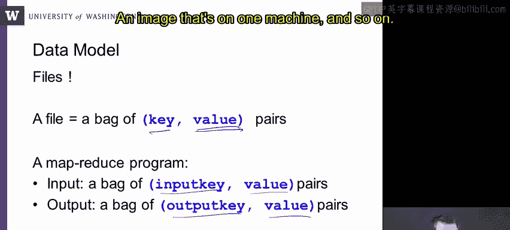

# 大规模数据科学（大数据操作，第1课/共3课） - P53：MapReduce数据模型 🗺️➡️🧮

在本节课中，我们将要学习MapReduce编程模型的核心概念，特别是其数据模型。我们将了解MapReduce如何通过简单的抽象来处理大规模数据，并理解其关键组成部分。

---

上一节我们介绍了并行计算的基本思想，本节中我们来看看MapReduce的具体数据模型是如何定义的。

MapReduce是2004年一篇论文中描述的编程模型。如今，当人们谈论MapReduce的流行时，有时会忽略该论文中提出的几个关键动机。我们稍后将讨论这两个好处。

需要认识到的一点是，MapReduce指的是这个抽象概念本身，它是2004年那篇论文作者赋予的名称。Hadoop是几年后出现的MapReduce的一个实现，最初由雅虎的一些人编写，后来成为一个由Apache管理、拥有众多贡献者的开源产品。

MapReduce的核心思想确实是这个编程模型。它当时也附带了一个系统，但编程模型能够表达许多不同的任务，并且有某种实现能自动将其转换为并行作业，这被证明是非常强大的。这是一种有吸引力的编写并行程序的方式，因为你实际上不必担心并行性。你只需编写一个串行的map函数和一个串行的reduce函数，并行性就会自动实现。

这更多是关于编程模型而非系统的证据是，你可以在其他上下文中看到MapReduce的实现。有人在GPU上实现了MapReduce，有共享内存多核机器上的MapReduce，有人在高性能计算平台上实现了MapReduce，甚至在手机群组上也有实现。这回到了本课程的一个动机，即我希望尽可能关注抽象而非工具。因此，我们讨论的是MapReduce编程模型，但我们会花较少时间在具体的Hadoop实现上，尽管你将有机会在一个可选作业中直接使用Hadoop。

那么，MapReduce的数据模型是什么？就是这样：**键值对的集合**。这里的“集合”指的是一个可能包含重复项的集合。我们之前见过，文档ID及其值构成一个键值对。有时在输入上我们会稍微宽松一些，不精确地指定键和值是什么。例如，如果只给你一条记录，你可以假设整个记录是键，或者一个文档。有时我们甚至可能没有明确的文档ID，但你可以假设URL或文件名等是键。

然而，对于映射器的输出，键和值之间的区别变得非常重要，因为这正是控制洗牌过程的关键，正如我们在示例中看到的那样。因此，这里的数据模型完全是关于键值对的。输入将是一组键值对，输出也将是一组键值对。关键在于，这组键值对可以任意变大，我们将能够处理这个集合，无论它变得多大。这里有一个隐含的假设，即键和值都是“小”的。“小”在这里不一定意味着非常非常小，只是它需要能放在一台机器上。如果值增长到TB级别，系统将无法工作，因为没有相应的支持。因此，一个能放在一台机器上的文档是可以的，一张能放在一台机器上的图像也是可以的。

---

本节课中我们一起学习了MapReduce数据模型的核心：**键值对的集合**。我们明确了MapReduce作为编程模型与Hadoop作为具体实现的区别，理解了键值对在控制数据分发（洗牌）中的关键作用，并认识了数据模型中对数据大小的隐含假设。下一节我们将深入探讨Map和Reduce函数的具体工作流程。