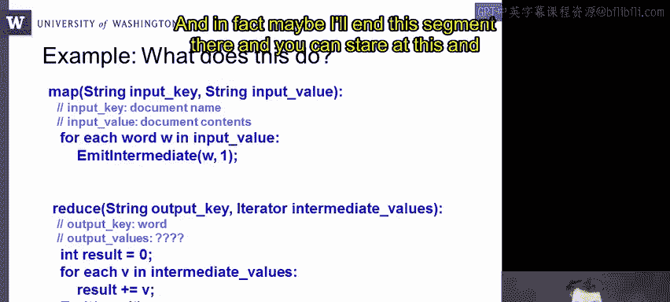

# 课程名称：大规模数据科学（大数据操作，第1课／共3课） - P54：Map与Reduce函数详解 🗺️➡️🧹


在本节课中，我们将要学习MapReduce编程模型中的两个核心函数：`map`函数和`reduce`函数。我们将详细解释它们各自的输入、输出以及在整个数据处理流程中的作用。

---

## 概述

MapReduce是一种用于处理大规模数据集的编程模型。它通过将复杂的计算任务分解为两个主要阶段——`map`（映射）阶段和`reduce`（归约）阶段——来简化并行处理。本节将深入探讨这两个函数的定义和工作原理。

---

## Map阶段详解

上一节我们介绍了MapReduce的整体框架，本节中我们来看看`map`函数的具体细节。

`map`函数是MapReduce模型的第一阶段。它的输入是一个键值对，输出则是一组中间键值对。重要的是，一个输入可以产生多个输出，这在处理如文档分词等任务时非常有用。

以下是`map`函数的定义：
```python
def map_function(in_key, in_value):
    # 处理逻辑
    # 输出一组 (intermediate_key, intermediate_value) 对
    return [(intermediate_key1, intermediate_value1), (intermediate_key2, intermediate_value2), ...]
```

**核心概念**：
*   **输入**：一个输入键（`in_key`）和一个输入值（`in_value`）。
*   **输出**：一个中间键值对的集合（通常称为“包”或列表）。例如，在词频统计中，输入一篇文档，输出可以是多个 `(单词, 1)` 这样的键值对。

---

## Reduce阶段详解

了解了`map`函数如何生成中间数据后，我们来看看`reduce`函数如何处理这些数据。

`reduce`函数接收由`map`阶段产生的、具有相同中间键的所有值。系统会自动将所有相同键的值分组，并传递给同一个`reduce`函数实例进行处理。

以下是`reduce`函数的定义：
```python
def reduce_function(intermediate_key, list_of_values):
    # 处理逻辑，例如对值进行求和、计数等操作
    # 输出最终结果列表
    return [final_value1, final_value2, ...]
```

**核心概念**：
*   **输入**：一个中间键（`intermediate_key`）和与该键关联的所有值的列表（`list_of_values`）。
*   **输出**：一个最终值的列表。这些值可能来自任何`map`任务实例，系统会自动完成分组。
*   **实现细节**：传递给`reduce`函数的值集合，在具体实现上可能是一个列表、迭代器或其他可遍历对象，但这不影响其作为值集合的概念理解。

---

## 函数总结与术语起源

现在，我们已经分别了解了`map`和`reduce`函数。让我们将它们放在一起总结，并了解其术语的起源。

下图清晰地展示了两个函数的输入输出关系：


**函数总结公式**：
*   **Map**: `(in_key, in_value) -> list((intermediate_key, intermediate_value))`
*   **Reduce**: `(intermediate_key, list(intermediate_value)) -> list(out_value)`

**术语起源**：`map`和`reduce`这两个术语源于函数式编程社区。`map`意指将一个函数“映射”应用到集合的每个元素上（例如，将一系列TIFF图像文件转换为PNG格式），`reduce`则意指将集合中的元素通过某种操作“归约”为一个或一组汇总结果。MapReduce模型的设计灵感来源于此，尽管其具体含义并不完全等同。

---

## 代码示例与思考练习

理论需要结合实践来巩固。以下是针对我们讨论的示例（如词频统计）的可能实现代码。

建议你花点时间仔细阅读并思考这段代码，理解其每一步的作用。虽然我们已经通过示例讲解了很多，但亲自梳理一遍仍然非常有指导意义。



（此处可插入具体的伪代码或Python示例，例如分词和计数的`map`/`reduce`函数实现）

---

## 总结

本节课中我们一起学习了MapReduce模型的核心：`map`函数和`reduce`函数。
*   `map`函数负责将输入数据转换为中间键值对。
*   `reduce`函数负责将具有相同键的中间值进行合并处理，产生最终输出。
*   系统自动处理了中间数据的排序、分组和分发，使程序员能够专注于这两个核心的业务逻辑函数。


理解这两个函数是掌握MapReduce并行计算模型的基础。在接下来的课程中，我们将看到如何将它们应用于更复杂的实际场景。