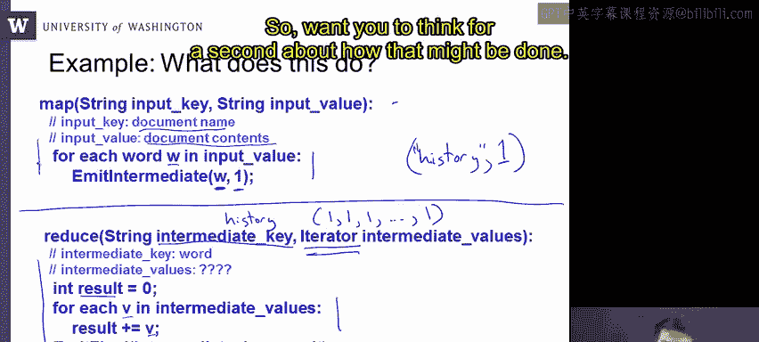

# 大规模数据科学（第1课） - P55：MapReduce简单示例 🧮


在本节课中，我们将学习MapReduce编程模型，并通过一个具体的“词频统计”示例来理解其工作原理。我们将分析伪代码实现，并探讨如何优化其性能。

---

上一节我们介绍了MapReduce的抽象概念和一些图示示例。本节中，我们将深入查看实现词频统计应用的伪代码，并分析其具体执行过程。

以下是该MapReduce应用的伪代码，它实现了我们之前讨论的词频统计功能。请注意，这是无法直接执行的伪代码，仅用于描述逻辑。

**Map函数：**
```python
function map(String key, String value):
    // key: 文档名称
    // value: 文档内容
    for each word w in value:
        EmitIntermediate(w, "1");
```

**Reduce函数：**
```python
function reduce(String key, Iterator values):
    // key: 一个单词
    // values: 该单词对应的计数列表（均为“1”）
    int result = 0;
    for each v in values:
        result += ParseInt(v);
    Emit(key, AsString(result));
```

现在，我们来逐步解析这段代码的执行流程。

输入数据模型是键值对集合。在本例中，键是文档名称，值是文档内容。Map函数接收一个这样的键值对。

Map函数遍历文档内容中的每一个单词。对于每个单词`w`，它输出一个中间键值对，其中键是单词本身，值是字符串“1”。这表示该单词出现了一次。

神奇的Shuffle阶段随后接管工作。它将所有中间键值对按键（即单词）进行分组。拥有相同键的所有值会被收集到一起，形成一个列表。

例如，单词“history”在多个文档中出现后，Shuffle会生成类似这样的分组：键为“history”，值是一个包含多个“1”的迭代器。

Reduce函数接收一个分组。它初始化结果`result`为0，然后遍历该单词对应的所有值（即一堆“1”），将它们转换为整数并累加到`result`中。最后，它输出最终的键值对，键是单词，值是累加后的总计数（例如 `("history", 25)`）。

---

通过以上分析，我们已经清楚了基础MapReduce词频统计的实现。然而，当前的Map函数为每个单词都发射一个“1”，这会产生大量中间数据。

现在，请你思考一下：**在不修改Reduce函数的前提下，如何改变Map函数来显著提升这个算法的计算效率？**

---



本节课中，我们一起学习了MapReduce模型在词频统计任务上的具体实现。我们分析了Map和Reduce阶段的伪代码，并理解了数据从输入、映射、混洗到归约的完整流程。最后，我们提出了一个关于优化Map函数性能的思考题，为后续深入探讨性能调优奠定了基础。