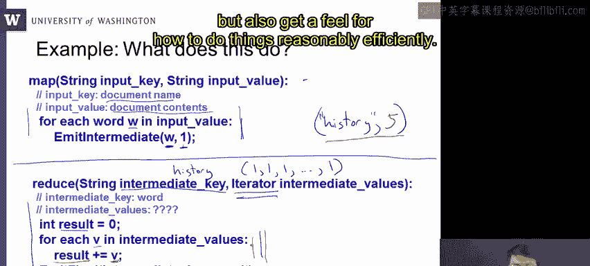

# 大规模数据科学（大数据操作，第1课／共3课） - P56：MapReduce简单示例（续）🔍

在本节课中，我们将继续探讨MapReduce编程模型，重点分析如何通过优化Map和Reduce函数来提升算法性能。我们将通过一个具体的词频统计示例，学习如何减少网络传输的数据量，从而设计出更高效的MapReduce算法。

---

上一节我们介绍了MapReduce的基本概念和简单词频统计的实现。本节中，我们来看看如何通过优化Map阶段的输出来提升整体性能。

观察下图所示的初始实现，其核心问题在于Map函数为每个单词的每次出现都发射一个键值对。

这里需要关注的是，我们为特定单词的每一次出现都发射一个键值对。每一个这样的键值对都必须通过网络进行洗牌，然后发送给Reducer。

因此，如果我们在单个文档中看到单词“history”出现25次，我们将为该单词发射25个键值对，它们都将在洗牌阶段被分组到一起。

但是，我们在这个Map函数中可以访问整个文档。那么，为什么不预先统计这些单词的所有出现次数，并产生一个不同的键值对呢？

以下是优化思路：我们可以在Map阶段对每个文档内的单词进行本地聚合。

于是，我们改为声明：单词“history”在这个特定文档中出现了5次（或其它次数）。现在，对于单词“history”，从这个文档中只产生一个键值对，而不是五个不同的键值对。

总体而言，在应用于此问题的所有计算机上的所有文档中，这将带来显著的性能节省。

接下来，需要仔细检查以确保不必更改Reduce端的代码。希望这一点是清晰的，因为您是将总值累加到结果中。

在Reduce端，您不再是将数字1累加25次，而是累加更少的次数。例如，您将累加5 + 10 + 3 + 4 等等，最终得到25。因此，这个循环被评估的次数更少。

我之所以想详细讲解这个示例，是为了说明两点。

第一，是尝试以MapReduce的思维方式思考，考虑如何将一个问题转化为对多个数据块进行操作、发射键来定义分组，然后对这些分组进行操作。

第二，是说明您实际上可以通过仅仅修改Map和Reduce函数，对这些算法的性能进行大量控制。即使您不处理系统内部机制，只有这两个控制点，您实际上也可以得到非常不同的算法、非常不同的行为，以及产生不同数量的中间结果等等。

仅仅通过这两个函数，您就可以实现这些。因此，您不仅需要了解如何以最直接的方式在MapReduce中表达算法，还需要了解如何以合理高效的方式处理问题。

事实上，这个示例展示了您需要寻找的一个关键点：瓶颈通常（并非总是）在于通过网络传输的数据量。

因此，如果您能减少Mapper产生的输出量，特别是在键值对的数量方面，您往往能提高性能（同样，并非总是如此）。我们将在后续看到更多这方面的例子。

我将在此暂停。在下一节中，我们将探讨一个具有类似特征但略有不同的问题变体，以进一步巩固如何针对不同问题设计MapReduce算法。

---

本节课中我们一起学习了如何通过优化MapReduce的Map函数来减少中间数据的网络传输，从而提升作业性能。核心在于利用Map阶段对数据进行本地预聚合，减少发射的键值对数量。理解这种优化模式，对于设计高效的大规模数据处理算法至关重要。