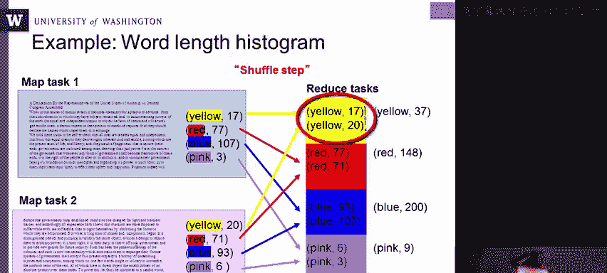
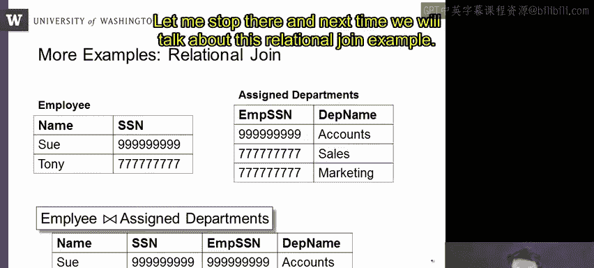

# 大规模数据科学（大数据操作，第1课／共3课） - P58：MapReduce示例：倒排索引、连接 📊


在本节课中，我们将学习MapReduce编程模型的两个核心应用示例：词长统计与倒排索引构建。我们将通过具体的输入输出示例，理解Map函数和Reduce函数的设计思路，并体会MapReduce模式的通用性。

---

## 词长统计示例 📏

上一节我们介绍了经典的词频统计（Word Count）示例。本节中我们来看看一个它的简单变体：词长统计。这个任务的目标是统计文档中不同长度（或类别）单词的出现次数。



假设我们有一个简单的分类规则：根据单词长度将其归类为“黄色”、“红色”、“蓝色”或“粉色”词。输入数据是文档块，Map任务需要处理这些块。

以下是Map阶段的工作原理：

1.  Map任务读取一个文档块。
2.  对于块中的每一个单词，计算其长度。
3.  根据长度，使用一个条件判断（如 `case` 语句）确定该单词对应的颜色类别。
4.  为每个类别输出一个键值对，其中**键**是颜色（如“黄色”），**值**是初始计数 `1`。

其核心逻辑可以用伪代码描述：
```python
def map(document_chunk):
    for word in document_chunk:
        length = len(word)
        color = determine_color(length) # 例如，根据长度判断颜色
        emit(color, 1)
```


如图所示，第一个文档块（Chunk 1）被分配给Map任务1，它处理后会生成一个关于“黄色”、“红色”、“蓝色”和“粉色”单词的初始计数直方图。第二个文档块（Chunk 2）进行同样的处理，生成另一组四个键值对。

在Shuffle阶段，所有相同颜色的键值对会被分组到一起。例如，所有键为“黄色”的键值对会汇集到同一个Reducer。

在Reduce阶段，Reducer的任务非常简单：对于每一个颜色键，将其对应的所有数值（都是 `1`）相加。例如，如果两个Map任务都输出了“黄色”，那么Reducer会收到两个 `(“黄色”, [1, 1])`，相加后得到最终结果 `(“黄色”, 2)`。


这个示例的结构与词频统计完全相同，只是修改了Map函数中的逻辑。值得注意的是，Reduce函数可以完全复用词频统计中的加法函数。这体现了MapReduce的一个特点：某些Reduce函数（如求和、计数）具有通用性，会在多种算法中反复使用。

---

## 倒排索引示例 🔍

理解了词长统计后，我们来看另一个重要的应用：构建倒排索引。这是搜索引擎等文本检索系统的核心步骤之一。

假设我们有一个文档（或推文）集合。通常，我们可以通过文档ID（如URL）高效地访问特定文档。而倒排索引则提供反向查找能力：给定一个单词，它能快速返回所有包含该单词的文档ID列表。

我们的输入数据是推文，其中**键**是推文ID，**值**是推文文本本身。期望的输出是：每个单词，以及包含该单词的所有推文ID的集合。

以下是构建倒排索引的MapReduce步骤：

1.  **Map阶段**：对于每一条推文，遍历其中的每一个单词。对于每个单词，输出一个键值对，其中**键**是该单词，**值**是当前推文的ID。
    *   这里可以进行一个优化：如果同一个单词在一条推文中出现多次，Map函数只需输出一次 `(word, tweet_id)` 即可，因为索引只关心推文是否包含该单词，而不关心出现的次数。
    *   伪代码如下：
        ```python
        def map(tweet_id, tweet_text):
            words = extract_unique_words(tweet_text) # 提取唯一单词
            for word in words:
                emit(word, tweet_id)
        ```

2.  **Shuffle阶段**：系统将所有相同单词的键值对分组。例如，所有键为“pancake”的 `(“pancake”, tweet_id)` 会被送到同一个Reducer。

3.  **Reduce阶段**：Reducer接收到一个单词（键）和对应的推文ID迭代器（值）。在这个特定任务中，Reduce函数几乎不需要做任何处理！因为Shuffle阶段完成的**分组操作**本身就已经产生了我们想要的结果——一个单词及其对应的推文ID列表。Reducer可以直接将这个列表作为最终值输出。

这种模式在MapReduce中也很常见：我们主要利用Map阶段进行数据转换，利用Shuffle阶段进行关键的分组，而Reduce阶段可能只是一个简单的“直通”操作，或者完全不需要。

这与传统关系型数据库的范式不同。在关系数据库中，一个单元格内通常不允许嵌套集合（这违反了第一范式）。但在MapReduce的键值对模型中，**值**可以是任意结构，包括列表或集合，这为处理复杂数据提供了极大的灵活性。



---

## 总结 📝

本节课中我们一起学习了两个MapReduce核心示例。

*   我们首先分析了**词长统计**，它是词频统计的变体，演示了如何通过修改Map函数来适应新的分类逻辑，同时复用通用的Reduce函数。
*   接着，我们深入探讨了**倒排索引**的构建过程。这个例子展示了MapReduce如何优雅地处理“分组”需求：Map阶段生成 `(单词, 文档ID)` 对，Shuffle阶段自动按单词分组，而Reduce阶段有时只需输出已分组的列表即可。


这两个例子体现了MapReduce模型的强大与灵活：通过定义不同的Map和Reduce函数，可以解决多种大规模数据处理问题。下次课我们将探讨MapReduce在实现关系型**连接（Join）** 操作中的应用。