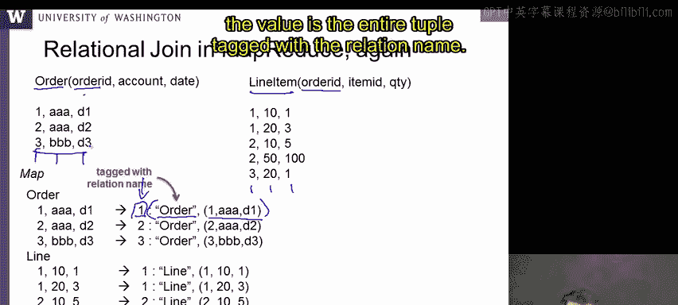

# 大规模数据科学（大数据操作，第1课／共3课） - P60：关系连接的Reduce阶段 🧩

在本节课中，我们将学习MapReduce框架中实现关系连接操作的**Reduce阶段**。我们将详细探讨在“魔法洗牌”阶段之后，数据如何被分组，以及Reduce函数如何利用这些分组数据来生成最终的连接结果。

---

上一节我们介绍了Map阶段如何为连接操作准备数据。本节中我们来看看在“魔法洗牌”阶段之后，Reduce阶段如何完成连接的计算。

在“魔法洗牌”阶段，所有具有相同键的记录会被集中到一起。因此，现在你会为每一个唯一的键调用一次Reduce函数。例如，会为键“9”调用一次，为键“7”调用一次。

与该键关联的值列表将包含所有共享此连接键的元组。这些元组来自哪个关系并不重要，它们都会出现在这个列表中。例如，对于某个键，我们可能得到一个来自`employee`关系的元组和一个来自`department`关系的元组；对于另一个键，可能得到一个来自`employee`的元组和两个来自`department`的元组。

此时，在单台计算机的上下文中，我们已经拥有了计算连接所需的所有数据。更重要的是，每一个Reduce函数的调用都可以在一台独立的机器上执行。这正是我们实现可扩展性的方式。

现在，如果我们要实现一个连接操作，程序需要编写的Reduce函数必须能够：接收这个键以及所有关联的元组，并生成连接后的元组。例如，连接结果中某些属性来自`employee`表，另一些属性来自`department`表。

以下是Reduce函数内部需要实现的操作逻辑：

如果你思考一下需要在这个Reduce函数中实现何种操作，你会发现：你得到了一组来自一个关系的元组，需要将它们与来自另一个关系的每一个可能的元组进行关联。因为根据定义，它们都共享相同的连接键，所以它们都能成功连接。

如果你需要将一个集合中的每个成员与另一个集合中的每个可能成员配对，这本质上是一个**笛卡尔积**操作。因此，我们再次看到关系代数在另一个上下文中出现。

我不想让你感到困惑，但总体而言，我们试图实现的是一个并行连接操作。而恰好，在单个Reduce函数内部，我们识别出这又是一个关系代数操作符——笛卡尔积。这更多是出于抽象层面的理解，而非算法本身的目的，但我想指出这一点。当你戴上关系代数的“有色眼镜”观察时，会发现这些操作符无处不在。

---

为了确保清晰，让我们再举一个例子。假设给你两个关系：`order`和`line_item`。

`order`表包含字段：`order_id`、`account`、`date`。
`line_item`表包含字段：`order_id`、`item_id`、`quantity`。

我们将基于`order_id`进行连接。

Map阶段是什么样的？键仍然是连接键，即`order_id`。值将是一个包含**关系名**和原始元组的配对。虽然具体的结构可能略有不同，但核心是所有信息都在这里：键必须是连接键，值是元组以及一个标识其来源关系的指示符。

这里有一个快速的问题：为什么需要这个关系指示符？

因为在Reduce阶段，如果我不知道哪些元组属于哪个关系，只是有一大捆元组，我将无法正确地生成连接后的元组。理论上，你可能可以通过模式推断来避免显式标记（例如，`employee`表可能先有一个字符串，然后是连接键；`department`表可能是连接键在前），但依赖这种信息有些危险。如果你连接的两个表具有完全相同的模式，就没有明显的方法来区分它们。因此，使用显式标记在这里更安全。

这就是Map阶段的过程：我们将所有记录汇集在一起，生成键值对。其中，键是来自对应关系的连接键（连接属性），值是被标记了关系名的整个元组。

---

本节课中我们一起学习了关系连接在MapReduce框架中的Reduce阶段。我们了解到，“魔法洗牌”将相同键的数据汇集，使每个Reduce任务能独立处理一组键及其关联的所有元组。Reduce函数的核心任务是在本地执行一个笛卡尔积操作，将来自不同关系但共享同一键的元组合并，最终生成连接结果。通过这种方式，连接操作被有效地并行化和规模化。