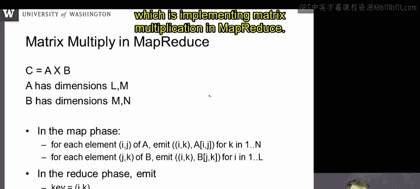

# 大规模数据科学（第1课）📊：简单社交网络分析 - 计算好友数


在本节课中，我们将学习如何使用MapReduce编程模型来解决一个简单的社交网络分析问题：计算社交网络中每个人的好友数量。我们将通过一个具体的例子，将问题分解为Map和Reduce两个阶段，并展示其与经典“词频统计”示例的相似性。

---

## 从连接操作到社交网络分析

上一节我们介绍了MapReduce如何执行连接（Join）操作。本节中，我们来看看一个不同的应用场景：社交网络分析。

假设我们有一个社交网络图，其中每条边代表一种“好友”关系（或在Twitter场景下为“关注”关系）。输入数据是一组边，每条边的语义是“用户A是用户B的好友”。为了简化，我们假设关系是对称的（即如果Jim是Sue的好友，那么Sue也是Jim的好友），这样我们可以避免有向图与无向图带来的混淆。

我们的任务非常明确：计算每个人的好友数量。期望的输出结果如下：
*   Jim: 3
*   Sue: 3
*   Kai: 1
*   Lyn: 2
*   Joe: 1

这个任务的结构，应该让我们联想到之前已经完成过的某个经典示例。

---

## Map阶段：生成键值对

以下是Map阶段需要执行的操作。对于输入数据中的每一条边（即每一条好友关系记录）：
*   我们关注记录左侧的人名。
*   生成一个键值对，其中**键（Key）**是这个人名，**值（Value）**是数字`1`，表示我们为这个人遇到了一个好友。

用伪代码描述这个过程：
```python
def map(record):
    # 假设 record 格式为 “person_a, person_b”
    person_a = record.split(',')[0]
    emit(person_a, 1)
```
经过Map阶段处理后，每条输入记录都被转换成了一个`(人名， 1)`的键值对。

---

## Shuffle与Reduce阶段：汇总计数

接下来，通过MapReduce框架的Shuffle阶段，所有具有相同键（即同一个人名）的值会被分组到一起，传递给同一个Reducer。

以下是Reduce阶段需要执行的操作。对于每一个键（如“Jim”）及其对应的值列表（如`[1, 1, 1]`）：
*   Reducer的任务非常简单，只需将这个列表中的所有值（数字`1`）相加。

用伪代码描述这个过程：
```python
def reduce(key, list_of_values):
    total_count = sum(list_of_values)
    emit(key, total_count)
```
这个Reducer的逻辑与“词频统计”示例中的Reducer完全一致，都是执行求和操作。

---

## 与词频统计的类比

这个计算好友数的过程，本质上与经典的词频统计（Word Count）非常相似。
*   在词频统计中，输入是文档，Map阶段为每个单词生成`(单词, 1)`。
*   在好友计数中，输入是边（好友关系），Map阶段为每条边左侧的人名生成`(人名, 1)`。

之后的过程便完全相同：Shuffle阶段按键分组，Reduce阶段对值列表求和。这展示了MapReduce模型的核心优势——**相同的聚合模式可以应用于多种看似不同的数据处理问题**。

---

## 总结

本节课中，我们一起学习了如何运用MapReduce模型解决“计算社交网络好友数”的问题。我们首先明确了任务目标，然后将其分解为Map和Reduce两个核心阶段：Map阶段从每条关系记录中提取关键人物并标记为`1`，Reduce阶段则对同一人物的所有标记进行求和。通过这个过程，我们再次看到了MapReduce“分组聚合”模式的强大与通用性，它能够将复杂的数据处理任务简化为可并行执行的标准化操作。



在下一节中，我们将探讨一个更具挑战性的任务：如何在MapReduce中实现矩阵乘法。