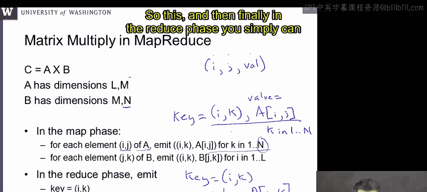

# 大规模数据科学（大数据操作，第1课／共3课） - P62：矩阵乘法概述 🧮

在本节课中，我们将学习如何在MapReduce框架下实现矩阵乘法。我们将从回顾矩阵乘法的基本概念开始，然后介绍一种适用于稀疏矩阵的MapReduce算法。这个算法通过巧妙的数据分发和聚合，能够高效地处理大规模矩阵相乘的问题。

## 回顾矩阵乘法

上一节我们介绍了课程背景，本节中我们来看看矩阵乘法的基本规则。

矩阵乘法要求第一个矩阵的列数等于第二个矩阵的行数。例如，一个 **2行4列** 的矩阵乘以一个 **4行2列** 的矩阵，结果将是一个 **2行2列** 的矩阵。

结果矩阵中每个元素的计算方法如下：它是第一个矩阵的某一行与第二个矩阵的某一列对应元素的乘积之和。具体公式为：

**C[i][j] = Σ (A[i][k] * B[k][j])**，其中 k 从 1 到 M（M是A的列数/B的行数）。

例如，结果矩阵中第一行第一列的元素，是第一个矩阵的第一行与第二个矩阵的第一列进行点积运算的结果。

## 稀疏矩阵表示法

在进入MapReduce算法之前，我们需要理解输入数据的格式。为了高效处理可能包含大量零值的大规模矩阵，我们使用稀疏矩阵表示法。

在这种格式中，矩阵的每个非零元素由一个三元组表示：**(行ID， 列ID， 值)**。如果矩阵中某个位置的值为0，则直接省略该三元组，不存储在数据集中。这种方法可以显著节省存储和计算资源。

我们的MapReduce算法的输入，就是两个以这种三元组集合形式表示的稀疏矩阵。

## MapReduce算法详解

现在，我们来看看如何利用MapReduce实现矩阵乘法。核心思想是将两个矩阵的数据重新组织，使所有需要相乘的元素在Reduce阶段汇聚到同一个键下。

以下是算法的两个主要阶段：

### Map阶段

Map阶段的任务是读取稀疏矩阵的三元组，并为每个元素生成多个中间键值对，为后续的聚合相乘做准备。

对于矩阵A中的每个元素 `(i, j, A_ij)`，我们需要为结果矩阵的每一列（即矩阵B的列数n）生成一个中间键值对。

对于矩阵B中的每个元素 `(j, k, B_jk)`，我们需要为结果矩阵的每一行（即矩阵A的行数L）生成一个中间键值对。

具体操作如下：

*   **处理矩阵A的元素 `(i, j, A_ij)`**:
    *   对于每一个 `k` (从1到n，n是矩阵B的列数)，发射一个键值对。
    *   **键(Key)**: `(i, k)`。这标识了结果矩阵 `C` 中 `C[i][k]` 的位置。
    *   **值(Value)**: `(‘A‘, j, A_ij)`。值中需要包含来源标记‘A‘、列索引`j`和实际值`A_ij`。

*   **处理矩阵B的元素 `(j, k, B_jk)`**:
    *   对于每一个 `i` (从1到L，L是矩阵A的行数)，发射一个键值对。
    *   **键(Key)**: `(i, k)`。同样标识了结果矩阵 `C` 中 `C[i][k]` 的位置。
    *   **值(Value)**: `(‘B‘, j, B_jk)`。值中包含来源标记‘B‘、行索引`j`和实际值`B_jk`。

这个过程可以理解为：将矩阵A的每个值“广播”到结果矩阵对应行的所有列；将矩阵B的每个值“广播”到结果矩阵对应列的所有行。这样，所有对计算 `C[i][k]` 有贡献的 `A[i][*]` 和 `B[*][k]` 都会汇聚到同一个键 `(i, k)` 下。

### Reduce阶段

Reduce阶段接收Map阶段输出的所有具有相同键 `(i, k)` 的键值对列表。这个列表里包含了所有标记为‘A‘和‘B‘的值及其对应的中间索引 `j`。

Reduce任务的目标是计算点积 `C[i][k] = Σ (A[i][j] * B[j][k])`。

以下是计算步骤：
1.  将接收到的值列表按来源标记（‘A‘或‘B‘）和中间索引 `j` 进行分组。
2.  对于每个共同的 `j` 值，找到对应的 `A[i][j]` 和 `B[j][k]`。
3.  将它们相乘。
4.  将所有乘积结果相加，得到最终 `C[i][k]` 的值。
5.  最后，发射最终结果：键为 `(i, k)`，值为计算得到的 `C_ik`。

## 总结

本节课中我们一起学习了利用MapReduce进行矩阵乘法的算法。我们从基础的矩阵乘法规则出发，介绍了适用于大数据的稀疏矩阵表示法。重点在于MapReduce算法的设计：在Map阶段，通过将矩阵元素按特定规则复制并分发到以结果矩阵坐标 `(i, k)` 为键的中间对中；在Reduce阶段，将共享同一键的值聚合起来，执行点积运算，从而得到结果矩阵的每一个元素。这种方法能够有效地将大规模计算任务并行化，是处理大数据集上矩阵运算的经典范例。