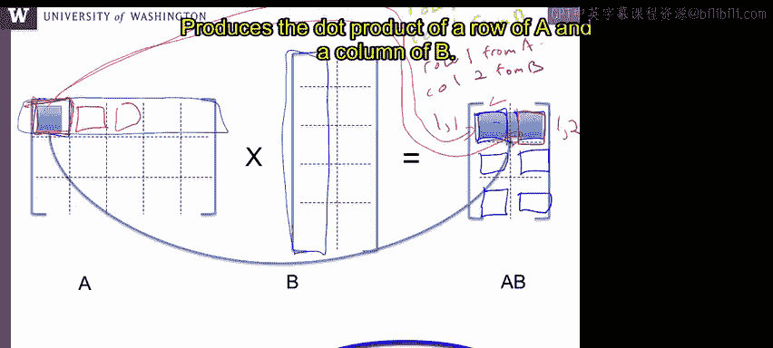

# 大规模数据科学（大数据操作，第1课／共3课） - P63：矩阵乘法图解 🧮


在本节课中，我们将学习如何使用MapReduce框架进行矩阵乘法。我们将通过图解的方式，理解如何将矩阵乘法分解为可并行化的任务，并解释数据在映射器和归约器之间如何流动。

---

## 概述

矩阵乘法是许多科学计算和数据分析任务的核心。当矩阵规模非常大时，传统的单机计算方法会变得低效。MapReduce提供了一种将矩阵乘法并行化的方法。本节我们将图解这一过程，理解每个数据单元如何被处理和路由。

## 算法核心：一个归约器对应一个输出单元

首先需要认识到，在这个算法中，输出矩阵的每一个单元都将对应一个归约器。

例如，对于一个 2x3 的输出矩阵，我们将有六个归约器。当我们处理非常大的矩阵时（例如 10000 x 1000 的维度），这种设计的优势就体现出来了。

**核心概念**：`一个归约器 = 输出矩阵的一个单元格`

## 归约器需要什么数据？

接下来，思考每个归约器需要哪些数据来计算它的结果。

以输出矩阵中位置为 (1,1) 的归约器为例。它需要来自矩阵A第一行的所有值，以及来自矩阵B第一列的所有值。

**公式表示**：
`C[1][1] = dot_product(A[1, :], B[:, 1])`

同理，对于输出位置 (1,2) 的归约器，它需要矩阵A第一行和矩阵B第二列的数据。

**公式表示**：
`C[1][2] = dot_product(A[1, :], B[:, 2])`

## 数据分发面临的挑战

问题在于，输入数据并不是以完整的行或列的形式存储的，而是以一个个独立的单元格形式存在。

因此，我们必须确定每个输入值（如 `a11`）应该被发送到哪里。它需要被发送给所有可能需要它的归约器。

例如，值 `a11`（矩阵A第一行第一列）属于矩阵A的第一行。因此，所有需要矩阵A第一行数据的归约器（即输出矩阵第一行的所有归约器）都需要这个值。这意味着 `a11` 需要被发送到多个地方。

## MapReduce的“复制”技巧

这正是MapReduce可以施展的一个巧妙技巧：映射器可以将一个单一的值复制并发送到多个目的地。

当我说“发送到多个地方”时，并不是指字面意义上通过网络发送多个数据包，而是指**将一个值附加到多个键上**，然后每个不同的键会被路由到不同的归约器。

**代码逻辑示意**：
```python
# 对于矩阵A中的每个元素 A[i][j]
for k in range(num_columns_of_B):
    emit(key=(i, k), value=('A', j, A[i][j]))

# 对于矩阵B中的每个元素 B[j][k]
for i in range(num_rows_of_A):
    emit(key=(i, k), value=('B', j, B[j][k]))
```

通过这个技巧，我们可以安排矩阵乘法并行进行。虽然我们进行了一些数据复制，但这种复制是必要的，并且整个计算过程可以高度并行化。

## 归约阶段：计算点积

最后，每个归约器会收到所有它需要的、来自矩阵A某一行和矩阵B某一列的数据。归约器的任务就是计算这两个向量的点积，从而得到输出矩阵对应位置的值。

**公式表示**：
`C[i][k] = sum_over_j( A[i][j] * B[j][k] )`

---

## 总结




本节课我们一起学习了利用MapReduce进行矩阵乘法的图解过程。我们了解到，通过为输出矩阵的每个单元格分配一个归约器，并利用映射器将输入数据复制并路由到所有需要它的归约器，可以实现大规模矩阵乘法的并行计算。这种方法的核心在于巧妙的数据分发策略，它虽然引入了数据复制的开销，但换来了强大的横向扩展能力，非常适合处理超大规模的数据集。