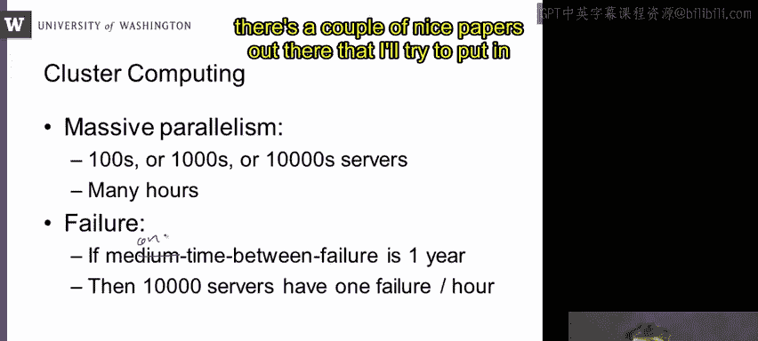

# 大规模数据科学（第1课）📊：无共享计算架构

在本节课中，我们将学习大规模数据处理系统（如MapReduce）所部署的底层硬件架构。我们将重点了解“无共享”架构，并探讨为何它成为处理海量数据的首选方案。

---

## 系统架构类型概述

上一节我们提到了MapReduce的运行环境，本节中我们来看看支撑其运行的三种主要系统架构。理解这些架构有助于我们把握大规模计算的本质。

在以下示意图中，圆柱体代表磁盘，矩形代表内存，圆形代表处理器。

以下是三种主要的并行计算架构：

1.  **共享内存**
    *   所有处理器都能访问全部内存和所有磁盘。
    *   这类似于你的笔记本电脑：如果它是四核（或如今常见的6核、12核）系统，使用的就是这种架构模型。

2.  **共享磁盘**
    *   多台独立的机器访问一个共享的文件系统。
    *   这种设置本身很常见，但用于并行分析领域，则多见于商业数据库系统（如Oracle、IBM的某些系统）。

3.  **无共享**
    *   这是我们本节课的重点，也是MapReduce和大多数并行数据库的设计目标。
    *   这意味着各台机器仅通过网络连接，**没有共享内存**，也**没有共享磁盘**。

---

## 为何选择无共享架构？

上一节我们介绍了三种架构，本节中我们来看看为何“无共享”架构在大规模数据处理中占据主导地位。

核心论点是：只有无共享架构能够扩展到成千上万台计算机甚至更多。因为共享内存或共享磁盘最终会成为瓶颈，限制你能连接到同一逻辑或物理设备的计算机数量。

因此，学习如何为这些庞大的无共享集群编程，正是MapReduce和并行数据库技术的核心。

*   **共享内存机器**可能最容易编程，但传统上被认为相当昂贵。不过需要指出，成本正在快速下降，购买一台拥有大量内存和多核心的强劲机器变得越来越可行。你的问题可能恰好能在一台这样的机器内解决。

---

## 大规模集群的上下文与挑战

了解了架构选择后，我们来看看MapReduce实际运行的环境以及随之而来的独特挑战。

我们讨论的上下文是：**大量商用服务器通过高速商用网络连接**。你可以想象一个数据中心：机柜里有多台服务器，数据中心里又有多个机柜，成千上万台计算机就是这样组织起来的。

我们寻求的是**大规模并行计算能力**，能够运行即使在数千或数万台服务器上也需要许多小时才能完成的任务。

在这种规模下，一个在较小规模场景中不常出现的问题变得至关重要：**故障**。如果你在数千台计算机上长时间运行一个作业，在此期间发生故障的概率**几乎为100%**。你的处理系统必须能够容忍这类故障，不能每次一有故障就回滚到起点重启，否则你将永远无法完成任何任务。

即使单个磁盘的平均故障间隔时间（MTBF）是一年，如果你有10，000台服务器（假设每台服务器有多个磁盘），你也会开始遇到大约每小时一次的故障率。你可以查阅平均故障间隔时间并实际计算，有几篇不错的论文讨论了这一点（我会尽量记得将其列入阅读材料）。

---

## 总结

本节课中我们一起学习了大规模数据处理系统的底层架构。我们了解了共享内存、共享磁盘和无共享三种架构，并重点探讨了为何无共享架构因其卓越的可扩展性而成为MapReduce等系统的设计基础。我们还认识到，在由成千上万台廉价商用硬件组成的大规模集群中，硬件故障是常态而非例外，因此系统必须具备容错能力。这正是像MapReduce这样的编程模型需要解决的核心问题之一。