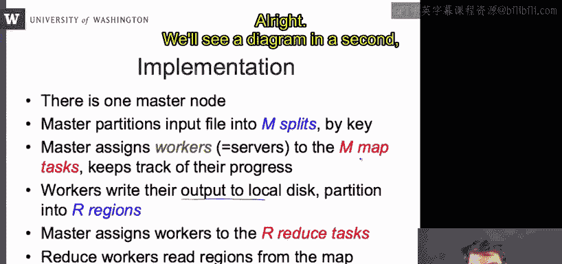

# 大规模数据科学（大数据操作，第1课／共3课） - P65：MapReduce实现详解 🧩

在本节课中，我们将深入探讨MapReduce计算模型的具体实现机制，重点关注其如何在一个由普通硬件构成的分布式集群上可靠地处理大规模数据。我们将从底层分布式文件系统开始，逐步向上解析MapReduce作业的执行流程。

## 分布式文件系统（DFS）基础

上一节我们介绍了MapReduce的编程模型，本节中我们来看看支撑其运行的底层存储系统。MapReduce通常运行在分布式文件系统之上，例如HDFS（Hadoop分布式文件系统）。其核心设计目标是管理超大规模文件并容忍硬件故障。

以下是分布式文件系统的关键特性：

*   **大文件分块**：单个超大文件在上传到集群时，会被自动分割成固定大小的数据块（例如64MB）。这些数据块被分散存储在不同机器上。
*   **数据块复制**：每个数据块会被复制多份（例如3份），并存储在不同机器、甚至不同机架上。这样，即使某台机器或整个机架发生故障，数据依然可用。
*   **主要实现**：其概念对应DFS，而具体实现包括Google的GFS和开源的HDFS。

## MapReduce架构与执行流程

理解了数据如何存储后，我们现在进入核心部分：MapReduce作业是如何在集群上调度和执行的。整个系统由一个主节点（Master）和众多工作节点（Worker）协同工作。

以下是MapReduce执行过程的关键步骤：

1.  **主节点（Master）**：负责协调整个作业。它掌握所有输入数据块的位置信息，并负责任务的分配与监控。
2.  **Map阶段**：主节点为输入文件的每一个数据块（Split）分配一个Map任务（Map Task）。一个Map任务会处理对应数据块中的所有记录，为每条记录调用一次用户定义的Map函数。Map任务运行在存储该数据块副本的机器上，以实现“计算向数据移动”。
3.  **中间输出**：每个Map任务将其产生的中间键值对输出写入**本地磁盘**，而不是回写到HDFS。这些输出会根据Reduce任务的数量进行分区（Partition），确保相同键的数据进入同一个分区。
4.  **Reduce阶段**：主节点为每个分区启动一个Reduce任务（Reduce Task）。Reduce任务通过网络从各个Map任务的本地磁盘上“拉取”（Shuffle）属于自己分区的所有中间数据。
5.  **Reduce计算**：每个Reduce任务对拉取到的数据进行排序和分组，然后为每个唯一的键调用一次用户定义的Reduce函数，并将最终结果输出（通常写入HDFS）。

## 容错机制设计

MapReduce实现的核心优势在于其内置的容错能力，这使得它能在由廉价、不可靠硬件组成的大规模集群上稳定运行。

其容错设计基于以下原则：

*   **中间结果持久化**：Map任务将输出写入本地磁盘。这样，如果某个Reduce任务失败，只需重新执行该Reduce任务，并从Map任务的本地磁盘重新拉取数据即可，无需重新执行所有Map任务。
*   **任务级重试**：如果某个Map任务所在的机器彻底宕机，由于中间结果只存储在本地，该Map任务需要从头重新执行。但得益于数据块的冗余存储，主节点可以轻松地将该任务调度到存有同一数据块副本的其他机器上执行。这仅影响单个任务，而非整个作业。
*   **主节点高可用**：通常通过主节点元数据备份和快速恢复机制来应对主节点故障（图中未展开，但实际部署中会考虑）。

## 总结

本节课中我们一起学习了MapReduce的具体实现架构。我们从底层的分布式文件系统（HDFS）出发，了解了数据如何被分块和复制以实现可靠存储。接着，我们剖析了MapReduce作业的执行流程，明确了主节点、Map任务和Reduce任务各自的职责，以及关键的Shuffle阶段。最后，我们探讨了其核心的容错机制，理解了通过将中间结果写入本地磁盘和任务级重试，MapReduce能够优雅地处理集群中常见的节点故障问题。这套设计使得大规模数据批处理变得既高效又可靠。