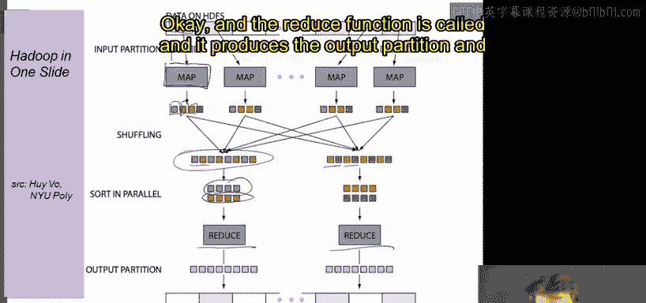
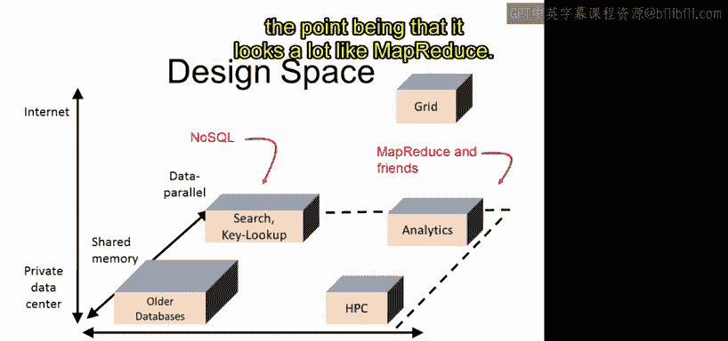

# 杜克大学《大规模数据科学》第1课：MapReduce阶段详解 🗺️➡️🧹


在本节课中，我们将深入学习MapReduce的具体执行阶段。我们将从HDFS读取数据开始，一步步跟踪数据经过映射、组合、排序、归约，最终写回HDFS的完整流程。理解这些阶段对于掌握大数据处理的核心机制至关重要。

上一节我们介绍了MapReduce的编程模型，本节中我们来看看其更详细、更具体的执行阶段。

## 执行阶段概述

MapReduce作业的执行包含一系列精心设计的阶段，以确保大规模数据处理的可靠性和效率。

以下是MapReduce作业从开始到结束的详细步骤：

1.  **文件分片读取**：作业从HDFS（Hadoop分布式文件系统）读取一个文件分片。HDFS是复制的，意味着每个数据块都有多个副本。
2.  **记录读取**：一个称为“记录读取器”的代码单元将分片（或数据块）解析为单独的记录。
3.  **映射函数执行**：程序员的映射函数在每个单独的记录上被调用。
4.  **组合阶段**：这是一个我们尚未讨论的步骤，用于在数据发送前进行本地聚合，稍后会详细解释。
5.  **中间输出写入**：这些阶段的输出被写入到该计算节点的本地存储中。
6.  **数据传输**：本地存储中按键分区的“区域”通过网络被归约阶段拉取。
7.  **排序与合并**：来自所有不同映射任务、对应相同键的区域被并行地排序和合并在一起。
8.  **归约函数执行**：调用用户的归约函数以产生最终输出。
9.  **最终输出写入**：该步骤的输出被写回HDFS，从而获得复制和持久化。

再次强调，如果在映射阶段出错，需要重新运行映射器；如果在归约阶段出错，可以从映射阶段的本地存储中拉取输出并重新运行归约器。负责协调整个作业的机制确保了容错性：因为HDFS数据是复制的，即使丢失了归约器或对应的映射器，也可以重新运行必要的部分，数据不会丢失。这保证了作业执行期间的容错能力。

## 深入理解组合器

为了理解为什么需要组合器，让我们回到最初讨论的词频统计例子。

在映射函数中，我们为每个单词生成一个键值对，例如 `(word, 1)`。如果一个单词（如“W1”）出现了两次，那么就会生成两个记录：`(W1, 1)` 和 `(W1, 1)`，并将它们都发送到网络，以便在归约端进行排序、分组和处理。

这有些浪费网络资源。理想情况是将它们合并为单个记录 `(W1, 2)` 再发送，因为这样数据量更小。虽然你可以重写映射函数来实现这一点，但由于这是一个非常普遍的需求，MapReduce框架提供了称为“组合器”的功能。

组合器的作用是在将数据发送到归约端之前，识别具有相同键的键值对并将它们聚合在一起。这节省了网络流量。在许多情况下，组合器函数可以完全与归约器函数相同。要使组合器正常工作，所应用的函数必须是**可结合**和**可交换**的。

以下是包含组合器的伪代码示例：

```python
# 映射函数
def map(doc_id, document_text):
    for word in document_text.split():
        emit(word, 1)

# 组合器函数（通常与归约器相同）
def combine(word, list_of_counts):
    total = sum(list_of_counts)
    emit(word, total)

# 归约函数
def reduce(word, list_of_counts):
    total = sum(list_of_counts)
    emit(word, total)
```

组合器的唯一目的是在数据通过网络传输之前应用聚合操作。

## 作业执行全景图

这是一个非常清晰的Hadoop作业执行总结图。

数据从HDFS开始，以数据块形式存储。输入分区被分配给各个映射任务。请注意，映射任务不是单次映射函数的调用，而是完整的处理单元；一个映射任务几乎肯定会产生多个键值对。

映射任务会产生按键着色的本地“区域”。这些区域通过网络被拉取到归约服务器。在此示例中，只有两个归约服务器。之前我们的例子显示所有蓝色键去一个地方，所有红色键去另一个地方，这是一种简化。实际上，如果你只有两个服务器，那么数百个可能的键必须映射到这两个服务器上，因此同一个服务器上肯定会收到混合的键。

逻辑上，你指定一个键，它通过哈希函数决定去往哪个归约器。但在那之前，数据必须被送到一台可能运行着许多归约任务或归约函数调用的机器上。在此图中，蓝色和红色的键最终到达同一台机器，绿色和橙色的键到达另一台机器。

随后，并行排序过程会将它们正确归类，把所有红色的放在一起，把所有蓝色的放在一起。然后，针对每一种颜色（即每一个键组），调用一次归约函数。归约函数被调用并产生输出分区，最终该输出被写回HDFS。





本节课中我们一起学习了MapReduce作业的详细执行阶段，包括从HDFS读取、映射、组合、排序、归约到写回HDFS的完整流程。我们还深入探讨了组合器的作用及其节省网络资源的原理，并通过全景图回顾了整个作业的生命周期。理解这些阶段是掌握大规模分布式数据处理的基础。