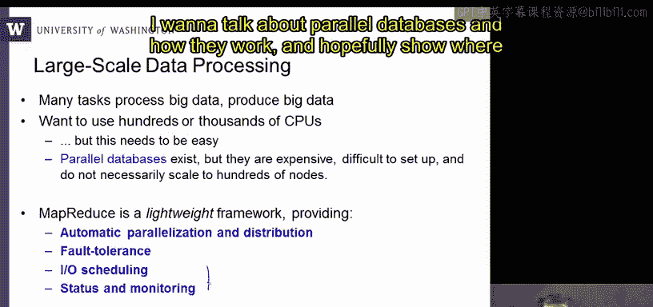
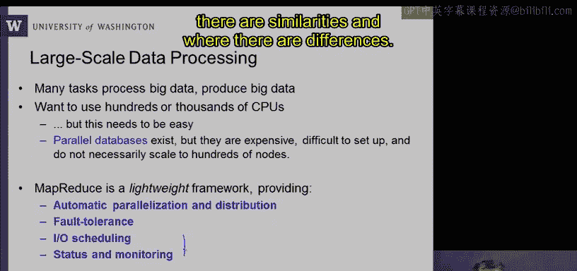

# 大规模数据科学（大数据操作，第1课／共3课）｜第67讲：大规模数据系统的设计空间 🗺️

在本节课中，我们将探讨大规模数据处理系统的设计空间，了解MapReduce之外的其他系统类型，并分析它们在不同维度上的定位与特点。

---

## 概述：大规模系统的设计维度

上一节我们介绍了MapReduce的基本原理。本节中，我们来看看其他大规模数据处理系统，并从一个更宏观的视角理解它们所处的设计空间。

这个设计空间的划分是由微软Dryad系统的开发者Michael Isard提出的。他将大规模数据处理系统按照三个核心轴线进行分类。

---

## 设计空间的三条轴线

以下是划分大规模数据处理系统的三个关键维度：

1.  **延迟与吞吐量**：一端是追求低延迟、快速交互响应的系统；另一端是追求高吞吐量、能同时在成千上万台计算机上运行大规模批处理作业的系统。
2.  **部署范围**：一端是在私有数据中心内部运行的系统；另一端是能够跨互联网广泛扩展的系统。
3.  **架构模型**：一端是**数据并行**模型；另一端是**共享内存**模型。

我们目前主要关注的领域位于**高吞吐量、私有数据中心、数据并行**这个象限，这也是MapReduce的典型定位。在后续章节中，我们也会探讨**低延迟、小规模操作**的象限，这类系统通常被称为NoSQL系统。

---

## 各类系统在设计空间中的位置

Michael Isard将传统的关系型数据库（尽管我这里的标注方式与他略有不同）定位在**低延迟、共享内存**的象限。我称之为“较旧的数据库”，是为了指出并非所有关系型数据库都只处在这个空间；事实上，许多现代并行数据库也是数据并行的。

例如，如果你熟悉的MySQL和PostgreSQL，它们可能更接近**共享内存、共享磁盘**的范畴。

*   **高性能计算**：位于**私有数据中心、高吞吐量、共享内存**象限。这是一种批处理作业提交系统，你将计算密集型任务提交给大型机器进行处理，最终返回结果。
*   **网格计算**：这个象限强调连接来自不同机构的计算机集群并让它们协同工作，因此它在“部署范围”轴线上被推向“跨互联网”的一端。
*   **发展趋势**：越来越多的系统正在向“跨互联网”这个维度扩展。例如，谷歌近期推出的Spanner系统就是一个很好的例子，它通过分布式哈希表等技术，在广域网范围内提供具有强一致性语义的服务。

---

## MapReduce的兴起背景

现在，让我们回顾并总结上一讲的内容。大规模数据处理通常涉及处理海量数据并生成海量结果，因此需要动用数十万计的计算核心和成千上万台计算机。但使用这些资源必须足够简便。

并行数据库确实存在，我们也曾赞扬过其编程模型的优点。然而，它们通常价格昂贵，几乎无一例外，并且配置复杂。此外，许多并行数据库是否能真正扩展到数百或数千台机器，这一点并不完全明确。

MapReduce正是在这样的背景下应运而生，某种程度上是对上述情况的一种回应。它是一个更轻量级的框架，具备我们讨论过的**自动并行化与分布式处理**能力，并提供了**容错性**。此外，它还有一些或许相对次要但依然重要的特性，如I/O调度和状态监控。

MapReduce的核心思想是：剥离并行数据库提供的众多功能，只专注于**并行处理**本身，并额外赋予其**容错**的优势。这个设计恰好满足了人们的迫切需求。

这里我想提出一个观点：如果当时有一个开源的并行关系型数据库产品可用，MapReduce是否还会如此流行，这一点并不完全确定。因为当时所有的开源数据库都不是并行的，事实上，它们在查询处理时甚至是单线程的，一次只能由一个线程处理单个查询。当然，这只是一些推测，我后续会提供一些证据来支撑这个论点。

---

## 下一节预告

接下来，我打算深入探讨并行数据库的工作原理。我希望通过对比，展示它们与MapReduce之间的相似之处，同时也明确指出它们的差异所在。

---

## 总结

本节课中，我们一起学习了大规模数据处理系统的设计空间。我们了解了以三条轴线（延迟/吞吐量、部署范围、架构模型）划分的不同系统类型及其典型代表，并分析了MapReduce在其特定历史和技术背景下兴起的原因。这为我们后续比较不同大规模数据处理范式奠定了基础。