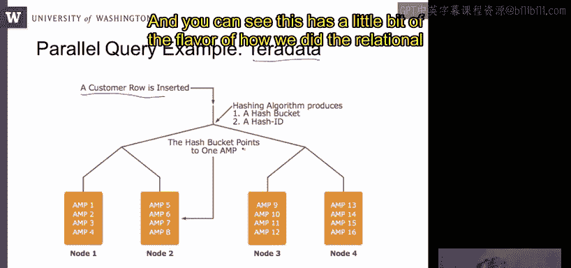

# 大规模数据科学（大数据操作，第1课／共3课） - P68：并行与分布式查询处理 🚀


在本节课中，我们将学习关系数据库查询处理的两个重要扩展概念：**并行查询处理**与**分布式查询处理**。我们将探讨它们的基本思想、工作原理、区别以及它们与MapReduce模型的关系。

---

## 概述

关系数据库的核心思想之一是关系代数，它允许我们构建查询计划。通常，我们使用**SQL**这种高级语言来编写查询，系统会自动将其转换为关系代数计划。

然而，在**MapReduce**范式中，这种自动转换的便利性被部分舍弃，以换取程序在数据处理上拥有更高的灵活性和控制力。

现在，我们希望评估这些查询，但要**并行地**进行。这就需要我们理解两个关键术语：**分布式查询处理**和**并行查询处理**。两者都旨在利用更多计算资源来执行同一查询，但它们的运作方式有所不同。

---

## 分布式查询处理

上一节我们提到了关系代数和SQL。本节中，我们来看看**分布式查询处理**。

在分布式查询中，我们的做法是：将一张大表分布到一个集群的多个节点上（正如我们之前讨论过的数据分区），然后将查询分解成多个独立的子任务，让每个任务在文件的一个分区上运行。

这听起来很像MapReduce，对吗？确实如此，但有一个关键区别：在典型的分布式查询系统中，所有子任务的结果最终都会被发送回一个**主节点（Head Node）** 来完成最终处理。

**核心概念示例**：
假设我们要对一个分布在多台机器上的超大文件执行计数操作（`COUNT`）。分布式查询系统（例如Microsoft SQL Server）足够智能，可以将查询分解并在多台机器上并行运行计数子任务。但是，这些子计数结果通常需要被发送回主节点进行汇总。

```sql
-- 分布式查询示例：计数操作可能被分解执行，但结果需汇总
SELECT COUNT(*) FROM large_table WHERE condition;
```

**分布式查询的局限性**：
虽然它获得了部分并行性，但并非所有操作都能并行完成。当需要将所有中间结果发送回单一节点进行最终处理时，就可能形成性能瓶颈。你可以将其理解为只有 **Map阶段**，而没有真正独立的 **Reduce阶段**。

---

## 并行查询处理

了解了分布式查询后，我们进一步探讨更彻底的并行化方法：**并行查询处理**。

在真正的并行查询中，关系代数中的**每一个独立操作符**（如连接`JOIN`、分组`GROUP BY`）本身都是以并行方式实现的。这意味着，当执行连接操作时，是在多个节点间并行进行的；执行分组操作时，也是在多个节点上并行完成的。

我们已经在MapReduce中见过如何实现关系连接，这与数据库内部的实际实现方式相去不远。如果我们知道如何实现连接（通常是最复杂的操作之一），那么其他操作也可以用类似的方式实现。

**核心概念示例**：
以Teradata系统为例（一家专注于高端企业级数据库的公司）。在这种并行数据库中，每一行数据在插入时，都会通过一个**哈希函数**被分配到集群中的某个特定服务器上。

```python
# 概念性代码：通过哈希函数决定数据行归属的服务器
server_id = hash(row_key) % total_servers
```

因此，数据被自动、近乎随机地分区到整个集群中。当运行查询时，所有机器都会并行访问和处理自己持有的那部分数据。这和我们之前在MapReduce中实现关系连接的思想非常相似。

---

## 视图与分布式表

现在，让我们将并行处理的概念与数据库的另一个功能——**视图**——结合起来看。

如果你不记得视图是什么，它可以被理解为一个**已命名的查询**，之后可以像访问单个表一样访问它。

在分布式场景下，我们可以这样构建一个视图：假设`sales`（销售）表实际上是许多按月划分的小销售表的**联合（UNION）**。我们可以将每个月的销售表放在不同的磁盘甚至不同的服务器上。

**创建分布式表的示例**：
```sql
-- 概念性语句：创建基于多个分区表的视图
CREATE VIEW sales AS
SELECT * FROM sales_january
UNION ALL
SELECT * FROM sales_february
UNION ALL
SELECT * FROM sales_march;
-- ... 以此类推，每个子表可能位于不同的物理位置
```

查询`sales`表的用户无需关心数据实际上是分布存储的。系统会自动从一月、二月、三月等分区中收集结果并将其组合。这由系统自动完成，对用户透明。

然而，其处理模式可能仍属于**分布式查询**：数据读取可以并行，但最终处理可能仍汇集于一点。

---

## 总结

本节课中，我们一起学习了大规模数据查询处理的两种核心范式：

1.  **分布式查询处理**：将大数据集分区存储，并行执行查询的子任务，但**最终结果通常需要汇集到一个中心节点**进行处理。它提供了部分并行性，但在最终聚合阶段可能存在瓶颈。
2.  **并行查询处理**：通过哈希等方式将数据自动分布到集群，并**在操作符级别实现全面并行**（如并行连接、并行分组）。每个节点独立处理自己的数据分区，更接近MapReduce中“Map”与“Reduce”完全分布式的思想。



两者都是对传统关系数据库查询模型的扩展，旨在利用集群资源提升处理海量数据的性能。理解它们的区别有助于我们根据具体场景选择合适的数据处理架构。