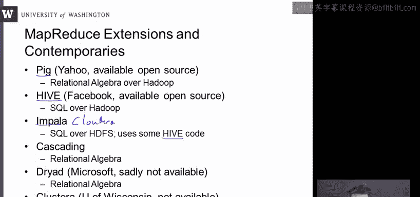

# 大规模数据科学（大数据操作，第1课／共3课） - P69：Teradata示例：MapReduce扩展 🧩

在本节课中，我们将通过Teradata数据库的具体示例，来理解大规模并行处理（如MapReduce）与关系型数据库操作（如连接查询）在底层思想上的共通性。我们将看到，看似不同的系统如何采用相似的并行处理模式。

---

## 查询与执行计划 📋

首先，我们有一个涉及`Orders`（订单）和`Line Items`（订单明细）的查询。其执行计划是：先筛选一部分订单，然后将这些订单与明细项进行连接。

上一节我们介绍了查询的基本概念，本节中我们来看看这个查询在Teradata这样的并行数据库中是如何具体执行的。

---

## 并行处理单元：AMP

在Teradata的术语中，并行处理的基本单元被称为AMP。每个AMP包含数据的一个分片。数据分片的划分方式通常是基于哈希函数随机定义的。

以下是AMP并行处理查询的步骤：
1.  所有AMP并行开始扫描各自持有的数据分片。
2.  所有AMP并行应用筛选条件，过滤掉不需要的记录。
3.  所有AMP并行基于连接键（此处应为`Order ID`）进行哈希计算。

这个哈希操作会将数据重新分布（或称“洗牌”）到另一组AMP上，这组AMP将负责执行下一步操作。

---

## 与MapReduce的类比 🔄

这个过程看起来非常像一个MapReduce作业。

*   前面的扫描和筛选步骤，类似于**Map**函数。
*   基于连接键哈希并重新分布数据，是为后续操作做准备。
*   接下来的连接操作本身，则类似于**Reduce**函数。

对于另一个关系（`Line Items`表），会发生完全相同的过程：扫描数据，然后基于相同的连接键（`Order ID`）进行哈希。

这样，所有具有相同`Order ID`的订单记录和明细记录，最终都会被哈希到同一台机器（同一个AMP）上。这与我们之前看到的MapReduce连接示例完全一样。

---

## 完成连接操作 ✅

经过上述两个并行步骤后，数据已经根据连接键聚合。

例如：
*   AMP 4 将拥有所有哈希值等于1的订单和明细。
*   AMP 5 将拥有所有哈希值等于2的订单和明细。
*   AMP 6 将拥有所有哈希值等于3的订单和明细。

此时，每个AMP都拥有了足够的信息，可以独立且并行地完成最终的连接操作，并产生结果。

---

## 抽象的价值与生态系统 🧠

关键在于，这种并行处理的机制在并行数据库和MapReduce中都已存在。在MapReduce中执行连接操作，本质上需要自己实现这套逻辑。

这一观察催生了许多工具，它们旨在为MapReduce提供标准化的高级操作接口，使用户无需每次都重写底层逻辑。

以下是几个重要的系统，它们都体现了关系代数的思想：

*   **Pig**（来自Yahoo）：提供了一套类SQL的语言，其操作符（如`JOIN`、`GROUP BY`）可被识别为关系代数。它允许稍微复杂的数据嵌套。
*   **Hive**：直接在Hadoop之上提供了SQL接口，比关系代数更进一步。
*   **Impala**（来自Cloudera）：一个较新的系统，为HDFS提供高性能的SQL查询，并使用了Hive的许多代码。
*   **Cascading**：另一个系统，也清晰体现了关系代数。
*   **Dryad**：虽然与MapReduce无直接关系，但动机相似，其内部也明显使用了关系代数。
*   **C-Store**：一个研究型项目，同样基于关系代数。

---

## 总结 📝

本节课中，我们一起学习了Teradata如何执行一个并行连接查询，并揭示了其底层逻辑与MapReduce模式的深刻相似性。更重要的是，我们认识到**关系代数**是一套强大且可模块化的概念，它已经超越了传统数据库的边界，渗透到Hadoop等众多大数据处理系统中。

当你戴上“关系代数”的眼镜观察世界时，你会发现这种思想无处不在。因此，回过头深入理解这些基本操作，是非常有益的。