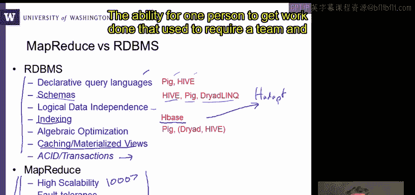

# 大规模数据科学（大数据操作，第1课／共3课） - P70：RDBMS与MapReduce特性对比 🆚


在本节课中，我们将深入探讨关系型数据库（RDBMS）与MapReduce框架之间的核心特性差异。我们将超越查询处理的表层，分析它们在数据模式、索引、容错性以及编程模型等方面的不同设计哲学与实现。

---

## 概述

上一节我们介绍了并行查询处理的基本策略在两者间的相似性。本节中，我们来看看关系型数据库所具备、而传统MapReduce所缺乏的一系列重要特性，并探讨现代大数据系统如何融合双方的优势。

## 关系型数据库的特性

以下是关系型数据库提供的一些关键特性，这些特性在早期MapReduce中并不直接具备。

### 数据模式（Schema）

关系型数据库要求在数据入库前定义并强制执行一个**模式**。任何不符合模式的数据都会被系统自动拒绝。这有助于保持数据清洁。其约束可表示为：
```
数据记录必须符合预定义的结构（例如：列名、数据类型、约束）
```
然而，在大数据场景下，数据往往“天生脏乱”，要求先清洗再处理通常不现实。这正是MapReduce的一个吸引力所在：它不强制要求预先定义模式。

但这并不意味着模式是个坏主意。即使在MapReduce中，模式也以隐式方式存在——它隐藏在应用程序代码里。例如，当你读取一条记录时，你假设第一个字段是整数，第二个是日期，第三个是字符串。这个模式是存在的，只是没有被“推入”系统底层。

近年来的大量实证研究表明，**尽可能将模式下推到数据层是更优的做法**。因此，我们看到Hive、Pig、Spark等系统都引入了自己的模式概念。

### 索引（Indexing）

索引是支持对数时间复杂度数据访问的重要结构。在原生MapReduce中，每次作业启动都会扫描输入中的所有记录，无法快速定位到特定记录，这被认为是低效的。

为了解决这个问题，人们为Hadoop生态系统添加了索引功能。例如，**HBase**（Google BigTable的开源实现）提供了对单个记录的快速访问，并与Hadoop兼容。这样，系统设计者就能同时获得MapReduce编程接口和索引能力的双重优势。

### 逻辑数据独立性与物化视图

逻辑数据独立性主要指**视图**的支持。传统Hadoop类系统对视图的支持不多，但预计未来会出现。物化视图是预计算并存储的视图，与运行时动态计算相对，在此不做深入讨论。

### 事务（Transactions）

关系型数据库非常擅长处理事务。但在MapReduce和NoSQL兴起的初期，事务特性曾被暂时搁置。如今，事务支持正在以新的形式回归大数据系统。需要注意的是，MapReduce提供的是极高的可扩展性（数千台机器）和**容错性**，这与基于事务的恢复机制不同。

## MapReduce的核心优势

### 容错性（Fault Tolerance）

关系型数据库通过事务保证恢复后数据不丢失，但这不同于在长时间运行的查询过程中处理故障。其隐含假设是：查询不会运行那么久，故障无需特别处理。

在大数据时代，分析查询可能运行数小时甚至数天，并且是在成千上万台必然会发生故障的机器上运行。**MapReduce的设计动机之一就是解决这种场景下的容错问题**。现在，现代并行数据库也开始引入某种形式的容错机制。

### 编程模型的民主化

MapReduce一个真正强大的地方在于，它让广大的Java程序员变成了分布式系统程序员。一个普通的Java开发者突然之间就能高效地处理数百TB的数据，而无需深入学习分布式系统的复杂性。

相比之下，要使用传统数据库，你通常需要先成为一名数据库专家。这种**降低分布式计算门槛**的影响怎么强调都不过分。一个人就能完成过去需要一个庞大团队耗时数月才能完成的工作，这是意义重大的。

---

## 总结

本节课中，我们一起学习了关系型数据库与MapReduce在多方面的特性对比。我们看到，关系型数据库在模式、索引、事务等方面提供了严谨的保障，而MapReduce则在可扩展性、容错性以及编程简易性上具有突破性优势。



当前大数据领域的设计趋势是**混合与匹配**：人们不再非此即彼，而是从两者中挑选合适的特性进行融合。最初的设计空间主要由关系型数据库占据，MapReduce的出现重启了探索，如今我们正处在一个功能选择更为灵活、系统设计更为多元的时代。