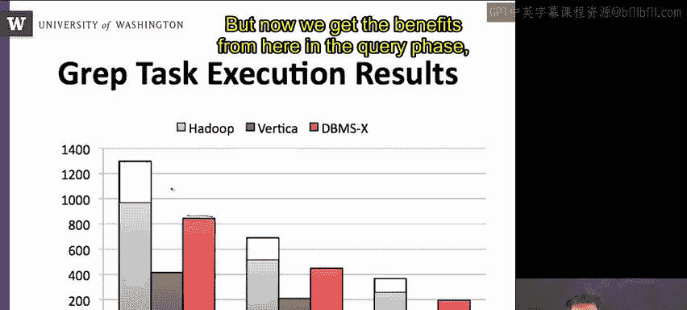

# 课程1：RDBMS与Hadoop性能对比分析 🚀

在本节课中，我们将学习一篇2009年论文的核心内容，该论文直接对比了Hadoop与两种不同类型数据库的性能。我们将重点分析一个名为“Grep”的特定任务，并探讨不同系统在数据加载和查询执行阶段的表现差异。

---

上一节我们介绍了本次对比实验的背景，本节中我们来看看实验的具体设置。

实验对比了三个系统：
*   **Hadoop**：一个基于MapReduce的分布式计算框架。
*   **Vertica**：一个列式存储数据库。
*   **DBMS X**：一个未具名的传统行式关系数据库。

虽然我们尚未深入探讨列式与行式数据库的区别，但为了理解本次实验，你可以将它们视为采用了不同底层技术的两种关系型数据库。

---

实验分析包含定性和定量两个方面。定性部分讨论了编程模型和系统搭建的便捷性。定量部分则针对特定类型的查询进行了性能测试。

以下是他们考虑的第一个任务：**Grep任务**。

该任务的目标是在一个包含100亿条记录（总计1TB数据）的数据集中，查找一个特定的3字节模式。每条记录大小为100字节。这个任务最初出现在2004年的MapReduce论文中，因此非常适合作为基准测试。

数据集被分布在25、50或100个节点上。

---

上一节我们了解了Grep任务，本节中我们来看看数据加载阶段的性能结果。

加载数据的结果如下图所示：

在Hadoop上加载数据很快，而在关系数据库（DBMS X）上加载则很慢。Vertica的加载速度也很快。

**为什么Hadoop加载更快？**
在Hadoop（HDFS）中加载数据主要涉及数据分区，没有太多额外工作。而将数据加载到数据库中时，需要将原始数据重新组织并转换为数据库的内部结构，这需要时间。如果还需要为数据建立索引，那么每次插入数据时都需要维护索引数据结构，这会使加载过程更慢。

**关键结论**：与传统关系数据库相比，Hadoop的数据加载时间通常更短，因为数据库需要做更多的预处理工作。

在25台机器的实验中，Hadoop的加载时间约为2500秒，而DBMS X的加载时间超过25000秒。随着服务器数量增加，时间有所减少。

---

数据加载完成后，我们进入查询执行阶段。现在来看看运行Grep任务查找数据的结果。

执行Grep任务的结果如下图所示：

在这个任务中，Hadoop的速度比数据库（DBMS X）慢。

**为什么此时数据库更快？**
Grep任务需要对所有数据进行全表扫描，无法利用索引进行加速。因此，理论上数据库并没有根本性的优势。然而，数据库更快的主要原因在于：
1.  数据库得益于其结构化的内部数据表示。数据已经以一种紧凑的二进制格式存储，查询时无需像Hadoop那样从磁盘重新解析原始数据格式。
2.  数据库在加载阶段付出了转换数据的代价，但在查询阶段获得了性能收益。

**核心差异**：`数据库查询速度 = 利用加载阶段的结构化优势`，而`Hadoop查询速度 = 原始数据解析开销 + 全量处理`。

即使在讨论索引之前，数据库因其内部数据表示的优势，在全扫描查询中也能表现得比Hadoop更好。

---

本节课中我们一起学习了Hadoop与关系数据库（RDBMS）在Grep任务上的性能对比。我们了解到，**Hadoop在数据加载阶段具有优势，因为它无需进行复杂的数据转换和索引构建**。然而，**在需要全表扫描的查询执行阶段，关系数据库可能更快，因为它可以充分利用加载阶段创建的高效内部数据表示结构**。这种“加载慢、查询快”与“加载快、查询慢”的权衡，是选择不同数据处理平台时需要考虑的重要因素。