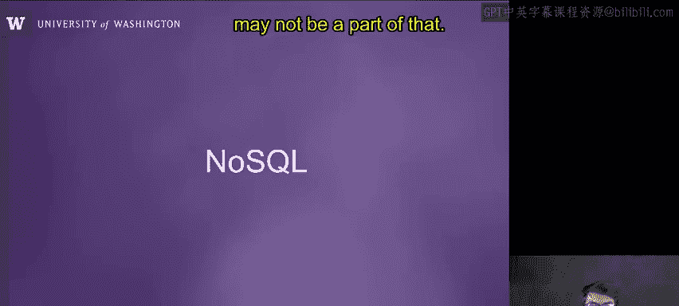
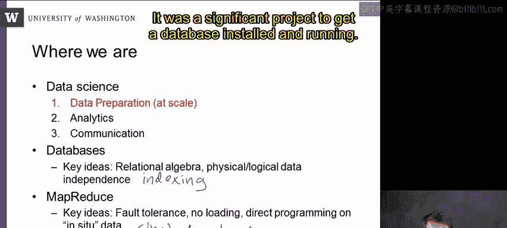

# 大规模数据科学（大数据操作，第1课／共3课）🚀：NoSQL背景与路线图

在本节课中，我们将要学习NoSQL数据库的背景知识及其在大数据生态系统中的定位。虽然本课程的核心是数据分析，但理解NoSQL系统对于数据科学家至关重要，因为它影响着我们处理大规模数据的方式和平台选择。

## 为何需要关注NoSQL？🤔

上一节我们介绍了数据库和MapReduce在数据准备阶段的应用。本节中，我们来看看NoSQL系统。这些系统通常与构建大型、可扩展的Web应用相关联，而非数据分析。然而，数据科学家仍需了解NoSQL，原因如下：

首先，作为数据科学家，你处理的数据越来越多地存储在各类NoSQL系统中。其次，该领域的系统和术语深刻影响着人们处理大规模数据的思维方式。了解其发展脉络和主要趋势，有助于你做出明智的技术选型决策。例如，你可能会被要求为分析工作推荐合适的平台。

第三，我们在其他章节讨论过的核心概念，如关系代数、逻辑数据独立性、简单可扩展的分析以及索引等，在NoSQL领域同样适用。这为你提供了应用这些概念的另一个场景。最后，数据科学家有时也需要参与构建大规模系统，作为数据产品的一部分，而NoSQL系统可能是其中的组件。

## 课程进度回顾与定位📍

目前，我们仍处于数据准备的阶段。我们已探讨了如何使用数据库和MapReduce进行数据操作与整理。关键要点包括：关系代数的概念不仅限于SQL系统；物理与逻辑数据独立性反复出现；索引的重要性；以及MapReduce的基本操作和容错性等优势。

MapReduce的一个显著优势是允许开发者直接对原始数据进行编程处理，无需像传统数据库那样必须先定义模式并加载数据。这大大降低了入门门槛，单个开发者也能快速上手。

## NoSQL的核心概念与分类🗺️

接下来，我们将深入NoSQL世界。理解其核心思想有助于把握不同系统的特点。

NoSQL系统主要围绕以下几个核心思想构建，它们通常为了追求扩展性、灵活性或性能而在某些方面放松了传统关系型数据库的约束：

以下是NoSQL系统的一些关键设计理念：

*   **模式灵活性**：数据模式可以动态变化，无需预先严格定义。
*   **最终一致性**：系统保证如果不再有新的更新，最终所有访问都将返回最后更新的值，这不同于关系型数据库的强一致性。
*   **分区容错性**：系统设计能在部分节点故障或网络分区时继续运行。
*   **简单查询接口**：通常提供比SQL更简单的API，有时以牺牲复杂查询能力为代价。

根据数据模型，NoSQL系统主要分为几类：

1.  **键值存储**：最简单的模型，通过唯一键访问值。例如：`GET user:12345`。
2.  **文档数据库**：值通常是结构化文档（如JSON、XML）。例如，一个用户文档可能包含嵌套的地址信息。
3.  **列族存储**：数据按列族组织，适合大规模分布式存储与分析。例如，HBase。
4.  **图数据库**：专注于实体（节点）和关系（边），适合社交网络、推荐引擎等场景。

## 总结📚

本节课中，我们一起学习了NoSQL系统的背景、其对于数据科学家的价值，并回顾了我们在数据准备阶段已掌握的工具。我们明确了NoSQL的核心设计理念与主要分类。理解这些内容，将帮助你在面对大规模数据处理和存储的技术选型时，拥有更清晰的视野和判断依据。在接下来的课程中，我们将继续深入大数据操作的其他方面。