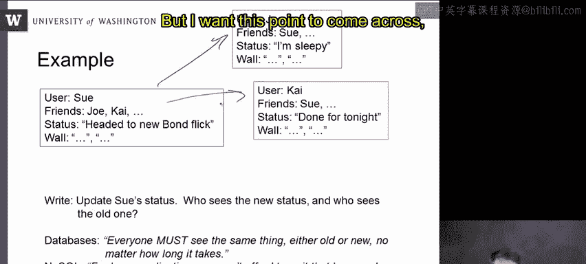

# 大规模数据科学（大数据操作，第1课／共3课） - P75：放宽一致性保证 🧩

在本节课中，我们将探讨在大规模分布式系统中，为何以及如何放宽传统数据库的强一致性保证，以换取更高的可用性和可扩展性。我们将从数据分片与复制的架构出发，分析强一致性模型在大型应用中的局限性，并介绍NoSQL系统为解决这些问题所采用的设计思路。

---

上一节我们介绍了数据分片与复制的基本架构，本节中我们来看看在这种架构下如何处理数据更新。

我们从一个与讨论MapReduce和可扩展性时相同的示意图开始。我们取一个大数据集，将其分解成多个数据块，并将这些块发送到不同的机器上。

在这里，我们将这个数据块复制到三台不同的机器上。这与我们在Hadoop文件系统中为容错所做的操作相同。这样做的目的是，如果一台机器宕机，我们仍然可以从另外两个副本中获取数据。我们对每一个数据块都执行此操作。

但这里我们需要满足两个要求：一是确保高可用性，以便在出现故障时数据仍然可访问；二是在此背景下支持数据更新，这与我们之前讨论的只读场景不同。因此，我们不仅关注读取性能或读取容错，还希望现在能对数据进行更改，并将这些更改传播到其他副本，在某些情况下，还要传播给其他关注这些变更的消费者。可能存在其他数据块引用了相同的信息，我将在下一张幻灯片中举例说明。

想象一个社交网络应用，用户更新自己的状态，而他们的好友可以看到这些状态更新。这里的正确操作是Sue更新她自己的状态。我们向她好友提出的问题是：会发生什么？谁看到新状态，谁看到旧状态？这个状态变更如何传播？

从数据库的角度来看，这个问题的答案是：要么所有人都必须看到新变更，要么没人看到。也就是说，事务要么提交，并且所有地方的数据副本都同时同步；要么不提交。此外，任何试图在新状态下读取该值的人，要么只能读取旧值，要么必须等待事务提交。这个等待时间可能相当长，甚至是任意的。死锁也可能发生，这就是我说“任意”的原因。

所以，这是数据库给出的答案：一切都是同步的，所有东西都必须更新，要么全有要么全无。

而NoSQL系统则提出了不同的观察。他们认为，对于真正的大型应用，我们根本无法承受为等待这种同步而花费任意长的时间。我的意思是，状态更新需要能够提交并响应，以便用户可以继续做其他事情。他们不能看着沙漏图标，而同步仍在进行。

进一步的观察是，也许这并不重要。我的意思是，如果Sue的朋友Joe看到了新状态，而Kai仍然看到旧状态，这真的那么重要吗？也许谁在乎呢？只要Kai最终能看到新状态，可能就足够好了。

这些观察建议在设计空间中向一个不同的领域移动，即高可扩展性、高可用性和一致性（应用一致性）的权衡领域。这类系统开始被视为一种反数据库，采取了与数据库截然不同的方法。因此，“NoSQL”这个术语开始流行。

实际上，“NoSQL”这个名字被固定下来有点不幸，因为它与SQL本身关系不大。它更多是与数据库的事务处理ACID特性相关，这与查询语言SQL并不完全相关。事务模型是关于读写序列的，与查询语言无关。但无论如何，这个名字已经固定下来了。

需要说明的是，“NoSQL”这个术语不仅暗示了不同的事务模型，也暗示了更弱的数据模型等等。我们稍后会讨论一点。但我希望这个观点能被理解，因为这是关键思想之一。

---

本节课中我们一起学习了传统强一致性模型在大规模分布式系统中的挑战，以及NoSQL系统通过放宽一致性保证来优先满足高可用性和可扩展性的核心理念。我们理解了在社交网络状态更新等场景中，“最终一致性”可能是一个更实用、更高效的设计选择。