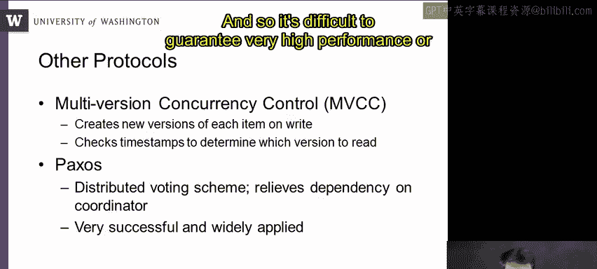

# 大规模数据科学（大数据操作，第1课／共3课） - P76：两阶段提交与共识协议 📚

在本节课中，我们将学习分布式系统中如何确保数据一致性。具体来说，我们将探讨**两阶段提交协议**以及更高级的**共识协议**（如Paxos），了解它们如何解决多个副本间数据同步的问题，以及各自的优缺点。

---

数据库如何解决数据一致性问题？为何解决此问题耗时较长？一个名为**两阶段提交**的协议是此类同步处理场景中的标准解决方案。

其设计动机如下：假设你有一组副本或其他类型的从属节点（例如，所有需要看到状态更新的好友服务器）。如果你直接通知它们进行更新（例如，“我已更改状态，请更新你的内部状态以反映Sue的新状态”），可能会出现问题。部分节点可能成功，但其中一个可能失败。此时系统将处于不一致状态：失败的节点保留旧值，而其他节点已更新为新值。

那么，如何解决这个问题？答案是**两阶段提交协议**。

## 两阶段提交协议详解 🔄

上一节我们介绍了数据不一致的问题，本节中我们来看看两阶段提交协议如何通过两个阶段来确保所有节点要么全部提交更新，要么全部放弃。

**第一阶段：准备阶段**
协调者向所有从属节点发送“准备提交”消息。从属节点必须确保无论发生什么情况，当被要求提交时都能执行该事务。通常，这意味着将事务相关信息写入日志。即使断电，节点恢复后也能从日志中恢复。随后，从属节点回复“是，我已准备提交”。

**第二阶段：提交或中止阶段**
如果所有从属节点都回复准备就绪，协调者将发送“提交”消息。如果有任何节点失败，协调者则发送“中止”消息，各节点进行清理。

以下是该过程的示意图：
1.  协调者发送“准备”消息。
2.  所有从属节点预写日志并回复“准备就绪”。
3.  协调者发送“提交”消息。
4.  所有节点完成最终提交。

（示意图未展示失败情况，但本质上协调者需要监控并在出错时发送“中止”消息。）

## 两阶段提交的局限性与共识协议 🧩

尽管两阶段提交解决了基本问题，但它存在一些缺陷。主要问题是对协调者的依赖：如果协调者在错误时间点故障，系统可能陷入混乱。

为了在完全分布式的对等网络中确保事务的相互承诺，需要使用共识协议。其中最成功和流行的方法是**Paxos算法**（我们不会深入细节，但你在阅读NoSQL系统相关文献时会看到这个术语）。

简而言之，可以将两阶段提交理解为**用于数据库本地集群**的协议，而Paxos则是**用于分布式对等网络**的协议。

Paxos本质上是一种投票机制。各个服务器需要自行决定是否应该提交事务。其细节可能有些微妙，但考虑到任务的复杂性，其整体思想相对简单。

除了协调者单点故障问题，两阶段提交的另一个问题是**耗时可能较长**。如果从属节点响应不及时，协调者可能需要等待；如果多次失败并在应用层中止和重试事务，过程会变慢。当需要协调成千上万个从属节点时，该协议难以扩展。

## 其他并发控制机制 ⚙️

还有一些其他协议，我们不会深入讨论，但会在相关论文中看到，例如**多版本并发控制**。在该机制中，每次写入都会创建数据项的一个新版本。读取的合法性通过比较读取事务的时间戳与试图读取的版本的当前时间戳来确定。如果在你应该读取的时间点之后数据已被更新，在严格的并发控制下，你只能中止读取并告知数据已脏。但通过多版本并发控制，系统可以保留多个版本，并将读取重定向到之前正确的版本，从而避免中止某些事务。

然而，该机制仍然依赖一个协调者角色来管理时间戳。

## 完全分布式方案：Paxos 🗳️

在完全分布式方案中，是否继续推进或中止事务的决定，是通过对等节点间的**投票机制**做出的，这就是**Paxos**。Paxos非常成功且应用广泛，如果你花时间阅读课程阅读清单中的NoSQL论文，会看到它的提及。

Paxos减少了对中央协调者的依赖，但它仍然是**同步的**，仍然存在**死锁的可能**，并且根据发生的故障类型，**达成共识可能需要一定时间**，因此难以保证极高的性能或极低的延迟。

---

**响应时间。**

---

**本节课总结**
本节课中，我们一起学习了分布式系统中确保数据一致性的核心机制。我们深入探讨了**两阶段提交协议**的工作流程与局限，并介绍了更高级的**Paxos共识协议**如何通过投票机制在分布式对等网络中实现事务承诺。此外，我们还简要了解了**多版本并发控制**等其他方案。理解这些协议是掌握大规模数据系统协调与一致性的基础。