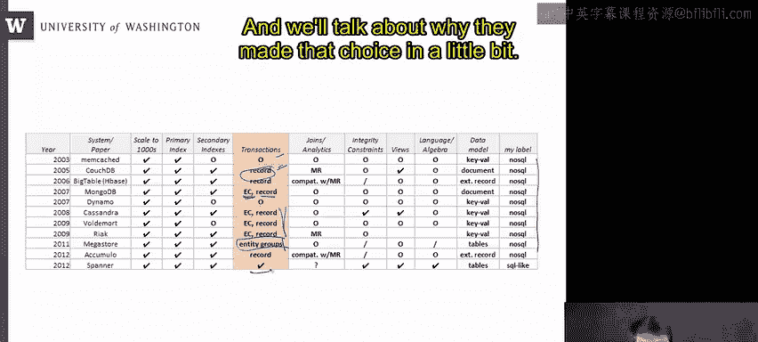

# 大规模数据科学（大数据操作，第1课／共3课） - P77：最终一致性 🧩

在本节课中，我们将学习分布式系统中的一个核心概念——**最终一致性**。我们将探讨其起源、基本含义、与强一致性的对比，以及它在不同NoSQL系统中的具体体现。

---

## 最终一致性的起源

上一节我们介绍了分布式系统的基本挑战，本节中我们来看看“最终一致性”这一术语的起源。

“最终一致性”这一术语最初并非主要在其**实用性**和**允许系统扩展至极大规模**的背景下定义。它更多源于一个论点：在分布式系统中，能够就如何处理冲突做出恰当决策的唯一合适参与者是**应用程序本身**。

这实际上是**端到端原则**的一个版本，该原则在网络领域可能已有所了解。这一术语由道格·特里在1995年的一篇论文中提出。他认为：

> 应用程序必须意识到，它们读取的可能是弱一致性的数据，其写入操作可能与其他用户和应用程序的操作冲突。应用程序必须参与冲突的检测和解决，这自然取决于应用程序的语义。

需要说明的是，我个人并不完全赞同这些断言。我认为，在系统能够处理时，由系统来负责处理可能更好。但介绍这些是为了让大家了解该术语的起源，而非近十年左右随着NoSQL系统流行而兴起的概念。

---

## 最终一致性的含义

了解了其起源后，我们来看看它的具体含义。

在**没有更新操作**的情况下，所有副本最终将收敛为相同的拷贝。这意味着，只要数据不再持续变动，当变更稳定下来后，所有节点最终都会看到相同的值。例如，你的所有朋友最终都会看到你的最新状态，而不会永久卡在旧状态上。

然而，在达到最终一致之前，应用程序（或你的某个朋友）具体看到哪个状态，高度依赖于你所构建应用程序的内部细节，因此**难以预测**。

正因如此，很难非常精确或形式化地推理“最终一致性”的含义，因为它极度依赖于那些本身就难以形式化的具体实现细节。

---

## 与强一致性的对比

上一节我们探讨了最终一致性的模糊性，本节中我们将其与另一种模型进行对比。

通常，我们可以将此与关系型数据库和Paxos等协议所保证的**强一致性**进行对比。强一致性系统可能面临**死锁**问题。可以证明，任何系统都无法在保证一致性的同时完全避免死锁。

因此，关系型数据库和Paxos协议放弃了**活性**属性，即它们可能允许死锁发生，以换取强一致性。虽然可以通过不同的设计决策使死锁情况变得罕见，但它们仍然可能发生。

而最终一致性模型则认为，我们无法承担等待这些协议运行完成的代价。此外，在某些应用场景下，强一致性可能并非必要。

---

## NoSQL系统中的一致性支持

现在，我们来看一个总结了不同系统一致性支持的表格。我们将具体分析这些术语的含义。

以下是不同NoSQL系统在一致性支持方面的对比：

*   **强一致性事务的支持范围**：这指的是在多大范围内，系统能保证事务的强一致性（即所有变更要么全部生效，要么全部不生效）。
*   **单个记录**：意味着可以更新一条记录中的多个字段，并保证这些更改的原子性。
*   **注意**：此列表仅过滤了NoSQL系统。关系型数据库支持跨任意记录的事务。
*   **EC（最终一致）**：表示系统在记录级别提供最终一致性保证，而非强一致性事务。
*   **实体组**：这是基于Google Bigtable的Megastore系统引入的概念。它是一组相关的记录，系统保证在该组内的事务具有强一致性。这比仅支持单条记录更好，但不如支持数据库中任意记录。
*   **Spanner**：这是Google最新的系统，它提供跨所有记录的真正强一致性。我们稍后会讨论他们为何做出这个选择。

---

## 总结

本节课中，我们一起学习了**最终一致性**。我们从其学术起源开始，理解了它的核心含义：在更新停止后，系统最终会达到一致状态，但在此过程中的状态难以预测。我们将其与追求原子性和隔离性的**强一致性**模型进行了对比，认识到最终一致性是以牺牲强一致性为代价来换取可用性和分区容忍性。最后，我们通过一个表格，看到了不同NoSQL系统（如Dynamo、Cassandra、Megastore、Spanner）在一致性支持范围上的权衡与演进，从仅支持单记录最终一致，到定义实体组，再到提供真正的全局强一致性。理解这些模型是设计可扩展分布式系统的关键基础。