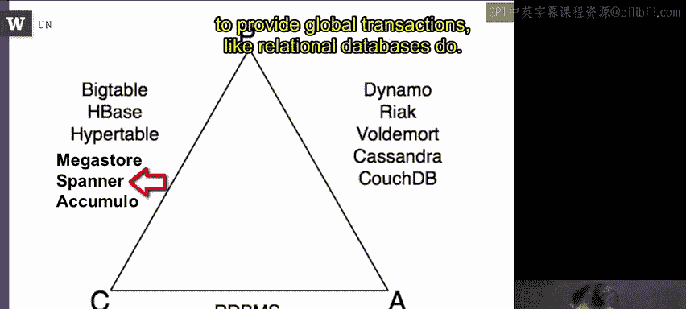

# 大规模数据科学（第1课/共3课） - P78：CAP定理 🧩

在本节课中，我们将学习分布式系统中的一个核心概念——CAP定理。该定理由Eric Brewer在2000年提出，并由Lynch在2002年正式定义，它阐述了分布式系统在一致性、可用性和分区容错性三者之间必须做出的权衡。

## 概述

CAP定理定义了三个核心概念：**一致性**、**可用性**和**分区容错性**。该定理常被描述为：在分布式系统中，你只能同时满足这三个属性中的两个，必须牺牲第三个。然而，这种理解方式可能过于简化，定理的提出者Eric Brewer本人也指出这可能不是最准确的思考方式。

## CAP定理详解

上一节我们概述了CAP定理的基本思想，本节中我们来详细看看这三个概念的具体含义以及它们之间的权衡关系。

### 核心概念定义

以下是CAP定理涉及的三个核心属性：

*   **一致性**：在分布式系统中，所有节点在同一时间看到的数据是相同的。任何数据更新操作完成后，所有后续的读取操作都将返回最新的值。这可以理解为系统状态的**全局统一性**。
*   **可用性**：系统提供的服务必须始终可用，对于每一个非故障节点的请求，系统必须在合理的时间内返回一个正常的响应（不保证是最新数据）。这可以理解为系统的**持续服务能力**。
*   **分区容错性**：系统能够容忍网络分区（即部分节点之间无法通信）的发生，并在分区发生后继续运行。这可以理解为系统对**网络故障的容忍能力**。

### 分区容错性的重要性

理解“分区”的含义是关键。在一个包含数百个节点、服务器彼此通信的大型分布式系统中，如果其中一部分节点与另一部分节点失去了通信连接，就发生了网络分区。

此时，系统面临一个选择：这两个被分割的片段能否独立地继续推进应用程序的工作，并在之后网络恢复时再进行同步？还是说，整个系统或部分节点必须停止工作，等待通信重新建立？

例如，在一个主从架构中，如果工作节点与主节点失去了联系，许多设计会要求工作节点在重新建立与主节点的连接之前无法进行任何有效工作，因为它们需要等待来自主节点的指令。在这种情况下，系统**牺牲了可用性**——这些节点变得不可访问或无法进行有效工作。

### 权衡的本质

另一方面，如果系统选择让各个分区在网络中断期间继续独立工作，那么不难证明，系统最终可能会进入一个**不一致的状态**。

网络两端的更新操作各自进行，当通信恢复时，可能会发现副本之间的数据出现了冲突。虽然系统之后可以尝试解决这些冲突，但在冲突解决之前，应用程序可能已经接触到了不一致的数据。因此，在这种选择下，系统**牺牲了一致性**。

关键在于，你无法同时获得全部三个属性。

## 传统数据库与NoSQL系统的选择

上一节我们理解了CAP定理的权衡本质，本节中我们来看看不同类型的数据库系统是如何做出选择的。

### 传统关系型数据库的选择

传统的数据库系统本质上**假设网络分区不会发生**。这是因为它们通常只在数十个节点的规模上运行，而非成千上万节点或全球范围的分布式系统。

这些节点通常位于同一个数据中心甚至同一个机房内，网络分区在当时并不是一个需要重点考虑的问题。因此，传统关系型数据库的设计目标是保证**一致性**和**可用性**，而**牺牲了分区容错性**（即假设分区不会发生）。

### NoSQL系统的选择

NoSQL系统则必须认真对待分区问题。它们规模庞大，分布广泛。由于巨大的规模，各种复杂的故障（拜占庭故障）随时可能发生。

因此，许多NoSQL系统选择**牺牲强一致性**，以换取**高可用性**和**分区容错性**。这意味着在网络分区发生时，系统仍然可以提供服务并接受写入，但不同分区间的数据可能暂时不一致。

## 图形化理解与系统定位

我们可以用一个三角形来图形化地理解不同系统的定位。

以下是不同类型系统在CAP三角形中的大致位置：

*   **关系型数据库**：通常位于“一致性-可用性”这条边上。它们假设分区不会发生，因此致力于保证强一致性和高可用性。
*   **强调分区容错性和一致性的系统**：这类系统需要容忍分区，并保证某种程度的一致性（如最终一致性），但可能在分区期间牺牲部分可用性（例如，某些操作会被阻塞直到多数节点达成一致）。
*   **强调分区容错性和可用性的系统**：这类系统在网络分区期间保证服务始终可用，但允许数据出现暂时的不一致。许多NoSQL数据库（如Cassandra、DynamoDB在默认配置下）属于此类。

需要强调的是，这里讨论的“一致性”范围非常关键。像Spanner这样的新型全球分布式数据库，通过精妙的技术（如TrueTime API）试图在提供全球级事务的同时，也保证强一致性和高可用性，并容忍分区，但这通常需要付出更高的延迟和复杂性代价。

## 总结

本节课中，我们一起学习了CAP定理。我们了解到，在分布式系统的设计中，一致性、可用性和分区容错性构成了一个不可兼得的三角。传统数据库通常优先保证一致性和可用性，而假设网络环境可靠；现代大规模分布式NoSQL系统则为了应对不可避免的网络分区和追求高可用性，往往选择放宽对强一致性的要求。理解这一权衡是设计和选择适合业务场景的分布式数据系统的关键基础。