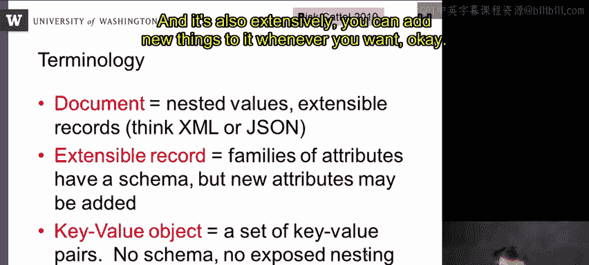
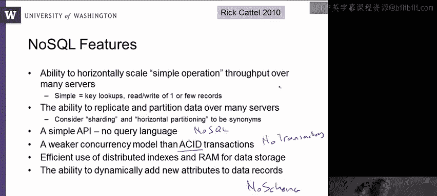

# 大规模数据科学（第1课） - P79：NoSQL系统类型 🗃️

在本节课中，我们将学习NoSQL系统的不同类型及其核心特征。我们将了解Rick在2010年关于可扩展SQL和NoSQL数据存储的论文中提出的分类法，并探讨NoSQL系统共有的关键特性。

---

## NoSQL系统的分类 📊

上一节我们提到了NoSQL系统的多样性。本节中，我们来看看Rick在其论文中提出的一个具体分类法。他将流行的NoSQL系统实例归纳为三种主要类型。

以下是Rick定义的三种NoSQL数据存储类型：

*   **键值存储**：数据模型是一组键值对。系统通常不关心键的模式，可以是任意键，并且不暴露嵌套结构。值可以是任何复杂对象，但对系统而言只是一个不透明的“二进制大对象”。
*   **文档存储**：数据以文档形式存储，例如XML文档或我们在Twitter作业中看到的JSON对象。文档支持任意的嵌套结构，并且是可扩展的，可以随时添加新内容，没有自上而下强制执行的结构模式。
*   **可扩展记录存储**：可以将其视为类似于数据库记录，但允许为单个行添加新属性。存在某种用于不同目的的模式概念，特别是存在一些被一起操作的属性组（列族），但你可以为单行附加新属性，这在关系型数据库中通常是不允许的。

---

## NoSQL系统的典型特征 ✅

了解了NoSQL的主要类型后，我们来看看这些系统通常具备哪些共同特征。需要承认的是，并没有一个关于NoSQL的正式定义，但这个术语往往被用于具备以下特性的系统。

以下是NoSQL系统常见的特征列表：

*   **可扩展的简单操作吞吐量**：能够将简单操作（如键查找、属性查找或少数记录的读写）的吞吐量扩展到许多服务器上。这与MapReduce和数据库中讨论的大型分析查询不同。
*   **数据的复制与分区**：能够跨多台服务器自动复制和分区数据，即将单个大型数据集分解成多个部分，而无需手动管理。你可能会看到“分片”和“水平分区”这两个术语，它们可以视为同义词。
*   **简单的API**：没有复杂的查询语言，操作主要是上述的简单操作。
*   **弱于ACID的并发模型**：提供比ACID事务更弱的并发一致性保证。我们将在下一张幻灯片中简要讨论ACID。
*   **高效利用分布式资源**：强调高效使用分布式索引和内存进行数据存储，侧重于最小化延迟，而不仅仅是吞吐量。
*   **动态模式**：通常能够以各种方式向数据记录添加新属性，这可以理解为“无模式”或“模式灵活”。

---

## 核心概念总结 📝

本节课中，我们一起学习了NoSQL系统的三种主要类型：**键值存储**、**文档存储**和**可扩展记录存储**。我们还探讨了NoSQL系统的一系列典型特征，包括可扩展的简单操作、数据自动分区、简单API、弱一致性模型、对分布式资源的高效利用以及灵活的模式。这些特征共同构成了“NoSQL”这一术语的常见语境，其核心可以概括为：**无固定模式**、**无强事务保证（ACID）**、**无复杂查询语言**，但具备**高可扩展性**。在接下来的课程中，我们将更深入地探讨其中的一些概念。