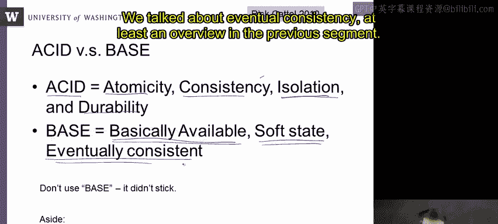

# 课程1：大规模数据科学 - 大规模数据操作 🚀

## 概述

在本节课中，我们将要学习大规模数据处理系统中的核心概念，特别是**ACID**原则及其在大数据环境下的演变。我们还将介绍三个对现代系统设计产生重大影响的早期系统：**Memcached**、**Amazon Dynamo**和**Google BigTable**。理解这些基础概念和系统架构，是掌握大规模数据操作的第一步。

---

## ACID原则详解 🧱

上一节我们提到了事务处理的重要性，本节中我们来看看确保数据操作可靠性的经典框架——ACID原则。ACID是一个缩写，代表了原子性、一致性、隔离性和持久性这四个概念。其核心背景是，当我们在数据库等系统中修改记录时，一系列操作被捆绑成一个事务进行处理。

以下是ACID原则的四个组成部分：

*   **原子性**：整个事务必须要么完全成功，要么完全失败。不允许出现部分操作成功的情况。其核心思想可以表示为：`事务状态 ∈ {成功, 失败}`。
*   **一致性**：这是最微妙的一个概念。任何写入数据库的数据都必须符合所有预定义的规则。这些规则可能来自数据库本身的完整性约束，也可能来自应用程序的业务逻辑。系统的目标是确保数据库始终从一个有效状态转换到另一个有效状态。
*   **隔离性**：在事务执行过程中，其他读写操作不能看到事务未完成的中间状态，它们只能看到事务开始前或完成后的最终状态。这个特性在实际系统中经常被以各种方式放宽限制，部分原因是实现严格隔离的成本很高，且并非总是绝对必要。
*   **持久性**：一旦系统报告事务成功提交，这个结果就必须是永久性的。这意味着数据必须被写入非易失性存储中，即使系统断电或崩溃，已提交的事务也不会丢失。

总的来说，ACID原则为传统数据库事务提供了可靠性的保障，其中“一致性”的概念相对灵活。

---

## 具有重大影响的系统 🌟

理解了保证数据一致性的经典模型后，我们来看看在大数据时代，为了追求可扩展性和性能，系统设计发生了哪些演变。本节将介绍三个具有开创性意义的系统，它们的许多思想被后续系统广泛借鉴。

以下是三个奠基性的系统：

1.  **Memcached**：这是一个非常简单的系统，其核心理念是将所有数据加载到内存中，并分布到多台机器上。这样，系统可以直接从内存服务读请求，而无需查询后端数据库。它的一个巨大优势是可以“安装”在现有的（无论是否可扩展的）数据库之上，并能显著提升读密集型工作负载的性能。该系统诞生于2003年，至今仍被广泛使用。
2.  **Amazon Dynamo**：亚马逊的Dynamo系统并未发明“最终一致性”的概念，但它有力地证明了，**通过放宽对强一致性的要求，系统可以获得极大的可扩展性**。在该模型中，数据副本不一定时刻保持最新，但系统保证所有更新最终都会被传播到需要的地方。其思想后来以云服务DynamoDB的形式发布。
3.  **Google BigTable**：谷歌的BigTable系统证明了面向记录的存储可以扩展到成千上万台机器。这是传统数据库当时未能充分展示的能力。我们将在后续课程中花更多时间探讨BigTable的细节。

---

## 总结

本节课中，我们一起学习了数据可靠性的基石——**ACID原则**，包括其原子性、一致性、隔离性和持久性的具体含义。接着，我们探讨了在大数据背景下，为了应对可扩展性挑战而诞生的三个关键系统：**Memcached**通过内存缓存加速读取，**Amazon Dynamo**通过引入最终一致性实现大规模扩展，而**Google BigTable**则展示了海量结构化数据存储的可能性。理解这些基础概念和系统架构，是进一步学习大规模数据操作技术的坚实基础。