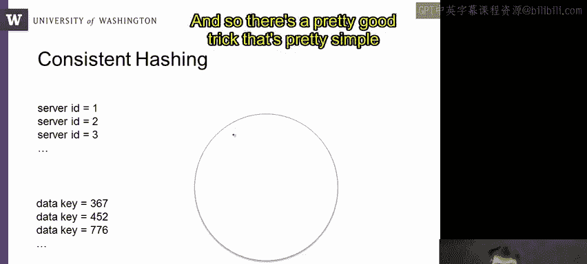

# 大规模数据科学（大数据操作，第1课／共3课） - P81：Memcached与一致性哈希 🧠


在本节课中，我们将学习Memcached这一内存缓存服务，并深入探讨其采用的关键技术——一致性哈希。我们将了解哈希的基本概念、传统哈希方法在分布式系统中的局限性，以及一致性哈希如何优雅地解决服务器扩缩容时的数据迁移问题。

---

## Memcached简介

Memcached是一种主要的内存缓存服务。它不提供数据持久化功能，其基础版本也不支持数据复制。这意味着每个缓存值通常只有一个副本。因此，如果某个节点发生故障，其上的数据就会丢失。但这对于缓存服务而言是可以接受的，因为它并不被假定为任何数据的“黄金”主副本。

尽管如此，社区已经开发了许多扩展来提供各种增强功能，例如Membase和Moxi。Memcached是一个相当成熟的系统，至今仍被广泛使用。它在此背景下采用的一个重要概念就是**一致性哈希**。

## 理解哈希

在深入一致性哈希之前，我们先来理解什么是哈希。哈希是一个在编程中非常基础且通用的概念。在我们当前的上下文中，我们试图将数据键（`data keys`）分配到一组不同的服务器上。

最简单的方法可能是采用轮询（round-robin）策略：第一个键分配给第一台服务器，第二个键分配给第二台服务器，依此类推。当服务器用尽后，再从头开始分配。这可以通过取模运算（`modulus function`）来实现。

**公式表示**：`server_index = key % number_of_servers`

每个数据键根据这个计算被放置在某台服务器上。这就是传统哈希的工作原理。

## 传统哈希的局限性

那么，这种方法有什么问题呢？想象一下，如果我们想向集群中添加更多的服务器，例如将服务器数量翻倍，会发生什么？

此时，每个现有数据键的位置都需要被重新计算。原本的计算是 `key % n`（n是旧服务器数量），现在需要变成 `key % 2n`（2n是新服务器数量）。这意味着**几乎每一个数据项都需要被重新映射到新的服务器上**。

每次添加服务器，你都必须移动系统中已经存在的所有数据，这在大型分布式系统中是灾难性的，会导致服务不可用。

## 一致性哈希的解决方案

因此，我们需要一种**一致性哈希**的方案。这里的“一致”意味着：当我将数据放置在某处后，即使我添加更多服务器，数据通常也会保持在原来的位置。有一个巧妙且易于理解的技巧可以实现这一点。

上一节我们介绍了传统哈希在服务器扩容时面临的挑战，本节中我们来看看一致性哈希是如何解决这个问题的。

一致性哈希的核心思想是，不再将键直接映射到服务器，而是将**键**和**服务器**都映射到一个共同的哈希环上。

以下是其工作原理的关键步骤：

1.  **构建哈希环**：想象一个从0到某个大整数（比如2^32 - 1）的圆环。
2.  **放置服务器**：使用一个哈希函数（例如 `hash(server_ip)`）将每台服务器映射到这个环上的某个点。
3.  **放置数据键**：同样使用一个哈希函数（例如 `hash(data_key)`）将每个数据键映射到环上的某个点。
4.  **确定归属**：为了找到某个键应该存储在哪台服务器上，从该键在环上的位置开始，**顺时针**查找，直到遇到第一台服务器。该键就存储在这台服务器上。

**代码描述逻辑**：
```python
# 伪代码示例
def assign_key_to_server(key, server_ring):
    key_hash = hash(key)
    # 在环上找到第一个哈希值大于等于 key_hash 的服务器
    for server in sorted(server_ring):
        if server.hash_position >= key_hash:
            return server
    # 如果没找到，则返回环上的第一台服务器（环状结构）
    return server_ring[0]
```

## 一致性哈希的优势

这种设计带来了巨大的好处：

*   **最小化数据迁移**：当添加一台新服务器（例如 `Server D`）到环上时，只有原本位于 `Server D` 与其在环上逆时针方向的前一台服务器（例如 `Server B`）之间的那部分数据需要从 `Server B` 迁移到 `Server D`。系统中其他大部分数据的位置保持不变。
*   **应对服务器故障**：类似地，当一台服务器下线时，只有原本存储在该服务器上的数据需要重新分配到环上的下一台服务器。影响范围被局部化。

---



本节课中我们一起学习了Memcached作为缓存服务的特点，以及一致性哈希这一关键算法。我们了解到，传统哈希在分布式系统扩缩容时会导致全局数据重分布，而一致性哈希通过引入哈希环的概念，将数据、服务器映射到同一个环上，并采用顺时针查找规则，极大地减少了服务器节点变化时需要移动的数据量，从而实现了高可扩展性和可用性。这是构建大规模、可扩展缓存和存储系统的基石之一。